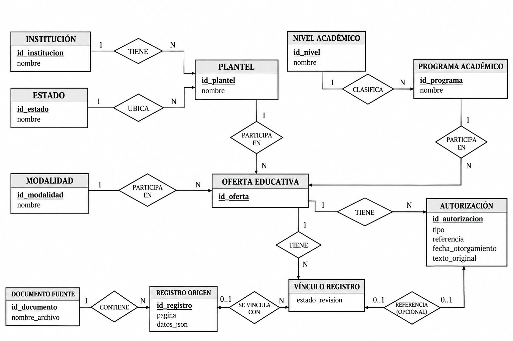
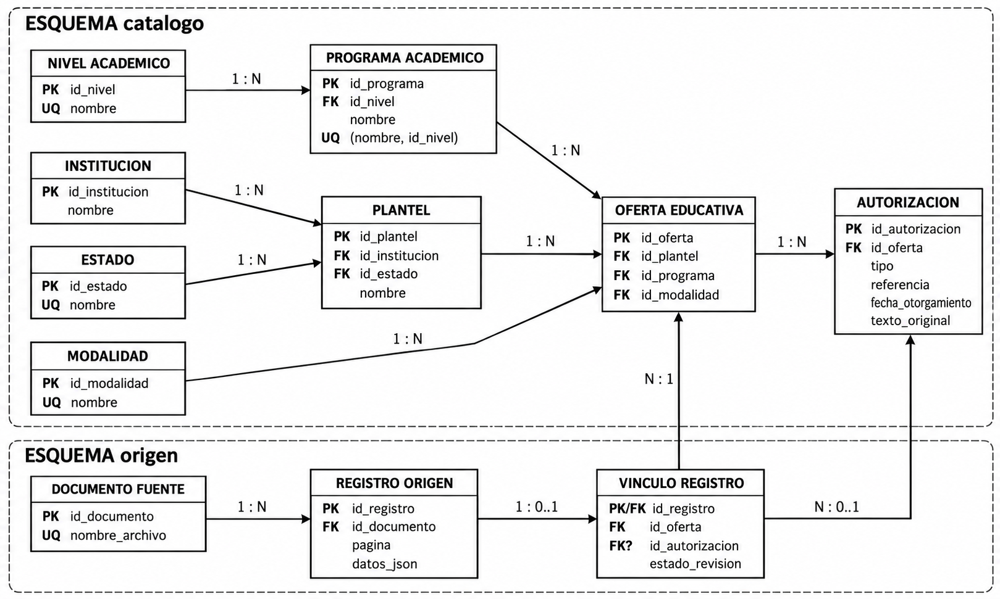

# Proyecto de Inteligencia Artificial – Oferta Educativa

Proyecto desarrollado para la asignatura de Inteligencia Artificial.

## Objetivo

Desarrollar un sistema para procesar, estructurar y analizar información de la oferta educativa, con énfasis inicial en las licenciaturas disponibles en la Ciudad de México.

El proyecto utiliza como fuente documentos PDF con registros oficiales de instituciones y programas educativos.

La arquitectura está preparada para ampliar posteriormente la cobertura al resto de México.

## Proceso realizado

Hasta el momento se han completado las siguientes etapas:

1. Extracción automática de tablas desde archivos PDF.
2. Conversión de la información extraída a formato JSON.
3. Integración de los registros de diferentes documentos.
4. Detección y revisión de inconsistencias de extracción.
5. Limpieza inicial y generación de un JSON consolidado.
6. Auditoría estructural y análisis de dependencias funcionales.
7. Elaboración del Modelo Entidad–Relación (MER).
8. Elaboración del modelo relacional y diseño de la normalización hasta 3FN.
9. Implementación de la base de datos en PostgreSQL.
10. Carga de los registros originales y de los catálogos académicos.
11. Integración de las licenciaturas de CDMX en la capa normalizada.
12. Primera etapa de consolidación y corrección de instituciones y planteles.
13. Verificación de integridad referencial y pruebas iniciales de consulta.

## Datos procesados

Se procesaron cuatro documentos PDF, obteniendo:

| Conjunto de datos | Registros |
|---|---:|
| Registros nacionales | 27,054 |
| Registros correspondientes a CDMX | 5,312 |
| Registros de licenciaturas de CDMX | 2,810 |

Los niveles académicos identificados son:

- Licenciatura
- Maestría
- Especialidad
- Doctorado
- Técnico Superior Universitario
- Profesional Asociado

Los 27,054 registros nacionales se encuentran almacenados en PostgreSQL dentro de la capa de origen. La normalización activa se concentra en las licenciaturas de Ciudad de México.

## Arquitectura de la base de datos

Se implementó una base de datos PostgreSQL 16 denominada `oferta_educativa`, organizada en dos esquemas:

- **`origen`:** conserva los registros extraídos de los PDF, los documentos fuente y sus vínculos documentales.
- **`catalogo`:** almacena las instituciones, planteles, estados, programas académicos, niveles, modalidades, ofertas educativas y autorizaciones.

Ambos esquemas pertenecen a la misma base de datos y se relacionan mediante claves foráneas.

### Modelo Entidad–Relación (MER)

El modelo conceptual representa las entidades, sus atributos, las relaciones entre ellas y las cardinalidades.



### Modelo relacional

El modelo relacional muestra las tablas, sus atributos, claves primarias, claves foráneas y restricciones de unicidad.



### Normalización

El diseño de la capa `catalogo` contempla la aplicación de los principios de Primera, Segunda y Tercera Forma Normal (1FN, 2FN y 3FN).

Se separaron las entidades académicas para reducir la redundancia y representar correctamente las relaciones entre instituciones, planteles, programas, modalidades y autorizaciones.

La capa `origen` mantiene los datos documentales para conservar la trazabilidad y facilitar futuras revisiones.

## Estado actual de PostgreSQL

Después de la carga inicial y las primeras correcciones, se obtuvieron los siguientes resultados:

| Tabla | Registros |
|---|---:|
| `catalogo.institucion` | 258 |
| `catalogo.plantel` | 326 |
| `catalogo.estado` | 32 |
| `catalogo.nivel_academico` | 6 |
| `catalogo.modalidad` | 3 |
| `catalogo.programa_academico` | 588 |
| `catalogo.oferta_educativa` | 2,616 |
| `catalogo.autorizacion` | 2,740 |
| `origen.registro_origen` | 27,054 |
| `origen.vinculo_registro` | 2,810 |

**Nota:** las 2,810 filas documentales de licenciatura de CDMX están vinculadas a 2,616 ofertas educativas en la capa normalizada. Ambos valores representan conceptos diferentes y no deben confundirse.

Los 2,810 vínculos se conservan en estado `REVISAR` mientras continúa la validación de identidades institucionales y autorizaciones.

## Limpieza y mejora de los datos

Se inició una segunda etapa de depuración sobre las entidades normalizadas en PostgreSQL.

Durante esta fase se consolidaron denominaciones de seis instituciones:

- Instituto Tecnológico y de Estudios Superiores de Monterrey.
- Universidad Tecnológica de México (UNITEC).
- Universidad de Londres.
- Universidad Insurgentes.
- Universidad La Salle.
- Universidad Panamericana.

Las correcciones se realizaron mediante transacciones SQL, actualizando relaciones entre instituciones y planteles y eliminando registros duplicados únicamente después de comprobar que no contenían referencias necesarias.

Las verificaciones confirmaron que permanecen las 2,616 ofertas educativas, las 2,740 autorizaciones y los 2,810 vínculos documentales.

Las correcciones realizadas se documentan en `limpieza_catalogo_cdmx_historial.md`.

La validación de los casos restantes continúa pendiente.

## Consultas y validaciones

Se implementaron consultas SQL para comprobar:

- La cantidad de registros nacionales y de licenciaturas de CDMX.
- La integridad de las relaciones entre ofertas y registros originales.
- La existencia de instituciones y planteles duplicados.
- La conservación de ofertas, autorizaciones y vínculos después de las correcciones.
- La búsqueda de licenciaturas por nombre de programa, institución y modalidad.

Las consultas de verificación están disponibles en la carpeta `sql/`.

## Estructura del proyecto

- `PDFs/`: documentos PDF utilizados como fuente.
- `datos/`: archivos JSON, CSV y resultados de análisis locales.
- `diagramas/`: modelos conceptual y relacional.
- `scripts/`: programas Python de extracción, limpieza, auditoría y carga.
- `sql/`: instrucciones de creación y verificación de PostgreSQL.
- `limpieza_catalogo_cdmx_historial.md`: historial de correcciones del catálogo.
- `.gitignore`: configuración de archivos excluidos del control de versiones.
- `README.md`: documentación del proyecto.

## Tecnologías utilizadas

- Python 3.12
- pdfplumber
- JSON
- PostgreSQL 16
- psycopg2-binary
- Git y GitHub

## Estado del proyecto y siguientes etapas

**La extracción, la carga documental, el diseño de la base de datos y la primera integración de licenciaturas de CDMX están completados.**

Actualmente se trabaja en mejorar la calidad de las correspondencias institucionales y de los planteles, conservando los datos originales.

Las próximas etapas son:

1. Continuar la limpieza controlada de instituciones y planteles.
2. Revisar autorizaciones y registros que presentan inconsistencias.
3. Consolidar y validar las consultas académicas.
4. Desarrollar la interfaz de búsqueda de licenciaturas de CDMX.
5. Incorporar las funcionalidades de Inteligencia Artificial.
6. Realizar pruebas funcionales y documentar los resultados.
7. Ampliar posteriormente la cobertura a nivel nacional.

**El alcance actual de la aplicación continúa limitado a las licenciaturas de Ciudad de México.**

## Motor de Inteligencia Artificial

El proyecto incorpora un motor de procesamiento de lenguaje natural desarrollado en Python para interpretar consultas sobre la oferta educativa de licenciaturas en Ciudad de México.

### Componentes implementados

| Archivo | Descripción |
|---|---|
| `scripts/10_normalizar_consultas.py` | Normaliza preguntas en español, eliminando diferencias de mayúsculas, acentos y puntuación. |
| `motor_ia/clasificador.py` | Implementa un clasificador de intenciones mediante TF-IDF y regresión logística. |
| `motor_ia/comparar_modelos.py` | Compara regresión logística, Naive Bayes y SVM lineal mediante validación cruzada y evaluación independiente. |
| `motor_ia/entidades.py` | Identifica instituciones, programas académicos y modalidades consultando los catálogos de PostgreSQL. |
| `motor_ia/interpretar_consulta.py` | Integra la clasificación de intenciones con la extracción de entidades y produce una interpretación estructurada de cada pregunta. |

### Clasificación de intenciones

El conjunto de entrenamiento contiene 80 preguntas etiquetadas, distribuidas entre cuatro categorías:

- `buscar_programa`
- `buscar_institucion`
- `filtrar_modalidad`
- `explorar_area`

Se preparó un conjunto independiente de 24 preguntas para evaluar el comportamiento de los algoritmos.

### Resultados experimentales

| Algoritmo | Validación cruzada | Evaluación independiente |
|---|---:|---:|
| Regresión logística | 96.25% | 91.67% |
| Naive Bayes | 92.50% | 87.50% |
| SVM lineal | 95.00% | 87.50% |

Se seleccionó provisionalmente regresión logística para la integración inicial, debido a su desempeño y facilidad de interpretación.

### Ejecución

Desde la carpeta principal del proyecto, con el entorno virtual y las dependencias instaladas:

**Comparar algoritmos**

```powershell
.\.venv\Scripts\python.exe motor_ia\comparar_modelos.py
```

**Probar la extracción de entidades**

```powershell
.\.venv\Scripts\python.exe motor_ia\entidades.py
```

**Interpretar consultas completas**

```powershell
.\.venv\Scripts\python.exe motor_ia\interpretar_consulta.py
```

Los módulos que acceden a PostgreSQL solicitan la contraseña mediante `getpass()` y utilizan la base de datos local `oferta_educativa`.

### Estado actual

La primera integración del motor de IA permite clasificar la intención del usuario y reconocer instituciones, programas y modalidades a partir de consultas en español.

Todavía están pendientes las funciones de recuperación de ofertas educativas, la búsqueda semántica, la gestión del contexto conversacional y la generación de respuestas fundamentadas.

**Nota:** Los datos oficiales utilizados provienen de documentos de la SEP con información actualizada al 30 de abril de 2021. Los resultados deben interpretarse considerando esa limitación temporal.


---

# Etapa 3. Integración del motor de inteligencia artificial

## 1. Objetivo

Durante esta etapa se desarrolló e integró el motor de inteligencia artificial del proyecto **Oferta Educativa Ciudad de México 2.0**, con el objetivo de permitir que los estudiantes consulten programas académicos mediante preguntas formuladas en lenguaje natural.

El sistema combina diferentes técnicas de inteligencia artificial y recuperación de información:

- Clasificación de intenciones mediante aprendizaje automático.
- Reconocimiento de entidades presentes en las preguntas.
- Búsquedas estructuradas mediante PostgreSQL.
- Búsqueda semántica utilizando embeddings.
- Recuperación de instituciones, programas, planteles y modalidades.
- Memoria y contexto conversacional.

La información procede de documentos de oferta educativa de la Secretaría de Educación Pública (SEP), fechados el **30 de abril de 2021**.

Por tanto, los resultados corresponden a los registros disponibles en esas fuentes y no garantizan que las ofertas educativas continúen vigentes actualmente.

---

## 2. Desarrollo del clasificador de intenciones

Se desarrolló un modelo de clasificación supervisada mediante la biblioteca **scikit-learn**.

El propósito del clasificador es identificar qué desea consultar el estudiante y seleccionar el procedimiento adecuado para obtener una respuesta.

### 2.1. Técnicas utilizadas

Se utilizaron:

- `TfidfVectorizer`: representación numérica de las preguntas.
- Unigramas y bigramas mediante `ngram_range=(1,2)`.
- `LogisticRegression`: clasificación supervisada de intenciones.
- Normalización de texto para facilitar el procesamiento.

El clasificador fue entrenado con **80 preguntas etiquetadas**.

También se preparó un conjunto independiente de **24 preguntas de evaluación**.

### 2.2. Intenciones reconocidas

| Intención | Descripción |
|---|---|
| `buscar_programa` | Buscar instituciones que ofrecen una carrera específica. |
| `buscar_institucion` | Consultar los programas de una institución educativa. |
| `filtrar_modalidad` | Buscar programas según su modalidad de estudio. |
| `explorar_area` | Identificar carreras relacionadas con los intereses del estudiante. |

### 2.3. Comparación de algoritmos

Se evaluaron tres algoritmos de clasificación:

1. Regresión logística.
2. Naive Bayes multinomial.
3. Máquina de vectores de soporte lineal (Linear SVM).

Los resultados fueron:

| Algoritmo | Exactitud en validación cruzada | Exactitud independiente |
|---|---:|---:|
| Regresión logística | 96.25 % | 91.67 % |
| Naive Bayes multinomial | 92.50 % | 87.50 % |
| Linear SVM | 95.00 % | 87.50 % |

La regresión logística obtuvo **22 clasificaciones correctas de 24 preguntas independientes**, equivalentes a una exactitud de **91.67 %**.

Por este motivo, se seleccionó como clasificador principal del proyecto.

Es importante aclarar que esta exactitud corresponde únicamente a la clasificación de intenciones, no al funcionamiento completo del asistente conversacional.

Dado que el conjunto independiente contiene 24 preguntas, será necesario ampliar la evaluación para obtener conclusiones más sólidas.

---

## 3. Reconocimiento de entidades

Se implementó un módulo de reconocimiento de entidades que utiliza los catálogos almacenados en PostgreSQL.

Las entidades identificadas son:

- Instituciones educativas.
- Programas académicos.
- Modalidades de estudio.

El procedimiento incluye normalización de texto y comparación con los nombres existentes en la base de datos.

### 3.1. Modalidades reconocidas

El sistema trabaja con tres modalidades:

| Modalidad | Expresiones relacionadas |
|---|---|
| ESCOLARIZADA | Presencial, escolarizada |
| MIXTA | Mixta, semipresencial |
| NO ESCOLARIZADA | A distancia, en línea, no escolarizada |

Estas equivalencias permiten reconocer diferentes expresiones utilizadas por los estudiantes.

El reconocimiento de entidades proporciona identificadores que posteriormente se utilizan en las consultas SQL.

---

## 4. Funciones de recuperación mediante PostgreSQL

Se incorporaron funciones específicas para recuperar información del catálogo académico.

Estas funciones se encuentran dentro del directorio `funciones/`.

### 4.1. Archivos desarrollados

| Archivo | Responsabilidad |
|---|---|
| `funciones/buscar_programa.py` | Recuperar ofertas educativas de un programa académico. |
| `funciones/buscar_institucion.py` | Recuperar los programas ofrecidos por una institución. |
| `funciones/filtrar_modalidad.py` | Recuperar ofertas según la modalidad solicitada. |

Las funciones utilizan consultas SQL parametrizadas sobre las tablas normalizadas de PostgreSQL.

### 4.2. Información recuperada

Las consultas permiten obtener:

- Nombre de la institución.
- Nombre del programa académico.
- Nombre del plantel, cuando está disponible.
- Modalidad educativa.
- Identificador de la oferta.

La información se recupera de registros reales almacenados en la base de datos.

No se generan nombres de instituciones ni programas inexistentes para completar las respuestas.

Cuando el nombre de un plantel no se encuentra registrado en la fuente, se utiliza el mensaje **Plantel no especificado**.

---

## 5. Incorporación de búsqueda semántica con MiniLM

Para permitir consultas basadas en intereses, se incorporó la biblioteca **Sentence Transformers**.

Se utilizó el modelo multilingüe previamente entrenado:

`sentence-transformers/paraphrase-multilingual-MiniLM-L12-v2`

Este modelo permite transformar textos en vectores numéricos llamados *embeddings*.

### 5.1. ¿Qué son los embeddings?

Los embeddings son representaciones vectoriales que permiten comparar textos mediante operaciones matemáticas.

El modelo MiniLM utilizado genera vectores de **384 dimensiones**.

Por ejemplo, una pregunta como:

> Me gustaría desarrollar videojuegos y programar mundos virtuales.

Puede compararse con nombres de programas académicos como:

- Programación de Videojuegos.
- Ingeniería en Animación y Videojuegos.
- Desarrollo de Software Interactivo y Videojuegos.

El sistema no necesita que la pregunta contenga exactamente el nombre oficial de una carrera.

### 5.2. Similitud del coseno

Para comparar los embeddings se utiliza la similitud del coseno:

$$
\operatorname{sim}(A,B)=
\frac{A\cdot B}{\|A\|\|B\|}
$$

Donde:

- $A$ es el vector correspondiente a la pregunta.
- $B$ es el vector correspondiente a un programa académico.
- $A\cdot B$ representa el producto punto.
- $\|A\|$ y $\|B\|$ representan las normas de los vectores.

Los programas se ordenan según sus puntuaciones de similitud.

Estas puntuaciones permiten establecer un orden de recuperación, pero no representan probabilidades de que una carrera sea adecuada para un estudiante.

### 5.3. Programas utilizados

La búsqueda semántica trabaja con **588 nombres distintos de programas académicos** recuperados del catálogo de PostgreSQL.

Los embeddings de estos programas se calculan al iniciar la aplicación y se reutilizan durante la sesión.

De esta manera, no es necesario volver a calcular los embeddings del catálogo por cada pregunta.

### 5.4. Archivos incorporados

| Archivo | Función |
|---|---|
| `motor_ia/12_probar_embeddings.py` | Descargar MiniLM y realizar pruebas iniciales de similitud. |
| `motor_ia/busqueda_semantica.py` | Comparar preguntas con programas académicos mediante embeddings. |
| `motor_ia/recuperacion_semantica.py` | Consultar las ofertas educativas asociadas a los programas encontrados. |

La utilización de MiniLM como modelo preentrenado fue consultada y autorizada por el profesor responsable del proyecto.

---

## 6. Instalación manual del modelo MiniLM

### 6.1. ¿Por qué MiniLM no se incluye en GitHub?

**Los archivos del modelo MiniLM no se almacenan directamente en este repositorio.**

Esta decisión responde a las siguientes razones:

1. MiniLM es un modelo previamente entrenado y publicado por terceros.
2. Sus archivos de pesos neuronales ocupan cientos de megabytes.
3. GitHub establece límites de tamaño para los archivos almacenados mediante Git convencional.
4. El modelo puede descargarse nuevamente desde Hugging Face.
5. Durante esta etapa no se ha realizado un reentrenamiento ni ajuste de los pesos originales.
6. Se busca mantener el repositorio centrado en el código fuente, los datos de trabajo y la documentación.

La carpeta:

`modelos_ia/`

Se encuentra excluida mediante el archivo `.gitignore`.

Esto significa que el repositorio conserva los programas necesarios para utilizar MiniLM, pero no incluye los parámetros descargados del modelo neuronal.

### 6.2. Requisitos previos

Para utilizar MiniLM es necesario contar con:

- Python instalado.
- Un entorno virtual configurado.
- Las dependencias del proyecto.
- Conexión a Internet durante la primera descarga.
- PostgreSQL configurado para las consultas del catálogo.

Los siguientes comandos están preparados para ejecutarse desde PowerShell, dentro de la carpeta principal del proyecto.

### 6.3. Instalar Sentence Transformers

Si la biblioteca todavía no está instalada, ejecutar:

```powershell
.\.venv\Scripts\python.exe -m pip install sentence-transformers
```

Esta biblioteca permite cargar modelos preentrenados y generar embeddings.

### 6.4. Crear las carpetas locales

Crear la carpeta donde se guardará el modelo:

```powershell
mkdir modelos_ia
```

Después crear la subcarpeta:

```powershell
mkdir modelos_ia\minilm
```

Si ambas carpetas ya existen, no es necesario repetir estos pasos.

### 6.5. Descargar el modelo

Ejecutar:

```powershell
.\.venv\Scripts\python.exe motor_ia\12_probar_embeddings.py
```

Durante la primera ejecución, el programa descarga desde Hugging Face el modelo:

`sentence-transformers/paraphrase-multilingual-MiniLM-L12-v2`

Posteriormente, lo guarda en:

`modelos_ia/minilm/`

La descarga puede tardar varios minutos, dependiendo de la conexión a Internet.

Una vez descargado, el modelo puede utilizarse localmente sin repetir el procedimiento.

### 6.6. Comprobar la instalación

La ejecución correcta debe mostrar mensajes semejantes a:

```text
Modelo guardado correctamente.

Cantidad de textos: 3
Dimensiones de cada vector: 384
```

El programa también presenta las similitudes calculadas entre tres textos utilizados como ejemplos.

### 6.7. Ejecutar la búsqueda semántica

Para probar MiniLM con los programas reales de PostgreSQL:

```powershell
.\.venv\Scripts\python.exe motor_ia\busqueda_semantica.py
```

Este programa permite escribir preguntas sobre intereses y consultar los programas académicos con mayor similitud.

Para ejecutar la recuperación de instituciones:

```powershell
.\.venv\Scripts\python.exe motor_ia\recuperacion_semantica.py
```

En esta prueba se muestran programas académicos, instituciones, planteles y modalidades registrados.

### 6.8. Ejecutar el asistente completo

Después de instalar MiniLM y configurar PostgreSQL:

```powershell
.\.venv\Scripts\python.exe app.py
```

El sistema solicita la contraseña de PostgreSQL y prepara los modelos necesarios para procesar las preguntas.

### 6.9. Mejora futura: descarga automática

En una actualización posterior se implementará la descarga automática de MiniLM.

El comportamiento previsto será:

1. Verificar si el modelo existe dentro de `modelos_ia/minilm/`.
2. Si existe, cargarlo desde el almacenamiento local.
3. Si no existe, intentar descargarlo desde Hugging Face.
4. Guardar el modelo descargado.
5. Continuar con el inicio de la aplicación.

**Esta funcionalidad todavía no está implementada en `app.py`.**

Por el momento, la instalación debe realizarse mediante el procedimiento manual descrito anteriormente.

---

## 7. Integración del motor de IA en app.py

El archivo `app.py` funciona como punto de entrada del asistente conversacional.

Durante el inicio de la aplicación se realizan las siguientes operaciones:

1. Preparar el clasificador de intenciones.
2. Establecer una conexión con PostgreSQL.
3. Recuperar las instituciones y programas académicos.
4. Cargar el modelo MiniLM desde el almacenamiento local.
5. Generar los embeddings de los 588 programas.
6. Inicializar la memoria conversacional.
7. Esperar preguntas del estudiante.

### 7.1. Procesamiento de preguntas

Cuando el estudiante escribe una pregunta, el sistema identifica la intención y las entidades correspondientes.

Si se trata de una búsqueda por institución, programa o modalidad, utiliza las funciones de recuperación SQL.

Si identifica la intención `explorar_area`, utiliza MiniLM para localizar programas relacionados con los intereses expresados.

Posteriormente, PostgreSQL permite recuperar las instituciones y modalidades correspondientes.

### 7.2. Flujo general

```text
Pregunta del estudiante
         |
         v
Clasificador de intenciones
         |
         v
Reconocimiento de entidades
         |
         v
Seleccion del procedimiento
         |
         +---------------------------+
         |                           |
         v                           v
Busqueda SQL                  Busqueda con MiniLM
         |                           |
         |                           v
         |                    Programas relacionados
         |                           |
         |                           v
         |                    Recuperacion SQL
         |                           |
         +-------------+-------------+
                       |
                       v
              Ofertas educativas
                       |
                       v
              Respuesta al usuario
```

El sistema utiliza PostgreSQL como fuente de información para verificar los programas e instituciones recuperados.

---

## 8. Memoria y contexto conversacional

Se amplió el módulo `motor_ia/contexto.py` para conservar información relevante de las consultas anteriores.

### 8.1. Contexto tradicional

El sistema puede conservar:

- Institución educativa.
- Programa académico.
- Modalidad de estudio.

Por ejemplo:

**Pregunta inicial:**

> ¿Qué carreras ofrece la Universidad ICEL?

**Pregunta de seguimiento:**

> ¿Y cuáles son mixtas?

El sistema conserva la institución Universidad ICEL y aplica el filtro de modalidad mixta.

### 8.2. Contexto semántico

Se incorporó la capacidad de conservar los identificadores de los programas encontrados mediante MiniLM.

Por ejemplo:

**Pregunta inicial:**

> Me gustaría desarrollar videojuegos y programar mundos virtuales.

El sistema encuentra cinco programas relacionados y guarda sus identificadores.

**Pregunta de seguimiento:**

> ¿Y cuáles de esas opciones son mixtas?

El sistema consulta únicamente las ofertas mixtas correspondientes a los programas encontrados.

**Nueva pregunta de seguimiento:**

> ¿Y cuáles son escolarizadas?

El sistema conserva los mismos programas, pero cambia el filtro a modalidad escolarizada.

### 8.3. Cambio de tema

Cuando el estudiante formula una pregunta independiente, se inicia un nuevo contexto.

Por ejemplo:

> ¿Qué carreras ofrece la Universidad ICEL?

Esta consulta deja de utilizar los identificadores semánticos anteriores y recupera la oferta educativa correspondiente a la institución mencionada.

La memoria implementada funciona durante la sesión actual de ejecución del programa.

---

## 9. Pruebas de integración

Se realizaron pruebas utilizando PowerShell, Python y PostgreSQL.

### 9.1. Búsqueda semántica sobre videojuegos

**Pregunta:**

> Me gustaría desarrollar videojuegos y programar mundos virtuales.

**Intención identificada:** `explorar_area`

**Confianza del clasificador:** 47.60 %

Los cinco programas recuperados fueron:

| Programa | Similitud |
|---|---:|
| Programación de Videojuegos | 0.4441 |
| Ingeniería en Animación y Videojuegos | 0.4340 |
| Ingeniería en Tecnología Interactiva en Animación Digital | 0.4164 |
| Desarrollo de Software Interactivo y Videojuegos | 0.4123 |
| Diseño de Animación Digital | 0.4110 |

Posteriormente se identificaron las instituciones correspondientes:

- Instituto SAE.
- Universidad Panamericana.
- Universidad del Valle de México.
- Instituto Universitario Amerike.
- Universidad Salesiana.

Esta prueba permitió comprobar la recuperación de programas relacionados con una descripción de intereses sin utilizar nombres exactos de carreras.

### 9.2. Búsqueda semántica sobre electrónica y robótica

**Pregunta:**

> Me interesa diseñar circuitos electrónicos y construir robots.

Los programas con mayor similitud fueron:

| Programa | Similitud |
|---|---:|
| Ingeniería Electrónica | 0.5095 |
| Ingeniería Electrónica y Comunicaciones | 0.4917 |
| Ingeniería Industrial Electrónica | 0.4886 |
| Ingeniería en Sistemas Digitales y Robótica | 0.4837 |
| Ingeniería Industrial Eléctrica | 0.4837 |

Los resultados mostraron programas relacionados principalmente con electrónica, electricidad y robótica.

Sin embargo, la pertinencia de cada programa deberá evaluarse posteriormente, ya que la similitud semántica no garantiza que todas las opciones recuperadas satisfagan los intereses del estudiante.

### 9.3. Seguimiento semántico: modalidad mixta

**Pregunta:**

> ¿Y cuáles de esas opciones son mixtas?

**Intención identificada:** `filtrar_modalidad`

**Confianza:** 49.70 %

El sistema conservó los cinco programas previamente encontrados y recuperó **3 ofertas educativas**:

| Institución | Programa | Plantel |
|---|---|---|
| Instituto SAE | Programación de Videojuegos | No especificado |
| Universidad del Valle de México | Ingeniería en Tecnología Interactiva en Animación Digital | San Rafael |
| Universidad del Valle de México | Ingeniería en Tecnología Interactiva en Animación Digital | Tlalpan |

Todas las ofertas recuperadas correspondieron a modalidad MIXTA.

### 9.4. Seguimiento semántico: modalidad escolarizada

**Pregunta:**

> ¿Y cuáles son escolarizadas?

**Intención identificada:** `filtrar_modalidad`

**Confianza:** 49.38 %

El sistema conservó los cinco programas anteriores y recuperó **5 ofertas educativas**:

- Universidad Panamericana: Ingeniería en Animación y Videojuegos.
- Universidad del Valle de México, Coyoacán: Ingeniería en Tecnología Interactiva en Animación Digital.
- Universidad del Valle de México, San Rafael: Ingeniería en Tecnología Interactiva en Animación Digital.
- Instituto Universitario Amerike, Del Valle: Desarrollo de Software Interactivo y Videojuegos.
- Universidad Salesiana: Diseño de Animación Digital.

Todas las ofertas correspondieron a modalidad ESCOLARIZADA.

### 9.5. Cambio de tema: Universidad ICEL

**Pregunta:**

> ¿Qué carreras ofrece la Universidad ICEL?

**Intención identificada:** `buscar_institucion`

**Confianza:** 68.14 %

**Resultado:** 313 ofertas educativas.

El sistema abandonó el contexto semántico de videojuegos y realizó una nueva consulta por institución.

Esto permitió comprobar que el cambio de tema funciona en el caso probado.

### 9.6. Seguimiento tradicional: Universidad ICEL

**Pregunta:**

> ¿Y cuáles son mixtas?

**Intención identificada:** `filtrar_modalidad`

**Confianza:** 43.58 %

**Resultado:** 75 ofertas educativas.

El sistema conservó Universidad ICEL como institución y aplicó correctamente la modalidad MIXTA.

### 9.7. Resumen de resultados

| Prueba | Resultado | Estado |
|---|---|---|
| Exploración semántica de videojuegos | 5 programas relacionados | Satisfactoria |
| Exploración semántica de electrónica | Programas relacionados recuperados | Satisfactoria |
| Seguimiento con modalidad mixta | 3 ofertas | Satisfactoria |
| Seguimiento con modalidad escolarizada | 5 ofertas | Satisfactoria |
| Cambio de tema a Universidad ICEL | 313 ofertas | Satisfactoria |
| Seguimiento tradicional sobre ICEL | 75 ofertas mixtas | Satisfactoria |

Los resultados corresponden a pruebas funcionales concretas y no representan una evaluación exhaustiva del asistente.

---

## 10. Limitaciones identificadas

Durante el desarrollo se identificaron aspectos que todavía requieren mejoras.

### 10.1. Confianza del clasificador

Algunas preguntas fueron clasificadas con niveles de confianza relativamente bajos.

Por ejemplo:

- Exploración de videojuegos: 47.60 %.
- Seguimiento de modalidad mixta: 49.70 %.
- Seguimiento de modalidad escolarizada: 49.38 %.

Aunque estas consultas fueron interpretadas correctamente, es necesario estudiar el comportamiento del clasificador cuando recibe preguntas ambiguas o diferentes a las utilizadas durante el entrenamiento.

Las puntuaciones del clasificador tampoco deben interpretarse automáticamente como probabilidades perfectamente calibradas.

### 10.2. Pertinencia semántica

MiniLM identifica programas mediante similitud vectorial, pero el programa con mayor puntuación no siempre será la opción más adecuada.

Se necesita evaluar:

- La pertinencia de las primeras recomendaciones.
- Las consultas que producen similitudes bajas.
- Los resultados poco relacionados con los intereses.
- Los casos en los que conviene solicitar información adicional.

Actualmente, el sistema utiliza los cinco programas con mayor similitud, sin aplicar todavía un criterio de rechazo validado experimentalmente.

### 10.3. Preguntas ambiguas

Se requiere mejorar la identificación de preguntas que no contienen información suficiente para ejecutar una búsqueda confiable.

En esos casos, el asistente deberá solicitar aclaraciones antes de mostrar resultados.

### 10.4. Respuestas sin evidencia

Es necesario fortalecer los mecanismos para reconocer situaciones en las que no existan programas pertinentes en el catálogo.

El sistema no debe presentar una recomendación como confiable únicamente porque obtuvo una puntuación de similitud mayor que las demás.

### 10.5. Respuestas conversacionales

La aplicación actualmente presenta resultados principalmente mediante mensajes y listas en la terminal.

Se requiere mejorar la presentación para ofrecer respuestas más naturales y comprensibles.

### 10.6. Alcance temporal del catálogo

Los datos utilizados proceden de documentos SEP fechados el 30 de abril de 2021.

La aplicación debe informar esta limitación para evitar que los estudiantes interpreten las ofertas como información necesariamente vigente en 2026.

---

## 11. Mejoras pendientes para concluir la etapa 3

Las siguientes actividades permanecen pendientes:

1. Incorporar mecanismos de manejo de preguntas ambiguas.
2. Evaluar criterios para rechazar resultados semánticos poco pertinentes.
3. Controlar consultas sin evidencia suficiente en PostgreSQL.
4. Mejorar la presentación conversacional de las respuestas.
5. Ampliar las pruebas de integración.
6. Implementar posteriormente la descarga automática de MiniLM.

Estos cambios deberán desarrollarse sin afectar las búsquedas y el contexto conversacional que ya funcionan.

---

## 12. Estado actual del proyecto

Al finalizar este avance, se cuenta con un prototipo funcional que integra:

**Clasificación de intenciones + reconocimiento de entidades + búsqueda semántica + PostgreSQL + memoria conversacional.**

El sistema puede:

- Interpretar preguntas sobre carreras, instituciones y modalidades.
- Recuperar ofertas educativas desde PostgreSQL.
- Identificar programas relacionados con intereses expresados en lenguaje natural.
- Recuperar las instituciones que ofrecen esos programas.
- Conservar resultados anteriores para aplicar filtros de modalidad.
- Reconocer cambios de tema en los casos probados.

La etapa 3 continúa en desarrollo y requiere mejorar el tratamiento de ambigüedades y la validación de resultados.

Posteriormente se realizará la evaluación integral de la aplicación, incluyendo al menos 20 consultas, documentación de resultados y preparación de la demostración final.

---

## 13. Herramientas y tecnologías utilizadas

| Herramienta | Aplicación en el proyecto |
|---|---|
| Python | Desarrollo del asistente y procesamiento de datos. |
| PostgreSQL | Almacenamiento y recuperación de ofertas educativas. |
| psycopg2 | Conexión entre Python y PostgreSQL. |
| scikit-learn | Clasificación supervisada de intenciones. |
| TF-IDF | Representación vectorial de las preguntas del clasificador. |
| Sentence Transformers | Generación de embeddings semánticos. |
| MiniLM multilingüe | Comparación semántica entre preguntas y programas. |
| PyTorch | Ejecución del modelo neuronal mediante sus dependencias. |
| Visual Studio Code | Desarrollo y edición de archivos. |
| Git | Control de versiones. |
| GitHub | Respaldo y seguimiento del código fuente. |

---

## 14. Referencias técnicas

- **Secretaría de Educación Pública (SEP). (2021).** Documentos de oferta educativa utilizados como fuentes originales del catálogo, con fecha del 30 de abril de 2021.

- **Pedregosa, F., et al. (2011).** Scikit-learn: Machine Learning in Python. *Journal of Machine Learning Research, 12*, 2825-2830. https://scikit-learn.org/

- **Reimers, N., y Gurevych, I. (2019).** Sentence-BERT: Sentence Embeddings using Siamese BERT-Networks. *Proceedings of EMNLP-IJCNLP*. https://arxiv.org/abs/1908.10084

- **Sentence Transformers. (s. f.).** Sentence Transformers Documentation. https://www.sbert.net/

- **Hugging Face. (s. f.).** sentence-transformers/paraphrase-multilingual-MiniLM-L12-v2. https://huggingface.co/sentence-transformers/paraphrase-multilingual-MiniLM-L12-v2

- **PostgreSQL Global Development Group. (s. f.).** PostgreSQL Documentation. https://www.postgresql.org/docs/

- **OpenAI. (2026).** ChatGPT [Modelo de lenguaje]. Consulta de apoyo para explicaciones técnicas, revisión de integración y preparación de documentación. https://chatgpt.com/
