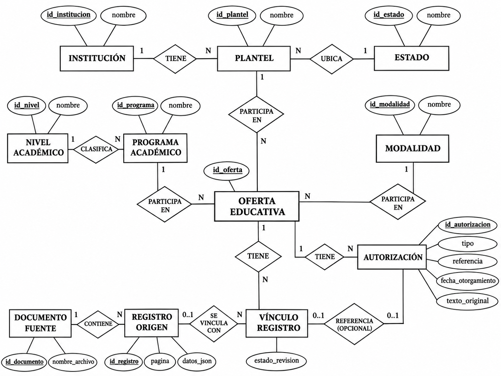
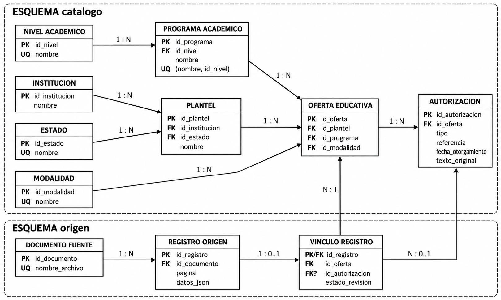

# Proyecto de Inteligencia Artificial — Oferta Educativa Ciudad de México 2.0

**Informe técnico y documentación del prototipo**  
**Asignatura:** Inteligencia Artificial  
**Fecha de actualización:** 13 de noviembre de 2026  
**Estado:** prototipo local con interfaz de escritorio, presentado en clase y en preparación para su entrega.

## Objetivo

Desarrollar un sistema para procesar, estructurar y consultar información de la oferta educativa mediante preguntas en español, con énfasis inicial en las licenciaturas de Ciudad de México registradas en las fuentes documentales incorporadas.

El proyecto comprende la extracción de tablas de documentos PDF de la Secretaría de Educación Pública (SEP), la limpieza y auditoría de los registros, el diseño de una base de datos relacional en PostgreSQL y la implementación de un asistente que combina clasificación de intenciones, reconocimiento de entidades, búsqueda semántica y contexto conversacional.

Las fuentes corresponden al **30 de abril de 2021**. La aplicación consulta un catálogo histórico: no verifica la vigencia actual de las ofertas ni representa la totalidad de instituciones y licenciaturas de Ciudad de México. La información nacional se conserva en la capa de origen; la ampliación del asistente a otros estados permanece como trabajo futuro.

## Estado actual del proyecto

Al cierre de esta revisión se dispone de una aplicación de escritorio en Tkinter y CustomTkinter y de una interfaz de consola que utilizan el mismo motor, `MotorEducativo`, definido en `app.py`.

| Componente | Estado al 13 de noviembre de 2026 |
|---|---|
| Extracción y preparación de datos | Completadas para los cuatro PDF de origen; se conservan los registros nacionales y los archivos de procesamiento. |
| Catálogo de consulta | Último corte documentado: 226 instituciones consolidadas, 588 nombres de programas y 2,616 ofertas normalizadas de licenciatura en CDMX. |
| Clasificador de intenciones | TF-IDF de palabras y caracteres con regresión logística; 136 preguntas etiquetadas y cuatro intenciones. |
| Recuperación de información | Consultas SQL por programa, institución y modalidad; búsqueda semántica con MiniLM y control de cobertura temática. |
| Memoria conversacional | Conservación de filtros y programas semánticos durante la sesión; reinicio de conversación sin recargar el motor. |
| Presentación de resultados | Fichas académicas y navegación de 15 ofertas por página en los listados paginados. |
| Consulta general del catálogo | Listado de programas con áreas orientativas, distribuido en páginas de seis carreras. |
| Alternativas afines | Confirmación mediante texto o botones «Ver opciones afines» y «No, gracias»; pertinencia basada en reglas auxiliares, no en planes de estudio verificados. |
| Material de exposición | Presentación académica y aplicación auxiliar `exposicion.py`, con preguntas copiables e índice técnico de archivos, funciones y fragmentos de código. |
| Pruebas automatizadas | Última ejecución completa registrada: **286 pruebas aprobadas, sin fallos, en 6.97 segundos**. |
| Presentación académica | Realizada el 12 de noviembre de 2026, con una consulta espontánea de un estudiante sobre videojuegos atendida correctamente durante la demostración. |
| Instalación en un segundo equipo | Pendiente de comprobación; no se ha completado la preparación y validación del respaldo de PostgreSQL para distribución. |

Las cifras del catálogo corresponden a cortes documentados, no a un conteo ejecutado al actualizar este archivo. La aprobación de las 286 pruebas acredita los casos incluidos en la batería disponible; **no equivale a una exactitud del 100 % ante consultas nuevas ni a una prueba de escalabilidad**.

## Proceso realizado

El siguiente registro conserva el orden de desarrollo. Las actividades completadas se distinguen de las tareas de distribución y validación externa que permanecen pendientes.

### Preparación de datos y base de datos

1. Extracción automática de tablas desde cuatro documentos PDF.
2. Conversión de la información extraída a JSON.
3. Integración de registros procedentes de distintos documentos.
4. Detección y revisión de inconsistencias de extracción.
5. Limpieza inicial y generación de un JSON consolidado.
6. Auditoría estructural y análisis de dependencias funcionales.
7. Elaboración del Modelo Entidad–Relación (MER).
8. Elaboración del modelo relacional y diseño de normalización hasta 3FN.
9. Implementación de la base de datos `oferta_educativa` en PostgreSQL 16.
10. Carga de registros originales y catálogos académicos.
11. Integración de las licenciaturas de CDMX en la capa normalizada.
12. Consolidación y corrección inicial de instituciones y planteles.
13. Verificación de integridad referencial y consultas de control.
14. Depuración adicional de nombres institucionales, planteles y programas, con conservación de los vínculos documentales.

### Motor de inteligencia artificial y evaluación

15. Preparación de conjuntos de entrenamiento y evaluación del clasificador de intenciones.
16. Comparación de regresión logística, Naive Bayes y SVM lineal.
17. Implementación del reconocimiento de instituciones, programas y modalidades.
18. Desarrollo de consultas parametrizadas para recuperar ofertas desde PostgreSQL.
19. Incorporación de MiniLM multilingüe y similitud del coseno para búsqueda semántica.
20. Implementación del contexto conversacional y filtros de seguimiento.
21. Evaluación exploratoria de resultados semánticos mediante etiquetas de pertinencia 0, 1 y 2.
22. Desarrollo de reglas de cobertura temática y controles sobre consultas sin evidencia directa en el catálogo.
23. Ampliación del entrenamiento de 80 a 136 preguntas e incorporación conjunta de TF-IDF de palabras y caracteres.
24. Incorporación de alternativas académicas afines seleccionadas por reglas, con comprobación de su existencia en el catálogo y confirmación del estudiante.
25. Desarrollo del generador de respuestas y pruebas de los principales flujos de consulta.
26. Evaluación integral con 30 consultas, reevaluación de casos conocidos y baterías posteriores de 20 preguntas.
27. Corrección de negaciones, modalidades, referencias conversacionales, consultas combinadas e interacciones fuera del alcance documental.

### Aplicación de escritorio, exposición y preparación de entrega

28. Integración de `MotorEducativo` como componente compartido por consola e interfaz gráfica.
29. Desarrollo de la interfaz en CustomTkinter, con hilo de trabajo, colas de comunicación, fichas académicas y logotipo.
30. Corrección del reinicio de conversación después de una despedida, sin reconstruir el motor.
31. Agrupación de resultados semánticos por programa e institución, conservando modalidades y planteles del grupo.
32. Incorporación de búsquedas amplias por categorías, como ingenierías e idiomas.
33. Implementación de navegación «Anterior» y «Siguiente» para listados de 15 ofertas por página.
34. Ampliación del reconocimiento de consultas temáticas con expresiones como «estudiar», «aprender», «imparten» y «enseñan».
35. Incorporación de botones de confirmación de alternativas afines y corrección del formato de sus tarjetas.
36. Incorporación de la consulta general de licenciaturas y áreas orientativas, con seis carreras por página.
37. Desarrollo de `exposicion.py` como panel auxiliar independiente, con preguntas de demostración y un índice técnico de 11 preguntas de estudio.
38. Preparación de la presentación, los diagramas y los ejemplos de TF-IDF, regresión logística, Softmax, pérdida logarítmica y similitud del coseno.
39. Presentación y demostración del prototipo en clase.
40. Revisión de dependencias y documentación de PostgreSQL, Python y la distribución del modelo MiniLM.
41. Limpieza de instaladores de modificaciones ya aplicadas, respaldos de trabajo y cachés; conservación de `scripts/`, `tests/`, evaluaciones y materiales de exposición.
42. Mantenimiento de pruebas desactualizadas respecto de las consultas temáticas combinadas y la paginación; incorporación de una comprobación adicional de búsqueda estructurada.
43. Ejecución final registrada de la batería completa: `286 passed in 6.97s`.

## Datos procesados

Se procesaron cuatro documentos PDF de la SEP. Los resultados del procesamiento fueron los siguientes:

| Conjunto | Cantidad | Interpretación |
|---|---:|---|
| Registros nacionales | 27,054 | Filas documentales conservadas en la capa de origen. |
| Registros correspondientes a CDMX | 5,312 | Registros de la entidad, antes de restringir el nivel académico. |
| Registros de licenciaturas de CDMX | 2,810 | Filas documentales correspondientes al alcance inicial del asistente. |
| Ofertas educativas normalizadas | 2,616 | Ofertas identificadas durante la carga y consolidación por plantel, programa y modalidad. |
| Nombres de programas de la capa de consulta | 588 | Denominaciones académicas utilizadas en las búsquedas. |
| Instituciones consolidadas | 226 | Última cifra reportada para la capa de consulta. |
| Modalidades | 3 | Escolarizada, mixta y no escolarizada. |

Los documentos nacionales incluyen licenciatura, maestría, especialidad, doctorado, técnico superior universitario y profesional asociado. La presencia de esos niveles en la capa de origen no implica que el asistente consulte todos ellos.

Los **2,810 registros documentales no son 2,810 carreras distintas**. Varios registros pueden relacionarse con una misma oferta normalizada. A su vez, un programa puede generar múltiples ofertas si cambia el plantel o la modalidad. La diferencia entre 2,810 registros y 2,616 ofertas no representa una eliminación de la procedencia documental.

## Arquitectura de la base de datos

### Organización de esquemas

La base `oferta_educativa` contiene dos esquemas relacionados mediante claves foráneas:

| Esquema | Contenido | Responsabilidad |
|---|---|---|
| `origen` | Documentos fuente, registros extraídos y vínculos documentales | Conservar el dato original y su procedencia. |
| `catalogo` | Instituciones, planteles, estados, niveles, programas, modalidades, ofertas y autorizaciones | Organizar la información académica utilizada por las consultas. |

`origen.registro_origen` conserva el registro extraído en `datos_json`, de tipo JSONB, además de la referencia al documento y la página cuando está disponible. `origen.vinculo_registro` relaciona ese registro con la oferta normalizada y, cuando corresponde, con una autorización.

### Modelo Entidad–Relación

El modelo conceptual describe las entidades académicas, sus relaciones y cardinalidades.



### Modelo relacional

El modelo relacional presenta las tablas, identificadores, claves foráneas y restricciones contempladas en el diseño.



### Normalización y trazabilidad

La normalización se aplicó al diseño de la capa `catalogo`, separada de la conservación documental en `origen`.

| Forma normal | Criterio de diseño aplicado |
|---|---|
| Primera Forma Normal (1FN) | Representación de los atributos académicos en columnas y de cada entidad u oferta en registros identificables, sin listas repetidas de instituciones o modalidades dentro de una misma celda de la capa de consulta. |
| Segunda Forma Normal (2FN) | Separación de los atributos propios de cada entidad para que no dependan únicamente de una parte de una combinación que identifica una oferta. Los nombres de programas, modalidades e instituciones se almacenan en sus respectivos catálogos. |
| Tercera Forma Normal (3FN) | Separación de dependencias transitivas: la oferta referencia al plantel y este referencia a la institución y al estado, sin repetir en la oferta los datos descriptivos de esas entidades. |

El diseño se fundamenta en las dependencias identificadas durante la auditoría. La reducción del número de registros o la creación de identificadores artificiales no constituye, por sí sola, una demostración de 3FN. La capa de origen conserva deliberadamente la representación documental y no se presenta como una copia de la estructura normalizada.

La trazabilidad permite seguir la relación **oferta normalizada → vínculo documental → registro original → documento y página de procedencia**. El historial de depuración registra las correcciones conocidas de instituciones y planteles; no se presupone la existencia de un sistema automático de auditoría de cada cambio.

El script inicial `sql/02_crear_esquemas_tablas.sql` declara expresamente que todavía no impone una restricción `UNIQUE` sobre la combinación de plantel, programa y modalidad. La carga documentada agrupa ofertas mediante esa combinación. Por tanto, el conteo de 2,616 ofertas no debe interpretarse como una garantía de que cualquier inserción posterior quedará protegida por una restricción de unicidad no comprobada en la instancia final.

### Cortes del catálogo

El registro histórico de la carga y las primeras correcciones contiene los siguientes conteos:

| Tabla | Registros en el corte histórico |
|---|---:|
| `catalogo.institucion` | 258 |
| `catalogo.plantel` | 326 |
| `catalogo.estado` | 32 |
| `catalogo.nivel_academico` | 6 |
| `catalogo.modalidad` | 3 |
| `catalogo.programa_academico` | 588 |
| `catalogo.oferta_educativa` | 2,616 |
| `catalogo.autorizacion` | 2,740 |
| `origen.registro_origen` | 27,054 |
| `origen.vinculo_registro` | 2,810 |

Posteriormente se reportaron **226 instituciones consolidadas**. Las cifras 258 y 226 corresponden a cortes diferentes y no se presentan como conteos simultáneos. El historial de depuración también señala verificaciones efectuadas antes de confirmar determinadas transacciones; la comprobación del estado persistido requiere consultar PostgreSQL.

En la carga inicial, los 2,810 vínculos se marcaron como `REVISAR`. No se ha documentado en esta revisión una consulta posterior que acredite su validación completa. La conservación de los conteos y de las relaciones no equivale a una revisión documental exhaustiva de identidades y autorizaciones.

### Limpieza y consolidación

La depuración incluyó denominaciones y planteles asociados con el Tecnológico de Monterrey, UNITEC, Universidad de Londres, Universidad Insurgentes, Universidad La Salle y Universidad Panamericana. Se utilizaron transacciones SQL, reasignación de referencias y comprobaciones antes de retirar registros duplicados.

El procedimiento conservó las ofertas, autorizaciones y vínculos documentales en los cortes verificados. Las operaciones están descritas en `limpieza_catalogo_cdmx_historial.md`; ese archivo constituye un registro de trabajo, no una migración que deba ejecutarse nuevamente por sus identificadores históricos.

Los scripts de `sql/` permiten revisar conteos, integridad referencial, posibles duplicados y correspondencias. La reproducción de la base final requiere considerar tanto la carga inicial como las correcciones posteriores.

## Arquitectura del asistente

### Componentes y responsabilidades

| Componente | Archivo o directorio | Función |
|---|---|---|
| Motor conversacional | `app.py` | Inicializa recursos, interpreta solicitudes, conserva la sesión y coordina las rutas de recuperación. |
| Interfaz de escritorio | `interfaz_escritorio.py` | Entrada de preguntas, visualización de fichas, confirmaciones y navegación. |
| Clasificación de intenciones | `motor_ia/interpretar_consulta.py` | Entrenamiento del pipeline e interpretación de consultas. |
| Entidades y conexión | `motor_ia/entidades.py` | Conexión a PostgreSQL, carga de catálogos y reconocimiento de nombres. |
| Modalidades | `motor_ia/interpretar_modalidades.py` | Interpretación de expresiones positivas, negaciones y restricciones de modalidad. |
| Contexto | `motor_ia/contexto.py` | Inicialización, seguimiento y actualización de filtros. |
| Recuperación SQL | `funciones/` | Búsqueda por programa, institución y modalidad. |
| Búsqueda semántica | `motor_ia/busqueda_semantica.py` | Codificación de consultas, comparación vectorial y selección de candidatos. |
| Recuperación de candidatos | `motor_ia/recuperacion_semantica.py` | Obtención de ofertas correspondientes a los programas seleccionados. |
| Cobertura temática | `motor_ia/validacion_cobertura_tematica.py` | Detección de temas y restricción de candidatos con evidencia en los títulos. |
| Anotaciones temáticas | `motor_ia/descripciones_tematicas.py` | Reglas y etiquetas auxiliares derivadas de nombres de programas. |
| Afinidades | `motor_ia/afinidades_academicas.py` | Selección orientativa de áreas relacionadas mediante reglas explícitas. |
| Respuestas | `motor_ia/generador_respuestas.py` | Construcción de mensajes y resúmenes a partir de resultados recuperados. |
| Interacción general | `motor_ia/interaccion_general.py` y `motor_ia/validacion_respuestas.py` | Saludos, despedidas, aclaraciones y límites de información. |
| Panel de exposición | `exposicion.py` | Consulta de material técnico y copia de preguntas de demostración. |

### Cinco etapas de procesamiento

Las cinco etapas siguientes describen el recorrido de una consulta. No deben confundirse con las etapas históricas de desarrollo ni con las 11 preguntas del índice de estudio.

| Etapa de procesamiento | Operaciones principales |
|---|---|
| 1. Entrada y normalización | Recepción de la cadena, limpieza de extremos y normalización para el análisis textual. |
| 2. Interpretación | Vectorización TF-IDF, clasificación de intención y reconocimiento de entidades. |
| 3. Contexto y selección del procedimiento | Integración de filtros, identificación de seguimientos y selección de consulta general, búsqueda estructurada o exploración temática. |
| 4. Recuperación y cobertura | Consulta SQL directa o validación temática seguida de MiniLM y recuperación SQL de ofertas; tratamiento de aclaraciones y alternativas afines. |
| 5. Construcción y presentación de respuesta | Generación de mensajes, agrupación de ofertas, fichas, confirmaciones y paginación cuando corresponde. |

El entrenamiento y la evaluación del clasificador son actividades de preparación y validación; **no constituyen una sexta etapa ejecutada después de cada respuesta**. Las ramas sin cobertura pueden producir aclaraciones sin recuperar ofertas.

```text
Pregunta del estudiante
        |
        v
Entrada y normalización
        |
        v
TF-IDF + clasificación + reconocimiento de entidades
        |
        v
Contexto y selección del procedimiento
        |
        +--> Catálogo general ------------------------------+
        |                                                   |
        +--> Consulta estructurada --> PostgreSQL ----------+
        |                                                   |
        +--> Exploración temática                           |
                 |                                          |
                 v                                          |
          Comprobación de cobertura                         |
                 |                                          |
                 +--> Cobertura directa                     |
                 |       |                                  |
                 |       v                                  |
                 |   MiniLM: candidatos permitidos          |
                 |       |                                  |
                 |       v                                  |
                 |   Recuperación SQL ----------------------+
                 |                                          |
                 +--> Sin cobertura --> Aclaración o        |
                       propuesta de afinidades              |
                              |                             |
                              +--> Confirmación --> SQL ----+
                                                            |
                                                            v
                                           Generación y presentación
```

### Inicialización y reutilización de recursos

Al crear `MotorEducativo` se entrena el clasificador, se establece la conexión con PostgreSQL, se cargan los catálogos, se lee MiniLM desde su directorio local, se calculan los embeddings de los programas y se inicializa el contexto.

El clasificador se ajusta nuevamente al iniciar una nueva instancia del motor. No se ha incorporado su persistencia en un archivo de modelo entrenado. Durante una misma sesión se reutilizan el clasificador, MiniLM, los embeddings del catálogo y la conexión; iniciar una nueva conversación reinicia los datos conversacionales, no el entrenamiento ni la carga del modelo.

Los embeddings del catálogo se generan en memoria a partir de los nombres recuperados de PostgreSQL. No se almacenan como una tabla de vectores en la base de datos en la implementación documentada. La consulta nueva se codifica cuando se utiliza la búsqueda semántica.

## Clasificación de intenciones y reconocimiento de entidades

### Normalización del texto

`normalizar_texto()` convierte el texto a minúsculas, aplica descomposición Unicode NFD, elimina marcas diacríticas, sustituye signos ajenos al patrón admitido y normaliza espacios. `.strip()` elimina espacios en blanco de los extremos; la reducción de espacios internos se realiza mediante expresiones regulares.

La normalización de las preguntas es distinta de la normalización relacional de la base de datos. La primera facilita la comparación de cadenas; la segunda organiza entidades y dependencias de los datos.

### Pipeline de clasificación

El clasificador operativo combina dos representaciones TF-IDF:

- Palabras y pares de palabras: `TfidfVectorizer(ngram_range=(1, 2))`.
- Secuencias de caracteres dentro de palabras: `TfidfVectorizer(analyzer="char_wb", ngram_range=(3, 5))`.

`FeatureUnion` concatena ambas representaciones. La regresión logística se configura mediante `LogisticRegression(max_iter=2000)`. El ajuste se realiza con las preguntas y etiquetas de `datos/intenciones_entrenamiento.csv`, ampliado de 80 a **136 ejemplos**.

| Intención | Responsabilidad |
|---|---|
| `buscar_programa` | Identificar dónde se ofrece un programa académico. |
| `buscar_institucion` | Consultar las ofertas de una institución. |
| `filtrar_modalidad` | Restringir las ofertas por modalidad. |
| `explorar_area` | Explorar programas relacionados con intereses académicos. |

`interpretar_pregunta()` obtiene la intención con `modelo.predict()` y las probabilidades estimadas con `modelo.predict_proba()`. El valor máximo se conserva como `confianza`, pero no constituye una garantía de clasificación correcta ni una probabilidad de pertinencia vocacional.

El motor no decide exclusivamente a partir de la etiqueta predicha. También intervienen las entidades, las reglas de exploración, las restricciones de modalidad y el contexto previo.

### Entidades y modalidades

Las instituciones y los programas se reconocen mediante comparación de nombres normalizados con los catálogos cargados desde PostgreSQL. La información reconocida incluye identificadores que se utilizan posteriormente en las consultas. Las siglas UVM, UNAM e ITAM se resuelven contra las instituciones disponibles; reconocer una sigla no crea registros nuevos.

| Modalidad | Expresiones interpretadas en los casos documentados |
|---|---|
| `ESCOLARIZADA` | Escolarizada, presencial. |
| `MIXTA` | Mixta, semipresencial. |
| `NO ESCOLARIZADA` | A distancia, en línea, totalmente desde casa. |

El módulo de modalidades diferencia solicitudes de exclusiones. «No quiero modalidad mixta; busco únicamente escolarizada» selecciona la modalidad escolarizada. Una negación sin alternativa puede requerir aclaración. «Mundos virtuales» se distingue de «clases virtuales» para evitar que un interés en videojuegos se convierta indebidamente en un filtro de educación a distancia.

Se amplió la interpretación de consultas académicas formuladas con «estudiar», «aprender», «cursar», «imparten», «enseñan» y «ofrecen». Cuando no se reconoce un programa exacto, una consulta temática puede continuar a la exploración manteniendo restricciones de institución o modalidad. Esta ampliación no garantiza reconocer cualquier formulación ni sustituye el control de cobertura.

## Recuperación SQL, MiniLM y cobertura temática

### Consultas estructuradas

`buscar_programa()`, `buscar_institucion()` y `filtrar_modalidad()` ejecutan consultas parametrizadas sobre las tablas de `catalogo`. Los `JOIN` relacionan oferta, plantel, institución, programa y modalidad; las condiciones `WHERE` restringen los registros y `ORDER BY` establece el orden de presentación.

Las ofertas recuperadas incluyen institución, programa, plantel y modalidad, además de los identificadores utilizados por los módulos correspondientes. Cuando falta un nombre de plantel, la interfaz presenta «Plantel no especificado».

La base de datos se seleccionó en función de las relaciones entre esas entidades, la integridad referencial y las consultas requeridas. JSON se utiliza como representación de intercambio y conservación de origen; su utilización no determina que el catálogo de consulta deba ser documental.

### MiniLM y comparación semántica

El modelo utilizado es:

```text
sentence-transformers/paraphrase-multilingual-MiniLM-L12-v2
```

La distribución publicada por Sentence Transformers en Hugging Face genera embeddings de **384 dimensiones**. MiniLM procede de la línea de investigación de Microsoft; Hugging Face es la plataforma que aloja la distribución específica empleada, no el nombre de su desarrollador original. Las fuentes técnicas se incluyen al final del documento.

En el prototipo se utilizan los pesos preentrenados sin ajuste adicional. El catálogo de referencia tiene 588 nombres en el corte documentado, pero la comparación de cada consulta se restringe a los programas admitidos por la cobertura temática y por los filtros aplicables; **no todas las consultas se comparan necesariamente con los 588 vectores**.

La similitud se calcula mediante:

$$
\operatorname{sim}(A,B)=\frac{A\cdot B}{\lVert A\rVert\,\lVert B\rVert}
$$

`util.cos_sim()` obtiene las puntuaciones y `topk()` permite seleccionar las de mayor valor. El flujo integrado llama a la búsqueda con un límite de **hasta cinco programas candidatos**. Este límite no es una restricción de MiniLM ni significa cinco instituciones o cinco ofertas: cada programa puede tener varias ofertas.

La similitud del coseno expresa una relación entre representaciones vectoriales; no es una probabilidad de idoneidad de la carrera. Los experimentos de ranking híbrido y descripciones enriquecidas se conservan en `scripts/`, pero no se presentan como mecanismos incorporados automáticamente al flujo operativo.

### Cobertura temática

Las funciones `detectar_temas()`, `priorizar_temas()`, `construir_indice()` y `comprobar_cobertura()` relacionan expresiones de interés con indicios presentes en los nombres de programas reales. El motor distingue los siguientes estados:

| Estado | Tratamiento |
|---|---|
| `cobertura_directa` | Selección de candidatos admitidos y comparación semántica; posteriormente se recuperan sus ofertas. |
| `sin_cobertura_directa` | Comunicación del límite del catálogo y búsqueda opcional de áreas generales afines mediante reglas. |
| `aclaracion` | Solicitud de una formulación más precisa cuando no se dispone de información suficiente. |

La denominación «cobertura directa» se refiere a evidencia temática en los títulos según las reglas implementadas. No implica verificación del plan de estudios, acreditación actual ni cobertura exhaustiva de una disciplina.

### Alternativas afines y confirmación

Cuando las reglas encuentran alternativas registradas, el motor conserva temporalmente los candidatos en `opciones_pendientes`. La interfaz ofrece **«Ver opciones afines»** y **«No, gracias»**; también se mantiene la aceptación o el rechazo mediante texto. Los controles de propuestas anteriores se desactivan cuando dejan de corresponder a la consulta activa.

Al aceptar, se recuperan las ofertas de los candidatos y se aplican las restricciones pertinentes. Se corrigió el orden de los campos entregados al generador de tarjetas y una referencia residual a una variable que impedía construir la respuesta de afinidades.

La asociación de Meteorología con Física y Matemáticas se conserva como regla experimental. En la comprobación de escritorio se mostraron Ingeniería Física y Matemáticas Aplicadas, con una advertencia expresa de que no eran carreras especializadas en Meteorología. **La existencia de esas ofertas en PostgreSQL está separada de la pertinencia de la relación propuesta**: esta última no ha sido validada curricularmente y puede ser demasiado general.

## Contexto, respuestas e interfaz

### Memoria de sesión

El contexto conserva institución, programa, modalidad y una lista de identificadores de programas semánticos. Se utiliza para resolver seguimientos como «¿Y cuáles son mixtas?» sin consultar indiscriminadamente todas las ofertas del catálogo.

Las consultas independientes reemplazan el contexto cuando corresponde. En los seguimientos semánticos se mantienen los identificadores de los programas recuperados; cambiar de modalidad no debe perderlos, incluso cuando el filtro anterior no produjo coincidencias.

La memoria es local a la sesión y no constituye un historial persistente de usuarios. En la interfaz, una despedida finaliza la conversación activa sin destruir el hilo que permite iniciar otra. En consola, la salida finaliza el bucle del asistente.

### Generación de respuestas

`generador_respuestas.py` utiliza plantillas y reglas para presentar los datos recuperados. No se emplea un segundo modelo generativo para redactar o completar nombres de instituciones, programas o modalidades.

Los resúmenes semánticos agrupan ofertas por programa e institución e incluyen las modalidades y planteles del grupo. Los listados de ofertas conservan la combinación específica de sus campos. Esa diferencia explica que una tarjeta agrupada y una oferta individual no representen la misma unidad de conteo.

Las respuestas sobre costos, becas, convocatorias o vigencia informan los límites de la fuente. Las respuestas sociales y las solicitudes de aclaración se construyen mediante reglas de interacción.

### Interfaz de escritorio

`interfaz_escritorio.py` utiliza un hilo de trabajo y colas de solicitudes y eventos. La inicialización de modelos y el procesamiento de consultas se realizan fuera del hilo gráfico; las actualizaciones visuales se atienden desde la interfaz. Este mecanismo mantiene disponible la ventana durante el procesamiento, pero no constituye una arquitectura de servicio multiusuario.

El diseño incluye encabezado azul marino, panel lateral gris, conversación sobre fondo claro, fichas de resultados y logotipo del proyecto. Se ajustaron el tamaño del texto, el salto de líneas, los bordes y el desplazamiento del historial. La contraseña local de PostgreSQL se gestiona mediante `keyring` en la interfaz.

### Paginación de ofertas

Los listados paginados presentan **15 ofertas por página**, con botones «Anterior» y «Siguiente» e identificación de la página activa. El motor conserva los resultados de la consulta y entrega segmentos de esa lista al cambiar de página; no se incorpora una nueva consulta SQL con `LIMIT/OFFSET` por cada pulsación.

Se diferencia el total recuperado del número de elementos visibles. En la búsqueda amplia de ingenierías se observaron **355 ofertas y 24 páginas**: 23 páginas completas y una final de 10 ofertas. Es un resultado de la sesión documentada, no un valor fijo del código.

La navegación conserva un identificador de búsqueda para impedir la reutilización de solicitudes de paginación que ya no corresponden a la consulta activa.

### Catálogo general: seis carreras por página

Se incorporó una ruta para solicitudes generales como «¿Qué carreras puedo estudiar en CDMX?» y «Muéstrame todas las licenciaturas».

Esta ruta presenta nombres de programas con ofertas en el catálogo y un área orientativa cuando puede inferirse del título. Las áreas se obtienen mediante reglas auxiliares; **no son una clasificación oficial de la SEP ni una comprobación curricular**. Cuando no se identifica un área, esa limitación se indica en el listado.

La detección combina referencias a carreras, licenciaturas, programas o áreas con expresiones de listado general. También considera la ausencia de entidades o filtros específicos que requieran otras rutas. No se trata de una quinta intención entrenada, sino de una regla adicional de selección del procedimiento.

| Mecanismo | Unidad mostrada o seleccionada | Tamaño configurado |
|---|---|---:|
| Catálogo general | Programas o carreras | 6 por página |
| Listados paginados de ofertas | Ofertas con sus filtros | 15 por página |
| Selección semántica integrada | Programas candidatos admitidos | Hasta 5 por consulta |

Estos tres valores cumplen funciones diferentes. Los resúmenes de programas semánticos no quedan convertidos automáticamente en páginas de seis o quince elementos.

### Panel de exposición

`exposicion.py` se conserva como material complementario de la entrega. Es una aplicación auxiliar independiente del motor, utilizada para copiar consultas de demostración y consultar un índice técnico de 11 preguntas, sus archivos, funciones y fragmentos representativos.

Se redujo el catálogo general de demostración a dos formulaciones y se ajustaron la distribución, el contraste y la tipografía del panel. Las 11 preguntas de estudio cubren entrada, TF-IDF, regresión logística, entidades, contexto, selección de ruta, MiniLM, respuestas, cobertura, entrenamiento y SQL.

El panel no sustituye el código fuente como referencia de implementación: sus fragmentos pueden estar resumidos y el pseudocódigo debe distinguirse de los extractos ejecutables. La existencia de una pestaña reservada o de una propuesta de ampliación no acredita, por sí sola, una función terminada.

## Evaluaciones y resultados

Las evaluaciones de clasificación, las conversaciones completas, las pruebas automatizadas y las demostraciones manuales se registran por separado. Sus porcentajes miden aspectos distintos y no deben combinarse en una única cifra de exactitud del sistema.

### Comparación inicial de clasificadores

El entrenamiento inicial comprendió 80 preguntas etiquetadas. Se compararon tres algoritmos y se utilizó un conjunto independiente de 24 preguntas.

| Algoritmo | Exactitud en validación cruzada | Exactitud en el conjunto independiente |
|---|---:|---:|
| Regresión logística | 96.25 % | 91.67 % |
| Naive Bayes multinomial | 92.50 % | 87.50 % |
| SVM lineal | 95.00 % | 87.50 % |

La regresión logística obtuvo 22 aciertos de 24 en el conjunto independiente. Se mantuvo como clasificador principal por el resultado observado y su interpretación. Estas métricas corresponden a intención, no a la calidad de la respuesta completa ni a la recuperación de ofertas.

### Ampliación a 136 preguntas

Se amplió el conjunto de entrenamiento y se evaluó la combinación de características de palabras y caracteres.

| Evaluación | Configuración original | Configuración mejorada |
|---|---:|---:|
| 40 preguntas de diagnóstico | 33/40 (82.50 %) | 37/40 (92.50 %) |
| 24 preguntas del conjunto independiente anterior | 22/24 (91.67 %) | 22/24 (91.67 %) |

El conjunto de 40 preguntas intervino en la selección de la mejora, por lo que no constituye una evaluación final independiente. Las 24 preguntas pertenecían al conjunto anterior, no a una batería nueva. En esta comparación, «Quiero pronosticar huracanes» cambió de `filtrar_modalidad` a `explorar_area`.

Los archivos relacionados son `datos/intenciones_entrenamiento.csv`, `datos/intenciones_entrenamiento_original_80.csv`, `datos/pruebas_intenciones_nuevas.csv` y `scripts/comparar_intenciones_actualizado.py`.

### Evaluación del asistente integrado

| Conjunto | Correctas | Parciales | Incorrectas | Pendientes de verificación | Carácter del resultado |
|---|---:|---:|---:|---:|---|
| Evaluación integral inicial: 30 consultas | 16 | 3 | 11 | 0 | Resultado anterior a las correcciones. |
| Repetición de las mismas 30 consultas | 28 | 2 | 0 | 0 | Regresión sobre casos conocidos. |
| Primera batería independiente: 20 consultas | 11 | 1 | 8 | 0 | Resultado original. |
| Segunda batería independiente: 20 consultas | 13 | 2 | 5 | 0 | Resultado original de otra versión y otro conjunto. |
| Tercera batería de 20 consultas | 9 | 2 | 6 | 3 | Clasificación exploratoria provisional. |

La primera evaluación de 30 consultas registró 53.3 % de respuestas correctas, 10.0 % parciales y 36.7 % incorrectas. La repetición alcanzó 28/30, equivalentes a 93.3 % de respuestas estrictamente correctas en ese conjunto conocido. Las dos respuestas parciales se relacionaron con Psicología y diseño de mecánicas para videojuegos.

La primera batería independiente de 20 consultas obtuvo 55 % de respuestas correctas, 5 % parciales y 40 % incorrectas. Sus ocho fallos se repitieron después de las correcciones y los ocho casos produjeron respuestas satisfactorias. Esa reparación **no modifica el resultado original de 11/20 ni acredita una nueva exactitud independiente del 100 %**.

La segunda batería obtuvo 13/20, equivalentes a 65 % de respuestas estrictamente correctas. Los resultados de la tercera permanecen provisionales; no se asigna una calificación final a los tres casos pendientes.

No se establece una exactitud global de «casi 90 %». Los valores 91.67 %, 92.50 % y 93.3 % pertenecen a conjuntos y tareas distintos. La versión final necesita una nueva evaluación con preguntas inéditas para estimar su generalización después de las modificaciones.

### Correcciones derivadas de las evaluaciones

| Área | Incidencias atendidas |
|---|---|
| Modalidades | Negaciones, selección explícita, expresiones de educación a distancia y solicitudes que requieren aclaración. |
| Contexto | Pérdida de institución o programa al cambiar de modalidad; referencias como «esa institución»; continuidad después de un filtro sin resultados. |
| Intereses | Tornados, terremotos, volcanes, ciencia de datos, biotecnología, astrobiología y áreas interdisciplinarias. |
| Desambiguación | Diferencia entre «mundos virtuales» y modalidad virtual; entre un título exacto y una exploración de programas relacionados. |
| Consultas combinadas | Aplicación conjunta de tema, institución y modalidad, sin sustituirla por la oferta completa de una universidad. |
| Instituciones | Resolución de siglas y compatibilidad con registros representados como tuplas o diccionarios. |
| Interacción general | Saludos, capacidades, agradecimientos, despedidas compuestas, costos, becas y limitación temporal del catálogo. |
| Presentación | Agrupación de modalidades por institución, tarjetas de afinidades, paginación y nueva conversación. |

### Pruebas automatizadas: corte del 13 de noviembre de 2026

La última ejecución completa registrada se realizó desde la raíz del proyecto:

```powershell
.\.venv\Scripts\python.exe -m pytest tests -q
```

Resultado comunicado por la terminal:

```text
286 passed in 6.97s
```

El entorno de las ejecuciones de esta revisión fue Windows, Python 3.12.10 y pytest 9.1.1. El tiempo corresponde a esa ejecución y no constituye un indicador de rendimiento del asistente con usuarios concurrentes.

La revisión previa había registrado `3 failed, 282 passed in 11.40s`, sobre 285 casos. Los fallos y sus tratamientos fueron los siguientes:

1. Dos pruebas conservaban la expectativa de bloquear toda exploración temática cuando se indicaba una institución o modalidad. Se actualizaron al comportamiento de consultas temáticas combinadas cuando no se reconoce un programa exacto. Las comprobaciones de conservación del diccionario de interpretación no acreditan, por sí solas, la aplicación posterior de filtros en SQL.
2. El motor simulado de la prueba de reinicio no incluía los atributos de paginación agregados a la aplicación. Se incorporaron `_pag_busqueda`, `_pag_ofertas` y `_pag_contexto`, junto con comprobaciones de su reinicio.
3. Se añadió una prueba para comprobar que un programa explícitamente reconocido conserva la búsqueda estructurada en el caso evaluado.
4. Se corrigió una cadena de prueba cuyos acentos se habían sustituido por signos de interrogación durante su escritura desde PowerShell.

La ejecución parcial posterior registró `32 passed in 0.19s`; después se ejecutó la batería completa de 286 casos. Este mantenimiento modificó pruebas y su simulación, no los pesos de MiniLM, los datos de PostgreSQL ni el algoritmo del motor para forzar la aprobación.

Los 21 archivos de `tests/` se conservan. Contienen pruebas parametrizadas, por lo que el número de casos ejecutados es mayor que el número de archivos. Parte de la batería utiliza catálogos y motores simulados; no debe describirse como 286 conversaciones completas con la base de datos real.

### Comprobaciones manuales y demostración académica

Durante el desarrollo se ejecutaron conversaciones con PostgreSQL real para observar búsquedas, restricciones y continuidad. Los resultados históricos específicos se conservan en el registro de integración de este documento.

En noviembre se verificaron la paginación de ingenierías, la consulta general de seis carreras por página y la aceptación de alternativas mediante botones. La revisión de Meteorología también permitió identificar una limitación de pertinencia de las afinidades, aun cuando las ofertas mostradas existían en la base de datos.

El 12 de noviembre de 2026 se realizó la exposición académica. Durante la demostración, otro estudiante formuló una consulta sobre dónde estudiar videojuegos y el asistente respondió correctamente según el registro de la sesión. Se trata de una prueba funcional espontánea individual, no de una nueva batería independiente ni de una medición porcentual del sistema.

## Registro histórico de experimentos e integración

Este apartado conserva resultados de versiones anteriores. Las cantidades, puntuaciones y tiempos no se presentan como mediciones del corte final ni como resultados que deban repetirse exactamente en otra instalación.

### Primera integración semántica

En la primera integración, la consulta «Me gustaría desarrollar videojuegos y programar mundos virtuales» se clasificó como `explorar_area` con confianza de 47.60 %. Se registraron los siguientes candidatos:

| Programa | Similitud registrada |
|---|---:|
| Programación de Videojuegos | 0.4441 |
| Ingeniería en Animación y Videojuegos | 0.4340 |
| Ingeniería en Tecnología Interactiva en Animación Digital | 0.4164 |
| Desarrollo de Software Interactivo y Videojuegos | 0.4123 |
| Diseño de Animación Digital | 0.4110 |

En la recuperación asociada se identificaron Instituto SAE, Universidad Panamericana, Universidad del Valle de México, Instituto Universitario Amerike y Universidad Salesiana.

Para «Me interesa diseñar circuitos electrónicos y construir robots» se registraron:

| Programa | Similitud registrada |
|---|---:|
| Ingeniería Electrónica | 0.5095 |
| Ingeniería Electrónica y Comunicaciones | 0.4917 |
| Ingeniería Industrial Electrónica | 0.4886 |
| Ingeniería en Sistemas Digitales y Robótica | 0.4837 |
| Ingeniería Industrial Eléctrica | 0.4837 |

Estos resultados corresponden al ordenamiento inicial por similitud. No acreditaban pertinencia curricular y precedieron a las restricciones temáticas posteriores.

### Seguimientos de la primera integración

| Consulta o acción | Confianza registrada | Resultado del corte |
|---|---:|---|
| Videojuegos: seguimiento en modalidad mixta | 49.70 % | Tres ofertas: Programación de Videojuegos en Instituto SAE y Tecnología Interactiva en Animación Digital en UVM, planteles San Rafael y Tlalpan. |
| Videojuegos: seguimiento escolarizado | 49.38 % | Cinco ofertas: Universidad Panamericana; UVM en Coyoacán y San Rafael; Instituto Universitario Amerike, Del Valle; Universidad Salesiana. |
| Cambio de tema a Universidad ICEL | 68.14 % | 313 ofertas. |
| Seguimiento de ICEL en modalidad mixta | 43.58 % | 75 ofertas. |

Los niveles de confianza corresponden al clasificador de intenciones de esa versión, no a las puntuaciones de MiniLM ni a una medida de corrección de las ofertas.

En actualizaciones posteriores se registraron dos ofertas mixtas de Instituto SAE en una secuencia semántica y, en otra prueba de la etapa 4, una oferta mixta de Instituto SAE y cuatro escolarizadas. Esos registros pertenecen a cortes distintos. No se dispone aquí de una reconstrucción única de sus catálogos, candidatos y filtros que permita tratarlos como resultados idénticos; se conservan como antecedentes y no como expectativas fijas de la versión final.

### Correcciones de modalidades e interacción

Los primeros conjuntos específicos registraron 14 pruebas de modalidades, 18 de contexto y 31 de interacción general: 63 casos satisfactorios en ese corte. Entre las comprobaciones con PostgreSQL figuraron 189 ofertas no escolarizadas, 1,657 escolarizadas, 313 ofertas de ICEL y 75 ofertas mixtas de esa institución.

Después de la primera batería independiente de 20 consultas se comprobaron, entre otros casos, 149 ofertas mixtas de UVM conservando la institución, seis ofertas escolarizadas de Instituto SAE y la recuperación de Ciencia de Datos e Ingeniería en Ciencia de Datos. Los ocho fallos originales se repitieron satisfactoriamente sin recalificar la evaluación independiente inicial.

### Consultas combinadas y contexto prolongado

| Secuencia documentada | Resultado observado en su corte |
|---|---|
| Derecho en Universidad ICEL; filtro escolarizado; cambio a distancia | 11 ofertas iniciales, cinco escolarizadas y una no escolarizada, conservando carrera e institución. |
| Mercadotecnia en UVM; cambio de no escolarizada a mixta | 15 ofertas iniciales, una no escolarizada y ocho mixtas. |
| Robótica en Universidad La Salle y cambios de modalidad | Se recuperó Ingeniería Mecatrónica mixta y se conservó el programa tras un filtro sin coincidencias; la relación temática no certifica equivalencia curricular. |
| Telecomunicaciones en ITAM y seguimiento presencial | Ingeniería en Telecomunicaciones e Ingeniería en Telemática, escolarizadas. |
| Biotecnología vinculada con medicamentos | Biotecnología e Ingeniero en Biotecnología. |
| Astrobiología en Universidad ICEL | Comunicación de ausencia de cobertura directa sin sustituirla por las 313 ofertas generales de la institución. |
| Animación digital en Universidad Panamericana | Ingeniería en Animación y Videojuegos, escolarizada. |
| Ciencia de Datos en UVM | Ingeniería en Ciencia de Datos, no escolarizada. |
| Costos y becas solicitados conjuntamente | Comunicación de ambas limitaciones, sin precios ni convocatorias no verificados. |

También se documentó una secuencia de cinco turnos: Ciencia de Datos en UVM, cambio a escolarizada sin resultados, retorno a no escolarizada, cambio a Ingeniería en Animación y Videojuegos en Universidad Panamericana y consulta de modalidad mixta. El registro reportó respuestas acordes con los filtros y el contexto de esos cinco turnos.

### Experimentos conservados

Los scripts `evaluar_descripciones_tematicas.py`, `evaluar_ranking_hibrido.py` y `evaluar_validador_semantico.py` corresponden a experimentos auxiliares. Exploran descripciones inferidas de títulos, combinación de similitud léxica y semántica, y criterios de rechazo sobre parejas pregunta–programa etiquetadas con una escala 0–2.

Los scripts examinados separan esas evaluaciones del funcionamiento de `app.py`. La presencia de un archivo experimental no demuestra que su procedimiento se utilice en la respuesta del asistente. Las etiquetas de pertinencia no son datos oficiales de los planes de estudio, y los resultados nuevos requieren su propia evaluación.

### Evolución de las pruebas automatizadas

| Corte | Resultado registrado | Alcance |
|---|---|---|
| Incorporación inicial de afinidades | 6 pruebas satisfactorias | Subconjunto de reglas y respuestas de afinidad. |
| Modalidades, contexto e interacción inicial | 63 pruebas satisfactorias | Suma de tres subconjuntos específicos. |
| Correcciones de la evaluación independiente | 185 pruebas satisfactorias | Batería disponible en ese momento. |
| Cierre de validación funcional anterior | `266 passed in 6.75s` | Corte previo a las últimas ampliaciones. |
| Revisión de entrega, antes del mantenimiento | `3 failed, 282 passed in 11.40s` | Batería de 285 casos. |
| Verificación parcial después del mantenimiento | `32 passed in 0.19s` | Los dos archivos revisados. |
| Verificación completa del 13 de noviembre de 2026 | **`286 passed in 6.97s`** | Batería completa registrada para esta revisión. |

Estos valores no se suman: representan subconjuntos o versiones sucesivas. La cifra vigente de la ejecución completa es 286, mientras que 185 y 266 se conservan únicamente como historial.

La primera integración de escritorio quedó documentada en la rama `feat/interfaz-escritorio`, commit `750d62c`. Ese identificador es un hito histórico; no identifica necesariamente el estado local posterior ni el commit final de entrega.

## Estructura del proyecto

```text
ProyectoIA/
├── app.py
├── interfaz_escritorio.py
├── exposicion.py
├── requirements_interfaz.txt
├── README.md
├── .gitignore
├── limpieza_catalogo_cdmx_historial.md
├── Exposicion_oferta_GJVY.pptx
├── PDFs/
├── datos/
├── diagramas/
├── evaluacion_etapa4/
├── funciones/
├── modelos_ia/
│   └── minilm/
├── motor_ia/
├── recursos/
├── scripts/
├── sql/
└── tests/
```

| Ruta | Contenido y criterio de conservación |
|---|---|
| `PDFs/` | Documentos utilizados como fuentes de extracción. |
| `datos/` | JSON, CSV, conjuntos de entrenamiento, correspondencias y resultados de análisis. |
| `diagramas/` | MER, modelo relacional y diagramas de apoyo. |
| `evaluacion_etapa4/` | Materiales de evaluación funcional y registros de resultados. |
| `scripts/` | Procesamiento, carga, auditoría y experimentos; se conservan los 21 archivos como evidencia metodológica. |
| `sql/` | Creación de la base y esquemas, consultas de verificación y correcciones documentadas. |
| `motor_ia/` | Clasificación, entidades, contexto, cobertura, semántica, afinidades y respuestas. |
| `funciones/` | Recuperación de ofertas mediante consultas SQL parametrizadas. |
| `tests/` | Los 21 archivos de pruebas; la ejecución final registrada comprende 286 casos. |
| `modelos_ia/minilm/` | Copia local del modelo preentrenado; excluida del control de versiones. |
| `recursos/` | Recursos gráficos, incluido el logotipo. |
| `exposicion.py` y presentación | Material complementario de la demostración académica. |

`app.py` contiene el motor compartido y el punto de entrada de consola; no es únicamente un lanzador. `requirements_interfaz.txt` conserva su nombre original, aunque su contenido se amplió a las dependencias del motor, procesamiento y pruebas.

### Scripts conservados como evidencia

| Grupo | Archivos |
|---|---|
| Extracción y análisis | `prueba_extraccion.py`, `extraer_todos.py`, `analizar_datos.py`, `analizar_todos.py`. |
| Limpieza y auditoría | `limpiar_datos.py`, `auditar_limpio.py`, `auditar_estructura.py`. |
| Carga documental y catálogos | `cargar_registros_origen.py`, `03_cargar_catalogos.py`. |
| Instituciones y planteles | `04_analizar_instituciones_planteles.py`, `05_preparar_instituciones_planteles.py`, `06_revisar_correspondencias.py`, `07_preparar_aprobacion_campus_cdmx.py`, `08_cargar_campus_aprobados_cdmx.py`. |
| Ofertas y normalización de consultas | `09_cargar_ofertas_licenciatura_cdmx.py`, `10_normalizar_consultas.py`. |
| Evaluación del motor | `comparar_intenciones_actualizado.py`, `evaluar_descripciones_tematicas.py`, `evaluar_ranking_hibrido.py`, `evaluar_validador_semantico.py`, `probar_cobertura_tematica.py`. |

Los scripts históricos y las migraciones no forman una secuencia de reinstalación comprobada que deba ejecutarse indiscriminadamente. Algunos realizan cargas o correcciones sobre estados concretos de los datos. Su conservación documenta el proceso, pero no sustituye la validación de restauración en una instancia nueva.

### Limpieza de la carpeta de entrega

Se retiraron los instaladores de modificaciones ya incorporadas: `aplicar_mejoras_busquedas.py`, `corregir_consultas_tematicas.py`, `instalar_paginacion.py` e `instalar_logo.py`. No son requisitos para iniciar la versión modificada del asistente.

Las copias `.bak` y las cachés de Python y pytest no forman parte de la evidencia metodológica principal. Las pruebas fuente, los scripts y los registros de evaluación sí se conservan. La eliminación de `__pycache__`, `.pyc` o `.pytest_cache` no equivale a eliminar `tests/` ni sus resultados.

El entorno `.venv/` se mantiene para la ejecución local, pero no debe confundirse con una distribución reproducible para otro equipo. El modelo MiniLM tampoco debe retirarse de una instalación local que dependa de esa copia. Las exclusiones de Git no eliminan archivos que pudieran permanecer dentro de un paquete comprimido preparado manualmente.

## Tecnologías y requisitos

### Entorno documentado

| Elemento | Uso o versión registrada |
|---|---|
| Windows 11 | Entorno de desarrollo y demostración. |
| Python 3.12.10 | Intérprete de la última ejecución de pruebas. |
| PostgreSQL 16 | Persistencia y consulta del catálogo. |
| Tkinter y CustomTkinter | Interfaz principal y panel auxiliar. |
| `keyring` | Credenciales locales de la interfaz. |
| Pillow | Visualización y procesamiento de imágenes. |
| `psycopg2-binary` | Acceso a PostgreSQL. |
| scikit-learn | TF-IDF, regresión logística y evaluación. |
| Sentence Transformers y PyTorch | Carga de MiniLM y operaciones con embeddings. |
| pdfplumber | Extracción de tablas y datos de PDF. |
| pytest 9.1.1 | Versión registrada en la revisión de pruebas. |
| JSON y CSV | Intercambio, almacenamiento intermedio y conjuntos de evaluación. |
| Git y GitHub | Control de versiones y distribución del código. |

La lista consolidada se encuentra en `requirements_interfaz.txt`. Su configuración conserva `customtkinter>=6.0,<7` y `keyring>=25,<27`, junto con Pillow, psycopg2-binary, scikit-learn, sentence-transformers, torch, pdfplumber y pytest. Las versiones sin fijar no constituyen una reproducción exacta del entorno utilizado.

Las líneas comentadas de ese archivo describen herramientas externas y fuentes de descarga. `pip` instala los paquetes indicados, pero los comentarios no instalan PostgreSQL, no restauran registros y no descargan automáticamente el modelo. El formato de requisitos se documenta en la referencia de pip incluida al final.

### Preparación del entorno Python

Los comandos siguientes corresponden a PowerShell, situado en la raíz del proyecto. La creación del entorno se aplica a una instalación nueva:

```powershell
py -3.12 -m venv .venv
.\.venv\Scripts\python.exe -m pip install --upgrade pip
.\.venv\Scripts\python.exe -m pip install -r requirements_interfaz.txt
```

La presencia de Python 3.12 y de su componente Tcl/Tk es un requisito previo. Los módulos de la biblioteca estándar, como `csv`, `json`, `re`, `pathlib`, `unicodedata`, `threading` y `queue`, no se enumeran como paquetes independientes en pip.

El inventario exacto del entorno local puede consultarse mediante:

```powershell
.\.venv\Scripts\python.exe -m pip freeze
```

No se ha registrado todavía una instalación limpia validada con todas las versiones fijadas. La documentación de requisitos y la comprobación efectiva de instalación se mantienen como actividades distintas.

### PostgreSQL y datos

La conexión de la implementación documentada utiliza los siguientes parámetros en `motor_ia/entidades.py`:

| Parámetro | Valor de la configuración revisada |
|---|---|
| Servidor | `localhost` |
| Puerto | `5432` |
| Base de datos | `oferta_educativa` |
| Usuario | `postgres` |
| Contraseña | Solicitada en ejecución; la interfaz utiliza el almacén local mediante `keyring`. |

El uso de otro servidor, puerto o usuario requiere ajustar la configuración correspondiente. No se presupone que esos parámetros estén externalizados en un archivo `.env`. Las credenciales de una instalación no se transfieren al equipo del evaluador.

**La exportación de la base final y su procedimiento de restauración permanecen pendientes de preparación y comprobación.** Este README no acredita que ya exista un respaldo distribuible ni incluye instrucciones de restauración de un archivo aún no verificado. Disponer del código y de las dependencias no basta para iniciar el asistente sin sus esquemas y datos.

### Obtención del modelo MiniLM

La distribución exacta utilizada es la publicada por Sentence Transformers:

[Modelo multilingüe en Hugging Face](https://huggingface.co/sentence-transformers/paraphrase-multilingual-MiniLM-L12-v2).

El script de preparación es `motor_ia/12_probar_embeddings.py`. Comprueba si existe `modelos_ia/minilm/modules.json`; si lo encuentra, carga la copia local. En caso contrario, solicita el modelo por su identificador y guarda sus archivos en `modelos_ia/minilm/`.

```powershell
.\.venv\Scripts\python.exe motor_ia\12_probar_embeddings.py
```

El script incluye una prueba con tres textos, informa la dimensión de los embeddings y calcula sus similitudes. Esa preparación no necesita consultar el catálogo de PostgreSQL. La descarga inicial requiere conexión a Internet, salvo que se disponga previamente de una copia utilizable por la biblioteca.

La aplicación principal carga el modelo desde su ruta local. La descarga condicional **ya existe en el script de preparación**, pero **no está integrada al arranque de `app.py`**. Por ello, el trabajo futuro consiste en unificar la preparación y la validación del modelo con el inicio del asistente, no en crear por primera vez un mecanismo de descarga.

Los pesos no se versionan en Git y no se reentrenaron en este proyecto. No se registra una revisión inmutable del modelo dentro de esta documentación; fijar esa revisión forma parte de la reproducibilidad pendiente.

## Ejecución y verificación

### Interfaz gráfica principal

Con PostgreSQL disponible, la base cargada, las dependencias instaladas, MiniLM preparado y los recursos gráficos presentes:

```powershell
.\.venv\Scripts\python.exe interfaz_escritorio.py
```

### Asistente de consola

```powershell
.\.venv\Scripts\python.exe app.py
```

La consola comparte el motor de consultas. Los botones de paginación y de confirmación pertenecen a la interfaz gráfica; no se presupone una navegación idéntica en terminal. En consola, las propuestas afines se confirman con las respuestas textuales admitidas por el motor.

### Panel de apoyo

```powershell
.\.venv\Scripts\python.exe exposicion.py
```

El panel puede ejecutarse en un proceso independiente del asistente. Su consulta de material técnico y copia de preguntas no requiere iniciar una sesión con `MotorEducativo`.

### Pruebas automatizadas

Ejecución completa:

```powershell
.\.venv\Scripts\python.exe -m pytest tests -q
```

Ejecución detallada:

```powershell
.\.venv\Scripts\python.exe -m pytest tests -v
```

Registro opcional de una nueva ejecución, visible también en la terminal:

```powershell
.\.venv\Scripts\python.exe -m pytest tests -v --color=no 2>&1 |
    Tee-Object -FilePath tests\resultados_pruebas.txt
```

`tests/resultados_pruebas.txt` es la ruta prevista para conservar esa salida. Su presencia en la entrega debe comprobarse; la transcripción del resultado final de 286 pruebas no demuestra por sí sola que el archivo de reporte haya sido guardado. La ejecución de pruebas puede volver a generar cachés.

### Comprobaciones de módulos y experimentos

Se conservan los puntos de entrada documentados para comparar clasificadores, inspeccionar entidades, interpretar preguntas y realizar pruebas semánticas:

```text
motor_ia/comparar_modelos.py
motor_ia/clasificador.py
motor_ia/entidades.py
motor_ia/interpretar_consulta.py
motor_ia/12_probar_embeddings.py
motor_ia/busqueda_semantica.py
motor_ia/recuperacion_semantica.py
scripts/comparar_intenciones_actualizado.py
```

Cada módulo tiene sus propios requisitos de datos y de ejecución. La batería automatizada completa no implica que todos los scripts históricos hayan sido ejecutados nuevamente en esta revisión.

### Consultas de demostración documentadas

| Flujo | Consulta inicial | Seguimiento o acción |
|---|---|---|
| Institución y contexto | ¿Qué carreras ofrece la Universidad ICEL? | ¿Y cuáles son mixtas? |
| Exploración semántica | Me gustaría desarrollar videojuegos y programar mundos virtuales. | ¿Y cuáles de esas opciones son escolarizadas? |
| Cobertura y alternativas | Quiero pronosticar huracanes. | Confirmación mediante «Ver opciones afines» o texto; interpretación orientativa de las alternativas. |
| Búsqueda amplia | Muéstrame todas las ingenierías. | Navegación de ofertas mediante «Siguiente» y «Anterior». |
| Catálogo general | ¿Qué carreras puedo estudiar en CDMX? | Navegación de seis carreras por página. |
| Límites de información | ¿Cuánto cuesta estudiar Derecho? | Comunicación de ausencia de datos económicos verificados. |
| Reinicio | Muchas gracias, nos vemos pronto. | Inicio posterior de una nueva conversación desde la interfaz. |

Las consultas independientes se evalúan con contexto nuevo. Los seguimientos de cada fila corresponden a la misma conversación. Los resultados concretos dependen del catálogo, de la formulación y de los filtros activos.

## Limitaciones

1. **Vigencia y cobertura.** Los datos corresponden al 30 de abril de 2021. El catálogo federal consultado no representa necesariamente toda la oferta pública autónoma o privada de CDMX. La ausencia de una institución no acredita que carezca de licenciaturas.
2. **Identidades y autorizaciones.** Se conserva información de procedencia y estados de revisión. Los conteos consolidados no certifican que todas las denominaciones, autorizaciones y relaciones hayan sido verificadas documentalmente.
3. **Comprensión de consultas.** Las entidades y parte de la detección temática dependen de patrones y nombres normalizados. Persisten formulaciones ambiguas, errores de escritura y especialidades que pueden requerir aclaración. El caso «Enfermería y Obstetricia» se conserva como incidencia pendiente de verificación específica; no se declara resuelto únicamente por la aprobación de la batería existente.
4. **Pertinencia semántica.** La similitud de embeddings y las reglas de afinidad no sustituyen planes de estudio ni orientación vocacional individual. Las relaciones generales pueden resultar poco apropiadas aunque los programas existan en PostgreSQL.
5. **Límites de selección y presentación.** El máximo de cinco candidatos semánticos y los tamaños de página son decisiones de implementación. La paginación no garantiza recuperar más candidatos semánticos de los seleccionados inicialmente.
6. **Evaluación.** Las baterías históricas corresponden a distintas versiones y conjuntos; las correcciones de casos conocidos no constituyen nueva evidencia independiente. Las pruebas con simulaciones no sustituyen la comprobación integral contra PostgreSQL y la interfaz real.
7. **Reproducibilidad.** Falta validar el proyecto en un equipo limpio, fijar versiones y preparar el respaldo restaurable de la base final. Los pesos de MiniLM y los registros de PostgreSQL no están contenidos en los archivos Python.
8. **Despliegue.** El sistema es un prototipo local. No se ha implementado ni medido una infraestructura para miles de usuarios concurrentes, ni se ha documentado un servicio público con API, autenticación, operación continua y pruebas de carga.

## Trabajo pendiente y mejoras futuras

| Prioridad | Actividad | Criterio de comprobación |
|---|---|---|
| Entrega reproducible | Preparar el respaldo final de PostgreSQL y un procedimiento de restauración. | Restauración satisfactoria en una instancia nueva, con comprobación de conteos e integridad. |
| Entrega reproducible | Registrar versiones efectivas de dependencias y revisión del modelo. | Instalación del entorno en otro equipo y ejecución de las pruebas y flujos principales. |
| Entrega reproducible | Revisar los archivos finales y el registro de control de versiones. | Correspondencia entre código entregado, documentación, recursos, datos y evidencia de pruebas. |
| Evaluación | Aplicar una batería de preguntas inéditas después de congelar la versión. | Resultados originales conservados y análisis de errores sin recalificación retroactiva. |
| Evaluación | Ampliar las pruebas integrales de botones, filtros, catálogo general y paginación. | Verificación de resultados completos en el motor y la interfaz, además de las reglas aisladas. |
| Calidad de datos | Continuar la validación de autorizaciones e identidades y actualizar fuentes. | Correspondencias documentadas y revisión de vigencia, sin alterar la procedencia original. |
| Pertinencia | Revisar afinidades con información curricular y criterios explícitos. | Distinción sustentada entre coincidencias directas, relación general y ausencia de evidencia. |
| Recuperación | Evaluar el límite fijo de cinco candidatos, umbrales y presentación de más resultados pertinentes. | Comparación con conjuntos de evaluación adecuados, sin sustituir pertinencia por cantidad. |
| Inicio del motor | Guardar y reutilizar el clasificador entrenado. | Control de cambios del entrenamiento y carga reproducible sin reajustarlo innecesariamente. |
| Inicio del motor | Incorporar preparación automática y verificación de MiniLM al arranque. | Detección de copia válida, descarga controlada cuando proceda y tratamiento de errores. |
| Desempeño | Evaluar persistencia de embeddings con identificación de cambios del catálogo. | Reutilización válida sin conservar representaciones desactualizadas. |
| Despliegue | Diseñar una arquitectura de servicio y evaluar concurrencia, seguridad y operación. | Pruebas de carga, gestión de conexiones, recursos y controles de acceso antes de ofrecer servicio multiusuario. |
| Alcance | Ampliar la capa normalizada y las fuentes de consulta a otros estados. | Datos y reglas regionales verificados; evaluación específica de la nueva cobertura. |

La presentación académica ya se realizó; no se mantiene como actividad pendiente. El cierre de la entrega técnica depende de la reproducibilidad en una instalación distinta, no solamente de la ejecución satisfactoria en el equipo de desarrollo.

## Referencias y procedencia técnica

Las cifras experimentales de este informe proceden de los registros de desarrollo y evaluación del proyecto, incluidos los materiales de `datos/`, `evaluacion_etapa4/` y `tests/`. El último resultado de pruebas corresponde a la salida de PowerShell registrada el 13 de noviembre de 2026. No se efectuó una nueva medición de la base de datos ni de la exactitud del asistente durante esta actualización documental.

Las siguientes fuentes identifican las herramientas y los modelos utilizados. Su consulta no sustituye la evaluación del prototipo:

1. **Secretaría de Educación Pública. (2021).** Documentos de registros de oferta educativa utilizados como fuentes del catálogo, con fecha del 30 de abril de 2021. Archivos conservados en `PDFs/`.
2. **Pedregosa, F., et al. (2011).** *Scikit-learn: Machine Learning in Python*. Journal of Machine Learning Research, 12, 2825–2830. [Documentación de scikit-learn](https://scikit-learn.org/).
3. **Reimers, N., y Gurevych, I. (2019).** *Sentence-BERT: Sentence Embeddings using Siamese BERT-Networks*. EMNLP-IJCNLP. [Publicación](https://arxiv.org/abs/1908.10084).
4. **Microsoft Research. (2020).** *MiniLM: Deep Self-Attention Distillation for Task-Agnostic Compression of Pre-Trained Transformers*. [Repositorio del proyecto MiniLM](https://github.com/microsoft/unilm/blob/master/minilm/README.md).
5. **Sentence Transformers.** [Documentación de la biblioteca](https://www.sbert.net/) y [ficha de `paraphrase-multilingual-MiniLM-L12-v2`](https://huggingface.co/sentence-transformers/paraphrase-multilingual-MiniLM-L12-v2), publicada en Hugging Face. Distribución específica utilizada por el asistente.
6. **PostgreSQL Global Development Group.** [Documentación de PostgreSQL](https://www.postgresql.org/docs/).
7. **CustomTkinter.** [Distribución en PyPI](https://pypi.org/project/customtkinter/). Consulta de disponibilidad para la revisión documental: 13 de noviembre de 2026.
8. **Python Packaging Authority.** [Formato de archivos de requisitos de pip](https://pip.pypa.io/en/stable/reference/requirements-file-format/).
9. **OpenAI. (2026).** *ChatGPT*. Herramienta de apoyo para explicaciones técnicas, revisión de integración y preparación documental. [Sitio del servicio](https://chatgpt.com/).
