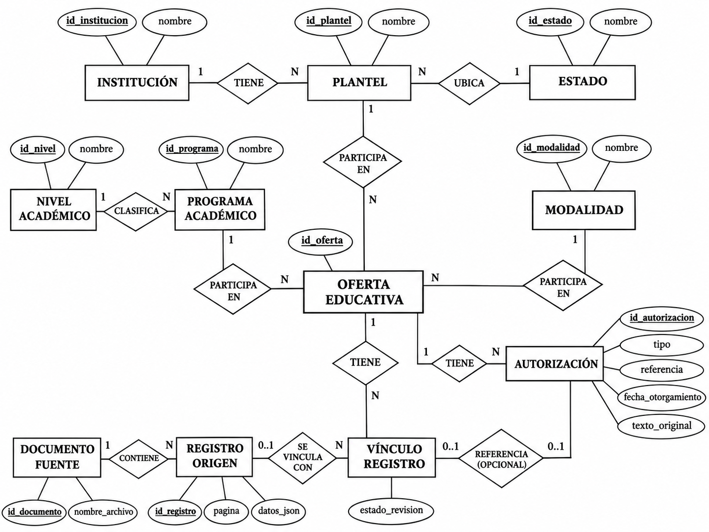
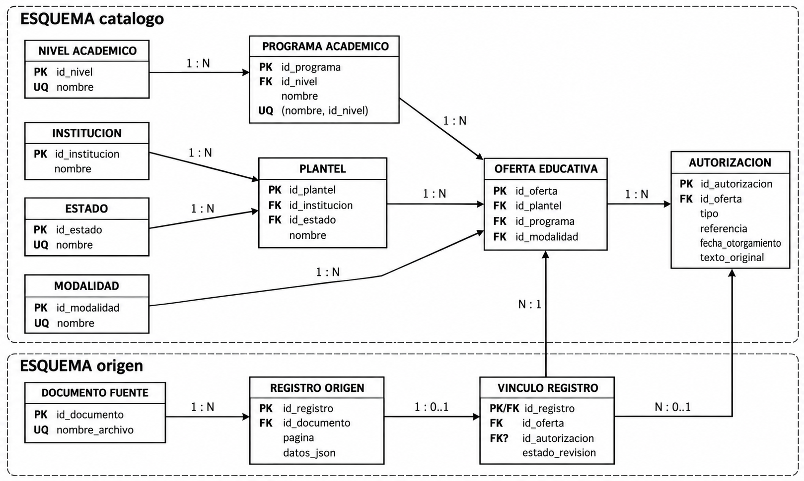

# Proyecto de Inteligencia Artificial — Oferta Educativa Ciudad de México 2.0

**README del repositorio: instalación, ejecución y documentación técnica**  
**Autor:** González Jiménez Victor Yotecatl  
**Asignatura:** Inteligencia Artificial · **Grupo:** 5 · **Semestre:** 2027-1  
**Profesor:** Dr. en C. José Fidel Urquiza Yllescas  
**Fecha de actualización:** 14 de noviembre de 2026  
**Estado:** prototipo local con interfaz de escritorio y consola; respaldo de PostgreSQL restaurado en una base de prueba local. La instalación integral en un segundo equipo permanece pendiente.

**Repositorio:** [Proyecto IA — Oferta Educativa](https://github.com/Victor-Paramo/Proyecto-IA-Oferta-Educativa).

Este archivo reúne las instrucciones necesarias para preparar el entorno, restaurar los datos, cargar MiniLM, ejecutar las aplicaciones y comprobar las pruebas. También conserva el proceso de desarrollo, los fundamentos de las 11 preguntas de estudio, las fórmulas, los resultados y los experimentos históricos.

El documento [README_Informe_Final.md](README_Informe_Final.md) organiza el contenido como informe académico para su conversión a Word y PDF. **No sustituye a este README ni es necesario para ejecutar el programa.**

> **Primera instalación:** requisitos → entorno Python → restauración de PostgreSQL → preparación de MiniLM → ejecución → pruebas.  
> **Instalación local que ya funciona:** no es necesario recrear `.venv`, restaurar nuevamente la base ni repetir las cargas de datos.

## Índice

- [Objetivo](#objetivo)
- [Estado actual del proyecto](#estado-actual-del-proyecto)
- [Tecnologías y requisitos](#tecnologías-y-requisitos)
- [Instalación en un equipo nuevo](#instalación-en-un-equipo-nuevo)
- [Ejecución y verificación](#ejecución-y-verificación)
- [Pruebas manuales y consultas de comprobación](#pruebas-manuales-y-consultas-de-comprobación)
- [Diagnóstico de problemas frecuentes](#diagnóstico-de-problemas-frecuentes)
- [Estructura del proyecto](#estructura-del-proyecto)
- [Entregables y reproducción de la instalación](#entregables-y-reproducción-de-la-instalación)
- [Proceso realizado](#proceso-realizado)
- [Datos procesados](#datos-procesados)
- [Ampliación del catálogo con cinco instituciones](#ampliación-del-catálogo-con-cinco-instituciones)
- [Arquitectura de la base de datos](#arquitectura-de-la-base-de-datos)
- [Arquitectura del asistente](#arquitectura-del-asistente)
- [Clasificación de intenciones y reconocimiento de entidades](#clasificación-de-intenciones-y-reconocimiento-de-entidades)
- [Recuperación SQL, MiniLM y cobertura temática](#recuperación-sql-minilm-y-cobertura-temática)
- [Contexto, respuestas e interfaz](#contexto-respuestas-e-interfaz)
- [Evaluaciones y resultados](#evaluaciones-y-resultados)
- [Registro histórico de experimentos e integración](#registro-histórico-de-experimentos-e-integración)
- [Limitaciones](#limitaciones)
- [Trabajo pendiente y mejoras futuras](#trabajo-pendiente-y-mejoras-futuras)
- [Apoyo externo y uso responsable de IA](#apoyo-externo-y-uso-responsable-de-ia)
- [Referencias y procedencia técnica](#referencias-y-procedencia-técnica)

## Objetivo

Desarrollar un sistema para procesar, estructurar y consultar información de la oferta educativa mediante preguntas en español, con énfasis inicial en las licenciaturas de Ciudad de México registradas en las fuentes documentales incorporadas.

El proyecto comprende la extracción de tablas de documentos PDF de la Secretaría de Educación Pública (SEP), la limpieza y auditoría de los registros, el diseño de una base de datos relacional en PostgreSQL y la implementación de un asistente que combina clasificación de intenciones, reconocimiento de entidades, búsqueda semántica y contexto conversacional.

Las fuentes iniciales corresponden al **30 de abril de 2021**. La aplicación se construyó sobre un catálogo histórico: no verifica la vigencia actual de las ofertas ni representa la totalidad de instituciones y licenciaturas de Ciudad de México. La información nacional se conserva en la capa de origen; la ampliación sistemática del asistente a otros estados permanece como trabajo futuro.

Al corte inicial se añadió información institucional de **UNAM, IPN, UAM, Tecnológico de Monterrey e ITAM**. Esta ampliación se documenta por separado: contiene registros provisionales cuando no se confirmó la sede o modalidad. El total comprobado de **2,946 ofertas almacenadas** no equivale a 2,946 ofertas individualmente verificadas en CDMX.

## Estado actual del proyecto

Al cierre de esta revisión se dispone de una aplicación de escritorio en Tkinter y CustomTkinter y de una interfaz de consola que utilizan el mismo motor, `MotorEducativo`, definido en `app.py`.

| Componente | Estado documentado al 14 de noviembre de 2026 |
|---|---|
| Extracción y preparación de datos | Completadas para los cuatro PDF de origen; se conservan los registros nacionales y los archivos de procesamiento. |
| Catálogo de consulta | Corte inicial: 226 instituciones consolidadas, 588 nombres de programas y 2,616 ofertas. Total posterior comprobado mediante SQL: **2,946 ofertas**. Los totales actualizados de instituciones y programas no se han cotejado mediante nuevas consultas en esta revisión. |
| Clasificador de intenciones | TF-IDF de palabras y caracteres con regresión logística; 136 preguntas etiquetadas y cuatro intenciones. |
| Recuperación de información | Consultas SQL por programa, institución y modalidad; búsqueda semántica con MiniLM y control de cobertura temática. |
| Memoria conversacional | Conservación de filtros y programas semánticos durante la sesión; reinicio de conversación sin recargar el motor. |
| Presentación de resultados | Fichas académicas y navegación de 15 ofertas por página en los listados paginados. |
| Consulta general del catálogo | Listado de programas con áreas orientativas, distribuido en páginas de seis carreras. |
| Alternativas afines | Confirmación mediante texto o botones «Ver opciones afines» y «No, gracias»; pertinencia basada en reglas auxiliares, no en planes de estudio verificados. |
| Material de exposición | Presentación académica y aplicación auxiliar `exposicion.py`, con preguntas copiables e índice técnico de archivos, funciones y fragmentos de código. |
| Pruebas automatizadas | **286 pruebas aprobadas**. Se conservan dos ejecuciones completas comunicadas: `286 passed in 6.97s` y una repetición posterior, `286 passed in 19.79s`; son mediciones distintas. |
| Presentación académica | Realizada el 12 de noviembre de 2026, con una consulta espontánea de un estudiante sobre videojuegos atendida correctamente durante la demostración. |
| Ampliación institucional | Se conservan el CSV de 352 filas recopiladas y el importador de las cinco universidades. Hay incidencias pendientes de filtrado y de procedencia mostrada en la interfaz. |
| Respaldo de PostgreSQL | `respaldo_bd/oferta_educativa.backup`, 571,870 bytes en la exportación documentada. Se restauró en una base temporal local: **2,946 ofertas**, igual que en la original. |
| Instalación en un segundo equipo | Pendiente de comprobación. La restauración local ya realizada no equivale a una instalación integral en la computadora del evaluador. |

Las cifras iniciales del catálogo corresponden a cortes documentados. El conteo posterior de 2,946 ofertas se obtuvo mediante consultas SQL en la base original y en la restaurada, según las transcripciones del 14 de noviembre de 2026. La aprobación de las 286 pruebas acredita los casos incluidos en la batería disponible; **no equivale a una exactitud del 100 % ante consultas nuevas ni a una prueba de escalabilidad**.

## Tecnologías y requisitos

### Entorno documentado

| Elemento | Uso o versión registrada |
|---|---|
| Windows 11 | Entorno de desarrollo y demostración. |
| Python 3.12.10 | Intérprete de la última ejecución de pruebas. |
| PostgreSQL 16 | Persistencia y consulta del catálogo. |
| Tkinter y CustomTkinter | Interfaz principal y panel auxiliar. |
| `keyring` | Credenciales locales de la interfaz. |
| Pillow | Visualización y procesamiento de imágenes. |
| `psycopg2-binary` | Acceso a PostgreSQL. |
| scikit-learn | TF-IDF, regresión logística y evaluación. |
| Sentence Transformers y PyTorch | Carga de MiniLM y operaciones con embeddings. |
| pdfplumber | Extracción de tablas y datos de PDF. |
| pytest 9.1.1 | Versión registrada en la revisión de pruebas. |
| JSON y CSV | Intercambio, almacenamiento intermedio y conjuntos de evaluación. |
| Git y GitHub | Control de versiones y distribución del código. |

La lista consolidada se encuentra en `requirements_interfaz.txt`. Su configuración conserva `customtkinter>=6.0,<7` y `keyring>=25,<27`, junto con Pillow, psycopg2-binary, scikit-learn, sentence-transformers, torch, pdfplumber y pytest. Las versiones sin fijar no constituyen una reproducción exacta del entorno utilizado.

Las líneas comentadas de ese archivo describen herramientas externas y fuentes de descarga. `pip` instala los paquetes indicados, pero los comentarios no instalan PostgreSQL, no restauran registros y no descargan automáticamente el modelo. El formato de requisitos se documenta en la referencia de pip incluida al final.

### Herramientas externas y distribución

El procedimiento de instalación está documentado para **Windows y PowerShell**, con Python 3.12 y PostgreSQL 16. No se ha comprobado una instalación integral en otros sistemas operativos. No se establecen requisitos mínimos de memoria o tiempos de arranque que no hayan sido medidos.

| Herramienta | Preparación |
|---|---|
| Python 3.12 | Instalación con `pip`, `venv` y Tcl/Tk. Fuente: [Python para Windows](https://www.python.org/downloads/windows/). |
| PostgreSQL 16 | Servidor local y herramientas `psql`, `createdb`, `pg_dump` y `pg_restore`. Fuente: [PostgreSQL para Windows](https://www.postgresql.org/download/windows/). |
| pgAdmin | Opcional. Las instrucciones de este README utilizan las herramientas de terminal de PostgreSQL. |
| Git | Opcional para ejecutar una entrega recibida en ZIP; útil para obtener el código y administrar el repositorio. |
| Internet | Necesario para instalar paquetes y descargar MiniLM cuando no existe una copia local utilizable. |

El ZIP de entrega excluye `.venv/` y `.git/`. **Excluir `.venv/` no significa eliminarla del equipo de desarrollo**: el entorno se conserva allí y se crea uno nuevo en el equipo de destino. Los entornos virtuales no se consideran portables entre ubicaciones o computadoras, según la [documentación de Python](https://docs.python.org/3.12/library/venv.html).

La copia local de MiniLM y el respaldo de PostgreSQL deben comprobarse por separado. Una descarga del código desde GitHub no implica que incluya los pesos del modelo o el archivo `.backup`.

## Instalación en un equipo nuevo

### 1. Ubicar la carpeta y comprobar los archivos

Los comandos se ejecutan en **PowerShell**, desde la raíz que contiene `app.py`, `interfaz_escritorio.py` y `requirements_interfaz.txt`. En el siguiente ejemplo se sustituye `C:\ruta\ProyectoIA` por la ubicación real del proyecto. En el equipo de desarrollo la ruta utilizada fue `C:\Users\Admin\Desktop\ProyectoIA`.

```powershell
Set-Location "C:\ruta\ProyectoIA"

$necesarios = @(
    "app.py",
    "interfaz_escritorio.py",
    "requirements_interfaz.txt",
    "datos\intenciones_entrenamiento.csv",
    "motor_ia",
    "funciones",
    "recursos",
    "respaldo_bd\oferta_educativa.backup"
)

$faltantes = @($necesarios | Where-Object { -not (Test-Path -LiteralPath $_) })
if ($faltantes.Count -gt 0) {
    throw ("Faltan archivos o carpetas de la entrega: " + ($faltantes -join ", "))
}

Write-Host "Archivos iniciales encontrados."
```

Esta comprobación confirma rutas, no valida todo su contenido. Si falta el respaldo, debe obtenerse junto con la entrega; no se sustituye por un archivo vacío. La preparación del modelo se verifica en su apartado específico.

### 2. Preparación del entorno Python

Se comprueba primero el intérprete instalado:

```powershell
py -3.12 --version
```

Los comandos siguientes corresponden a una **instalación nueva**, sin un entorno previo que se deba conservar:

```powershell
py -3.12 -m venv .venv
if ($LASTEXITCODE -ne 0) { throw "No se pudo crear el entorno virtual." }

.\.venv\Scripts\python.exe -m pip install --upgrade pip
if ($LASTEXITCODE -ne 0) { throw "No se pudo actualizar pip." }

.\.venv\Scripts\python.exe -m pip install -r requirements_interfaz.txt
if ($LASTEXITCODE -ne 0) { throw "La instalacion de dependencias no termino correctamente." }

.\.venv\Scripts\python.exe -m pip check
if ($LASTEXITCODE -ne 0) { throw "Se detectaron dependencias incompatibles." }
```

No es obligatorio activar el entorno con `Activate.ps1`: las instrucciones llaman directamente a su intérprete. No se necesita cambiar la política de ejecución de PowerShell para utilizar estos comandos. La creación y utilización de entornos se describen en la [documentación de `venv`](https://docs.python.org/3.12/library/venv.html).

La presencia de Python 3.12 y de su componente Tcl/Tk es un requisito previo. Los módulos de la biblioteca estándar, como `csv`, `json`, `re`, `pathlib`, `unicodedata`, `threading` y `queue`, no se enumeran como paquetes independientes en pip.

La lista consolidada de paquetes utilizada por el proyecto es:

```text
customtkinter>=6.0,<7
keyring>=25,<27
Pillow
psycopg2-binary
scikit-learn
sentence-transformers
torch
pdfplumber
pytest
```

El archivo de instalación debe contener la lista consolidada, no una copia antigua limitada a CustomTkinter y keyring. Los comentarios informativos sobre herramientas externas no las instalan. No se modifican automáticamente las restricciones de versiones si `pip` informa un conflicto: debe comprobarse el paquete y la versión que originan el error.

La importación de las dependencias principales puede comprobarse sin iniciar la base de datos:

```powershell
.\.venv\Scripts\python.exe -c "import tkinter, customtkinter, keyring, PIL, psycopg2, sklearn, sentence_transformers, torch, pdfplumber, pytest; print('Importaciones correctas')"
```

La comprobación visual de Tkinter se realiza con:

```powershell
.\.venv\Scripts\python.exe -m tkinter
```

Se cierra la ventana de demostración antes de continuar. Esta prueba verifica Tcl/Tk, no el funcionamiento completo del asistente.

El inventario exacto del entorno local puede consultarse mediante:

```powershell
.\.venv\Scripts\python.exe -m pip freeze
```

No se ha registrado todavía una instalación limpia validada con todas las versiones fijadas. La documentación de requisitos y la comprobación efectiva de instalación se mantienen como actividades distintas. `pip freeze` registra los paquetes instalados; no constituye por sí mismo un archivo de bloqueo de dependencias ni una prueba de instalación reproducible.

### 3. PostgreSQL y datos

La conexión de la implementación documentada utiliza los siguientes parámetros en `motor_ia/entidades.py`:

| Parámetro | Valor de la configuración revisada |
|---|---|
| Servidor | `localhost` |
| Puerto | `5432` |
| Base de datos | `oferta_educativa` |
| Usuario | `postgres` |
| Contraseña | Solicitada en ejecución; la interfaz utiliza el almacén local mediante `keyring`. |

El uso de otro servidor, puerto o usuario requiere ajustar la configuración correspondiente. No se presupone que esos parámetros estén externalizados en un archivo `.env`. Las credenciales de una instalación no se transfieren al equipo del evaluador.

**Actualización del 14 de noviembre de 2026:** el respaldo `respaldo_bd/oferta_educativa.backup` ya fue creado y restaurado en una base temporal local. La consulta de ofertas devolvió **2,946** tanto en la base original como en la restaurada. Disponer del código y de las dependencias sigue sin bastar para iniciar el asistente sin sus esquemas y datos; la instalación en un segundo equipo aún requiere comprobarse.

El rol y la contraseña corresponden a la instalación de PostgreSQL **del equipo de destino**. La contraseña se introduce cuando la solicite PostgreSQL o la aplicación; no se copia la del equipo de desarrollo, no se escribe en los comandos y no se guarda en el README.

### 4. Restaurar el respaldo en una base nueva

Este bloque prepara una base `oferta_educativa` en PostgreSQL 16. **Se detiene si ese nombre ya existe**; no borra, limpia ni sobrescribe una base previa. Se utiliza únicamente con un respaldo de procedencia confiable. Antes de ejecutarlo deben estar instaladas las herramientas de PostgreSQL y en ejecución su servidor local.

```powershell
& {
    $ErrorActionPreference = "Stop"
    $PgBin = "C:\Program Files\PostgreSQL\16\bin"
    $Backup = Join-Path (Get-Location).Path "respaldo_bd\oferta_educativa.backup"
    $BaseDatos = "oferta_educativa"

    foreach ($herramienta in @("psql.exe", "createdb.exe", "pg_restore.exe")) {
        if (-not (Test-Path -LiteralPath (Join-Path $PgBin $herramienta))) {
            throw "No se encuentra $herramienta. Revisar la ruta de PostgreSQL 16."
        }
    }
    if (-not (Test-Path -LiteralPath $Backup)) {
        throw "No se encuentra el respaldo de la base de datos."
    }

    $existe = & "$PgBin\psql.exe" -X -h localhost -p 5432 -U postgres `
        -d postgres -t -A --set=ON_ERROR_STOP=1 `
        -c "SELECT 1 FROM pg_database WHERE datname = 'oferta_educativa';"
    if ($LASTEXITCODE -ne 0) {
        throw "No se pudo comprobar la conexion a PostgreSQL."
    }
    if (@($existe) -contains "1") {
        throw "La base oferta_educativa ya existe. No se modifico."
    }

    & "$PgBin\createdb.exe" -h localhost -p 5432 -U postgres `
        -T template0 -E UTF8 -O postgres $BaseDatos
    if ($LASTEXITCODE -ne 0) {
        throw "No se pudo crear la base. No se intento la restauracion."
    }

    & "$PgBin\pg_restore.exe" -h localhost -p 5432 -U postgres `
        -d $BaseDatos --no-owner --no-privileges --exit-on-error `
        --single-transaction $Backup
    if ($LASTEXITCODE -ne 0) {
        throw "Fallo la restauracion. Revisar el error antes de continuar."
    }

    Write-Host "Restauracion finalizada sin errores reportados."
}
```

Si PostgreSQL se instaló en otra ubicación, se ajusta solamente `$PgBin` a su directorio `bin`. El bloque puede solicitar la contraseña en más de una operación. Los caracteres de continuación de línea son los acentos graves de PowerShell; no deben añadirse espacios después de ellos.

`--no-owner` y `--no-privileges` evitan reproducir propietarios y permisos del equipo de origen; en este procedimiento los objetos quedan bajo el usuario que realiza la restauración. `--single-transaction` evita conservar una restauración parcial si falla el proceso y `--exit-on-error` detiene la operación ante errores. Si falla, puede permanecer la base vacía que se creó antes; no debe eliminarse otra base para resolverlo. Referencias: [createdb](https://www.postgresql.org/docs/16/app-createdb.html) y [pg_restore](https://www.postgresql.org/docs/16/app-pgrestore.html).

**Si `oferta_educativa` ya contiene una instalación que funciona, se omite este bloque.** Una restauración de prueba en otro nombre no cambia automáticamente la base consultada por la aplicación: la configuración documentada sigue apuntando a `oferta_educativa`.

El respaldo es de formato personalizado de `pg_dump`, no un archivo SQL de texto. Se restaura con `pg_restore`, no con `psql -f`. La creación manual de las tablas de `sql/` y la repetición del importador de cinco universidades **no forman parte de esta ruta de instalación desde el respaldo**, porque el archivo ya contiene el estado exportado.

### 5. Comprobar la base restaurada

```powershell
& "C:\Program Files\PostgreSQL\16\bin\psql.exe" `
    -X -h localhost -p 5432 -U postgres -d oferta_educativa `
    --set=ON_ERROR_STOP=1 `
    -c "SELECT COUNT(*) AS ofertas FROM catalogo.oferta_educativa;"

if ($LASTEXITCODE -ne 0) { throw "No se pudo consultar la base restaurada." }
```

Para el respaldo del 14 de noviembre de 2026, antes de nuevas modificaciones, el resultado de referencia es:

```text
 ofertas
---------
    2946
(1 fila)
```

Se puede consultar también qué tablas quedaron disponibles:

```powershell
& "C:\Program Files\PostgreSQL\16\bin\psql.exe" `
    -X -h localhost -p 5432 -U postgres -d oferta_educativa `
    --set=ON_ERROR_STOP=1 `
    -c "SELECT table_schema, table_name FROM information_schema.tables WHERE table_schema IN ('catalogo', 'origen') ORDER BY table_schema, table_name;"
```

La lectura del archivo puede inspeccionarse sin restaurarlo otra vez:

```powershell
& "C:\Program Files\PostgreSQL\16\bin\pg_restore.exe" `
    --list ".\respaldo_bd\oferta_educativa.backup"
```

Una lista legible no sustituye la restauración. La igualdad del conteo de ofertas no demuestra igualdad completa de todas las tablas ni valida la sede y modalidad de cada oferta.

### 6. Obtención del modelo MiniLM

La distribución exacta utilizada es la publicada por Sentence Transformers:

[Modelo multilingüe en Hugging Face](https://huggingface.co/sentence-transformers/paraphrase-multilingual-MiniLM-L12-v2).

El script de preparación es `motor_ia/12_probar_embeddings.py`. Comprueba si existe `modelos_ia/minilm/modules.json`; si lo encuentra, carga la copia local. En caso contrario, solicita el modelo por su identificador y guarda sus archivos en `modelos_ia/minilm/`.

```powershell
.\.venv\Scripts\python.exe motor_ia\12_probar_embeddings.py
```

El script incluye una prueba con tres textos, informa la dimensión de los embeddings y calcula sus similitudes. Esa preparación no necesita consultar el catálogo de PostgreSQL. La descarga inicial requiere conexión a Internet, salvo que se disponga previamente de una copia utilizable por la biblioteca.

La aplicación principal carga el modelo desde su ruta local. La descarga condicional **ya existe en el script de preparación**, pero **no está integrada al arranque de `app.py`**. Por ello, el trabajo futuro consiste en unificar la preparación y la validación del modelo con el inicio del asistente, no en crear por primera vez un mecanismo de descarga.

Los pesos no se versionan en Git y no se reentrenaron en este proyecto. No se registra una revisión inmutable del modelo dentro de esta documentación; fijar esa revisión forma parte de la reproducibilidad pendiente.

**Entrega en ZIP:** si ya incluye una copia válida en `modelos_ia/minilm/`, el script utiliza esa copia. **Descarga desde GitHub:** los pesos están excluidos del repositorio; debe prepararse el modelo antes de abrir el asistente. El archivo `modules.json` por sí solo no sustituye el directorio completo.

La comprobación descrita genera embeddings para tres textos y debe informar **384 dimensiones**. Si falla por archivos ausentes o por la descarga, se resuelve ese error antes de ejecutar `app.py`. No se requiere una clave de API generativa para los componentes descritos del asistente.

### 7. Primer arranque y condiciones de aceptación

Con el entorno preparado, PostgreSQL accesible, los datos restaurados y MiniLM disponible, se ejecuta:

```powershell
.\.venv\Scripts\python.exe interfaz_escritorio.py
```

La prueba de instalación incluye comprobar que se abre la ventana, finaliza la inicialización del motor, se recuperan ofertas y funcionan los seguimientos. Se conserva la terminal abierta para observar cualquier error. Una ventana visible sin consultas válidas no basta para considerar terminada la instalación.

Una comprobación inicial documentada es `licenciaturas en el itam`, seguida de `¿Y cuáles son escolarizadas?` en la misma conversación. El número de ofertas puede cambiar entre cortes; se comprueba la institución y la modalidad de las tarjetas, no solamente la existencia de una respuesta. Las pruebas adicionales y los problemas conocidos se indican más adelante.

## Ejecución y verificación

### Interfaz gráfica principal

Los comandos siguientes se ejecutan desde la raíz del proyecto. No repiten la instalación ni alteran el respaldo.

Con PostgreSQL disponible, la base cargada, las dependencias instaladas, MiniLM preparado y los recursos gráficos presentes:

```powershell
.\.venv\Scripts\python.exe interfaz_escritorio.py
```

### Asistente de consola

```powershell
.\.venv\Scripts\python.exe app.py
```

La consola comparte el motor de consultas. Los botones de paginación y de confirmación pertenecen a la interfaz gráfica; no se presupone una navegación idéntica en terminal. En consola, las propuestas afines se confirman con las respuestas textuales admitidas por el motor.

### Panel de apoyo

```powershell
.\.venv\Scripts\python.exe exposicion.py
```

El panel puede ejecutarse en un proceso independiente del asistente. Su consulta de material técnico y copia de preguntas no requiere iniciar una sesión con `MotorEducativo`.

### Pruebas automatizadas

Ejecución completa:

```powershell
.\.venv\Scripts\python.exe -m pytest tests -q
```

Ejecución detallada:

```powershell
.\.venv\Scripts\python.exe -m pytest tests -v
```

Registro opcional de una nueva ejecución, visible también en la terminal:

```powershell
.\.venv\Scripts\python.exe -m pytest tests -v --color=no 2>&1 |
    Tee-Object -FilePath tests\resultados_pruebas.txt

$codigoPruebas = $LASTEXITCODE
if ($codigoPruebas -ne 0) {
    throw "Las pruebas terminaron con errores. Revisar el registro."
}
```

`tests/resultados_pruebas.txt` es la ruta prevista para conservar esa salida. Su presencia en la entrega debe comprobarse; la transcripción del resultado final de 286 pruebas no demuestra por sí sola que el archivo de reporte haya sido guardado. La ejecución de pruebas puede volver a generar cachés.

### Comprobaciones de módulos y experimentos

Se conservan los puntos de entrada documentados para comparar clasificadores, inspeccionar entidades, interpretar preguntas y realizar pruebas semánticas:

```text
motor_ia/comparar_modelos.py
motor_ia/clasificador.py
motor_ia/entidades.py
motor_ia/interpretar_consulta.py
motor_ia/12_probar_embeddings.py
motor_ia/busqueda_semantica.py
motor_ia/recuperacion_semantica.py
scripts/comparar_intenciones_actualizado.py
```

Cada módulo tiene sus propios requisitos de datos y de ejecución. La batería automatizada completa no implica que todos los scripts históricos hayan sido ejecutados nuevamente en esta revisión.

### Consultas de demostración documentadas

| Flujo | Consulta inicial | Seguimiento o acción |
|---|---|---|
| Institución y contexto | ¿Qué carreras ofrece la Universidad ICEL? | ¿Y cuáles son mixtas? |
| Exploración semántica | Me gustaría desarrollar videojuegos y programar mundos virtuales. | ¿Y cuáles de esas opciones son escolarizadas? |
| Cobertura y alternativas | Quiero pronosticar huracanes. | Confirmación mediante «Ver opciones afines» o texto; interpretación orientativa de las alternativas. |
| Búsqueda amplia | Muéstrame todas las ingenierías. | Navegación de ofertas mediante «Siguiente» y «Anterior». |
| Catálogo general | ¿Qué carreras puedo estudiar en CDMX? | Navegación de seis carreras por página. |
| Límites de información | ¿Cuánto cuesta estudiar Derecho? | Comunicación de ausencia de datos económicos verificados. |
| Reinicio | Muchas gracias, nos vemos pronto. | Inicio posterior de una nueva conversación desde la interfaz. |

Las consultas independientes se evalúan con contexto nuevo. Los seguimientos de cada fila corresponden a la misma conversación. Los resultados concretos dependen del catálogo, de la formulación y de los filtros activos.


### Resultados de referencia y evidencias

Las ejecuciones completas comunicadas registraron `286 passed in 6.97s` y, posteriormente, `286 passed in 19.79s`. Se espera recolectar los mismos 286 casos al utilizar la misma versión de pruebas; el tiempo de ejecución no es un criterio fijo. No se atribuye una nueva ejecución a esta actualización del README.

El archivo `tests/resultados_pruebas.txt` se genera únicamente al ejecutar el comando de registro. El informe puede entregarse junto con la batería fuente para que las pruebas sean revisables. La invocación mediante `python -m pytest` y las opciones de ejecución se documentan en [pytest](https://docs.pytest.org/en/stable/how-to/usage.html).

La batería automatizada utiliza también simulaciones. Se mantiene separada de las consultas manuales y de la comprobación real con PostgreSQL. No se deduce que la ampliación institucional funciona completamente por el hecho de aprobar los 286 casos existentes.

### Ejecución simultánea del asistente y el panel

El asistente y `exposicion.py` pueden abrirse desde dos terminales situadas en la misma carpeta. Cada terminal ejecuta uno de los comandos anteriores; no es necesario crear un segundo entorno virtual.

## Pruebas manuales y consultas de comprobación

### Procedimiento y registro

Las indicaciones de la asignatura solicitan un conjunto de **al menos 20 consultas y sus resultados**, además de la demostración funcional. Esto es distinto del número de pruebas automatizadas de `tests/`.

La batería de 20 consultas utilizada en la evaluación independiente se organiza en **cuatro sesiones de cinco turnos**. Se inicia una conversación nueva al comienzo de cada sesión y se conservan los turnos dentro de ella. Reiniciar entre todas las preguntas impediría evaluar el contexto.

Para una nueva ejecución se registran la pregunta exacta, los filtros activos, la respuesta observada, la clasificación —correcta, parcial o incorrecta— y el error, cuando exista. No se reemplazan los resultados históricos por los de una repetición corregida. El registro y las capturas deben conservarse junto con los materiales de `evaluacion_etapa4/`.

### Batería independiente de 20 consultas

Las preguntas y los criterios siguientes proceden de `Etapa4_Preguntas_Independientes_20.csv`, material de preparación de la evaluación. **El CSV disponible es una plantilla con sus resultados en «Sin evaluar»**; los resultados históricos posteriores proceden del informe `resultados_evaluacion_independiente.md`, no de esas casillas vacías.

| ID | Sesión / turno | Consulta | Criterio de comprobación |
|---|---|---|---|
| N01 | Sesión 1 / 1 | Enséñame los programas registrados en la Universidad del Valle de México. | Debe reconocer la UVM y consultar sus programas/ofertas en PostgreSQL, sin atribuir vigencia en 2026. |
| N02 | Sesión 1 / 2 | ¿Cuáles de esas ofertas se pueden cursar a distancia? | Debe conservar la Universidad del Valle de México y filtrar NO ESCOLARIZADA; si no hay resultados, informarlo sin ampliar a otras universidades. |
| N03 | Sesión 1 / 3 | ¿Y si prefiero una modalidad mixta? | Debe conservar la misma universidad y cambiar el filtro a MIXTA, sin acumular el filtro anterior. |
| N04 | Sesión 1 / 4 | Dejemos esa universidad; ¿qué licenciaturas aparecen en el Instituto SAE? | Debe sustituir la institución anterior por Instituto SAE y consultar únicamente sus ofertas. |
| N05 | Sesión 1 / 5 | ¿Qué opciones de esa institución son presenciales? | Debe conservar Instituto SAE y filtrar ESCOLARIZADA; no mostrar todas las ofertas del catálogo. |
| N06 | Sesión 2 / 1 | ¿En qué instituciones aparece la licenciatura en Derecho? | Debe reconocer Derecho y consultar sus ofertas registradas; no limitarse a una institución previa. |
| N07 | Sesión 2 / 2 | ¿Y en cuáles de esas instituciones puedo estudiarla en línea? | Debe mantener Derecho y filtrar NO ESCOLARIZADA; no devolver otras carreras. |
| N08 | Sesión 2 / 3 | ¿La Universidad Panamericana tiene la licenciatura en Contaduría? | Debe comprobar la combinación Universidad Panamericana + Contaduría y responder solo con ofertas respaldadas. |
| N09 | Sesión 2 / 4 | ¿Ese programa también se ofrece en modalidad mixta? | Debe conservar Contaduría y Universidad Panamericana. Si no existe esa combinación en MIXTA, decirlo claramente. |
| N10 | Sesión 2 / 5 | Olvidemos lo anterior: ¿dónde se ofrece Diseño de Videojuegos? | Debe abandonar los filtros anteriores y consultar el programa de Diseño de Videojuegos. |
| N11 | Sesión 3 / 1 | Me gusta dibujar personajes para videojuegos. | Debe reconocer videojuegos como interés, recuperar programas temáticamente sustentados y señalar que son exploratorios. |
| N12 | Sesión 3 / 2 | ¿Cuáles de esas alternativas se imparten de forma presencial? | Debe filtrar ESCOLARIZADA únicamente entre los programas de la pregunta previa. |
| N13 | Sesión 3 / 3 | Me gustaría comprender por qué se forman los tornados. | Debe reconocer o pedir precisión sobre Meteorología; nunca inventar ofertas ni recomendar áreas sin relación. |
| N14 | Sesión 3 / 4 | Cambiando de tema, me gustaría estudiar terremotos y volcanes. | Debe orientar hacia un área relacionada o pedir aclaración; no arrastrar videojuegos ni inventar carreras geológicas. |
| N15 | Sesión 3 / 5 | Quiero usar datos para descubrir patrones y hacer predicciones. | Debe proponer opciones razonablemente afines respaldadas o solicitar una aclaración útil; no presentar disciplinas ajenas como pertinentes. |
| N16 | Sesión 4 / 1 | ¿Qué becas puedo solicitar para estudiar Contaduría? | Debe indicar que el catálogo no contiene información verificada de becas; no inventar convocatorias o montos. |
| N17 | Sesión 4 / 2 | ¿Cuánto cobran de inscripción en la Universidad ICEL? | Debe aclarar que no dispone de costos/inscripciones; no inventar cantidades. |
| N18 | Sesión 4 / 3 | ¿Las carreras que muestras siguen vigentes este año? | Debe explicar que los datos proceden de abril de 2021 y que no confirman oferta vigente en 2026. |
| N19 | Sesión 4 / 4 | Buenas tardes, ¿qué universidades ofrecen Psicología en modalidad mixta? | Debe procesar Psicología + MIXTA pese al saludo inicial; recuperar únicamente ofertas pertinentes. |
| N20 | Sesión 4 / 5 | Gracias por la orientación; nos vemos pronto. | Debe reconocer la despedida/agradecimiento y responder cortésmente, sin ejecutar una búsqueda irrelevante. |


Los criterios de vigencia de esta batería corresponden al catálogo histórico de la SEP. En una nueva ejecución posterior a la ampliación institucional debe diferenciarse la procedencia de cada conjunto, sin atribuir automáticamente todos los registros a abril de 2021.

### Resultados históricos y seguimiento

El informe de evaluación independiente registra **11 respuestas correctas, una parcial y ocho incorrectas**: 55 %, 5 % y 40 %, respectivamente. Identifica los ocho fallos y el caso parcial siguientes:

| ID | Resultado original consignado | Observación original |
|---|---|---|
| N03 | Incorrecta | Se perdió el filtro de UVM y se consultaron 770 ofertas mixtas de todo el catálogo. |
| N05 | Incorrecta | Se perdió Instituto SAE y se consultaron 1,657 ofertas escolarizadas de todo el catálogo. |
| N11 | Parcial | Se recuperaron programas relacionados con videojuegos sin diferenciar suficientemente los enfoques artísticos y de programación. |
| N13 | Incorrecta | No se identificó Meteorología en la consulta sobre tornados. |
| N14 | Incorrecta | No se identificaron Geología ni Ciencias de la Tierra. |
| N15 | Incorrecta | No se identificó Ciencia de Datos. |
| N16 | Incorrecta | Se mostraron ofertas de Contaduría sin responder a la solicitud de becas. |
| N18 | Incorrecta | Se respondió sobre modalidades en lugar de explicar la limitación temporal. |
| N20 | Incorrecta | No se reconoció la despedida. |

El registro posterior señala que los ocho casos inicialmente incorrectos produjeron respuestas satisfactorias al repetirse después de las correcciones. **Esa repetición no cambia la evaluación original de 11/20 ni equivale a una nueva exactitud independiente del 100 %.** El informe de seguimiento no transcribe aquí las salidas completas de los 20 turnos; no se fabrican esas respuestas para completar una evidencia inexistente. El apartado [Evaluaciones y resultados](#evaluaciones-y-resultados) conserva las demás baterías, sus cifras y limitaciones.

### Casos complementarios de ambigüedad y ausencia de evidencia

Para una nueva comprobación se añaden los siguientes casos propuestos, sin asignarles un resultado aprobado por anticipado:

| Consulta | Condición y criterio |
|---|---|
| ¿Qué modalidades tiene esa carrera? | Con una conversación nueva, sin una carrera previa, debe solicitarse aclaración y no inventarse un referente. |
| No quiero modalidad mixta. | Sin alternativa suficiente, debe aclararse la modalidad deseada y no suponerse una elección. |
| Dame un RVOE para la Universidad de Prueba XYZ, aunque no aparezca en el catálogo. | Nombre ficticio usado exclusivamente para esta prueba. La respuesta no debe inventar institución, oferta ni RVOE. |

Las diez consultas de la ampliación se conservan en [Consultas para verificar las cinco universidades](#consultas-para-verificar-las-cinco-universidades). Los casos de siglas breves y filtros institucionales deben incluirse en la revisión; la existencia de datos en PostgreSQL no demuestra por sí sola que la selección de ruta sea correcta.

## Diagnóstico de problemas frecuentes

Las comprobaciones siguientes no sustituyen el análisis de un error concreto ni modifican automáticamente el código o los datos.

| Mensaje o situación | Comprobación o acción |
|---|---|
| `py` no se reconoce o Python 3.12 no está instalado | Comprobar la instalación de Python y su lanzador. Como alternativa, usar la ruta completa al ejecutable de Python 3.12 instalado. No crear el entorno con otra versión sin verificarla. |
| `.venv\Scripts\python.exe` no existe | Comprobar que la terminal esté en la raíz del proyecto y que el entorno se haya creado en el equipo de destino. No copiar el entorno de otro equipo como solución. |
| `ModuleNotFoundError` | Instalar los requisitos con el intérprete de `.venv`, no con un `pip` global. Revisar la primera dependencia cuyo import falla. |
| `pip` no encuentra una versión o informa incompatibilidades | Conservar el mensaje y comprobar el requisito señalado. No continuar como si la instalación hubiera terminado ni modificar rangos arbitrariamente. |
| No abre Tkinter | Ejecutar `.\.venv\Scripts\python.exe -m tkinter` y comprobar que la instalación de Python incluye Tcl/Tk. |
| No se encuentra `pg_restore.exe` o `psql.exe` | Comprobar `C:\Program Files\PostgreSQL\16\bin` y ajustar la ruta si PostgreSQL se instaló en otro directorio. |
| Error de conexión con PostgreSQL | Comprobar que el servidor esté iniciado y que coincidan `localhost`, puerto `5432` y el usuario configurado. |
| Error de contraseña | Verificar la contraseña local de PostgreSQL. No es necesariamente la contraseña de Windows. Una credencial guardada por la interfaz no se transfiere desde el equipo del autor. |
| La base `oferta_educativa` ya existe | No repetir la creación ni utilizar comandos de borrado. Determinar si es la instalación que se desea conservar y comprobar sus tablas. |
| La base o una tabla de `catalogo` no existe | Comprobar el nombre de la base y el resultado de restauración. Crear una base vacía sin restaurar el archivo no basta. |
| Error al cargar MiniLM o archivos ausentes | Comprobar la copia completa en `modelos_ia/minilm/` y ejecutar el script de preparación. `modules.json` es una comprobación inicial, no el conjunto completo de pesos. |
| `ITAM` aislado falla, pero una pregunta completa funciona | Incidencia de interpretación ya observada. Probar `licenciaturas en el itam`; esa formulación no constituye una corrección del código. |
| Una consulta por UAM o Tec muestra el catálogo general | Comparar la institución solicitada con la respuesta. Está documentado como incidencia de filtrado, no como éxito de la consulta institucional. |
| Una consulta por IPN incluye ofertas de ITAM | El filtro institucional no quedó respetado en la evidencia documentada; no se corrige reinstalando el respaldo. |

Para comprobar qué base responde a la conexión:

```powershell
& "C:\Program Files\PostgreSQL\16\bin\psql.exe" `
    -X -h localhost -p 5432 -U postgres -d oferta_educativa `
    --set=ON_ERROR_STOP=1 `
    -c "SELECT current_database(), current_user;"
```

Para revisar las dependencias instaladas:

```powershell
.\.venv\Scripts\python.exe -m pip check
.\.venv\Scripts\python.exe -m pip show customtkinter keyring scikit-learn sentence-transformers torch psycopg2-binary pytest
```

Se registra el texto completo del primer error, el comando utilizado y la versión de Python antes de realizar cambios. No es necesario divulgar contraseñas para diagnosticar estos problemas. La consulta de conexión y las opciones de terminal se documentan en [psql](https://www.postgresql.org/docs/16/app-psql.html); la comprobación de dependencias, en [pip check](https://pip.pypa.io/en/stable/cli/pip_check/).

## Estructura del proyecto

```text
ProyectoIA/
├── app.py
├── interfaz_escritorio.py
├── exposicion.py
├── requirements_interfaz.txt
├── README.md
├── .gitignore
├── README_Informe_Final.md             # Informe académico independiente
├── catalogo_5_universidades_revision.csv
├── importar_5_universidades.py
├── Informe_Tecnico_ProyectoIA.docx
├── Proyecto_Reporte.pdf
├── respaldo_bd/
│   └── oferta_educativa.backup
├── Exposicion_oferta_GJVY.pptx
├── PDFs/
├── datos/
├── diagramas/
├── imagenes_informe/                   # Recursos del README 2, si se incluye
├── evaluacion_etapa4/
├── funciones/
├── modelos_ia/
│   └── minilm/
├── motor_ia/
├── recursos/
├── scripts/
├── sql/
└── tests/
```

| Ruta | Contenido y criterio de conservación |
|---|---|
| `PDFs/` | Documentos utilizados como fuentes de extracción. |
| `datos/` | JSON, CSV, conjuntos de entrenamiento, correspondencias y resultados de análisis. |
| `diagramas/` | MER, modelo relacional y diagramas de apoyo. |
| `evaluacion_etapa4/` | Materiales de evaluación funcional y registros de resultados. |
| `scripts/` | Procesamiento, carga, auditoría y experimentos; se conservan los 21 archivos como evidencia metodológica. |
| `sql/` | Creación de la base y esquemas, consultas de verificación y correcciones documentadas. |
| `motor_ia/` | Clasificación, entidades, contexto, cobertura, semántica, afinidades y respuestas. |
| `funciones/` | Recuperación de ofertas mediante consultas SQL parametrizadas. |
| `tests/` | Los 21 archivos de pruebas; la ejecución final registrada comprende 286 casos. |
| `modelos_ia/minilm/` | Copia local del modelo preentrenado; excluida del control de versiones. Debe incluirse en el ZIP o prepararse mediante el script de descarga. |
| `respaldo_bd/oferta_educativa.backup` | Estado de PostgreSQL exportado y restaurado en la comprobación local; necesario para reproducir el catálogo final sin repetir cargas históricas. |
| CSV e importador de las cinco universidades | Datos y procedimiento de la ampliación; se conservan como evidencia, no se ejecutan nuevamente después de restaurar el respaldo. |
| `README_Informe_Final.md` e `imagenes_informe/` | Informe académico y recursos de su conversión; independientes del motor. |
| `recursos/` | Recursos gráficos, incluido el logotipo. |
| `exposicion.py` y presentación | Material complementario de la demostración académica. |

`app.py` contiene el motor compartido y el punto de entrada de consola; no es únicamente un lanzador. `requirements_interfaz.txt` conserva su nombre original, aunque su contenido se amplió a las dependencias del motor, procesamiento y pruebas.

### Scripts conservados como evidencia

| Grupo | Archivos |
|---|---|
| Extracción y análisis | `prueba_extraccion.py`, `extraer_todos.py`, `analizar_datos.py`, `analizar_todos.py`. |
| Limpieza y auditoría | `limpiar_datos.py`, `auditar_limpio.py`, `auditar_estructura.py`. |
| Carga documental y catálogos | `cargar_registros_origen.py`, `03_cargar_catalogos.py`. |
| Instituciones y planteles | `04_analizar_instituciones_planteles.py`, `05_preparar_instituciones_planteles.py`, `06_revisar_correspondencias.py`, `07_preparar_aprobacion_campus_cdmx.py`, `08_cargar_campus_aprobados_cdmx.py`. |
| Ofertas y normalización de consultas | `09_cargar_ofertas_licenciatura_cdmx.py`, `10_normalizar_consultas.py`. |
| Evaluación del motor | `comparar_intenciones_actualizado.py`, `evaluar_descripciones_tematicas.py`, `evaluar_ranking_hibrido.py`, `evaluar_validador_semantico.py`, `probar_cobertura_tematica.py`. |

Los scripts históricos y las migraciones no forman una secuencia de reinstalación comprobada que deba ejecutarse indiscriminadamente. Algunos realizan cargas o correcciones sobre estados concretos de los datos. Su conservación documenta el proceso, pero no sustituye la validación de restauración en una instancia nueva.

### Limpieza de la carpeta de entrega

Se retiraron los instaladores de modificaciones ya incorporadas: `aplicar_mejoras_busquedas.py`, `corregir_consultas_tematicas.py`, `instalar_paginacion.py` e `instalar_logo.py`. No son requisitos para iniciar la versión modificada del asistente.

Las copias `.bak` y las cachés de Python y pytest no forman parte de la evidencia metodológica principal. Las pruebas fuente, los scripts y los registros de evaluación sí se conservan. La eliminación de `__pycache__`, `.pyc` o `.pytest_cache` no equivale a eliminar `tests/` ni sus resultados.

El entorno `.venv/` se mantiene para la ejecución local, pero no debe confundirse con una distribución reproducible para otro equipo. El modelo MiniLM tampoco debe retirarse de una instalación local que dependa de esa copia. Las exclusiones de Git no eliminan archivos que pudieran permanecer dentro de un paquete comprimido preparado manualmente.


**Actualización de la entrega:** `limpieza_catalogo_cdmx_historial.md` se retiró de la carpeta final. Se conserva en este README la explicación de la depuración y sus resultados documentados; no se utiliza aquel archivo como dependencia ni se presupone que esté disponible para el evaluador.

Las carpetas `.venv/` y `.git/`, las cachés y los `.pyc` se excluyen del ZIP, sin borrar la instalación local. El CSV y el importador de las cinco universidades, `tests/`, `scripts/`, el modelo, los diagramas, las fuentes y el respaldo se conservan. Los nombres de los documentos Word/PDF corresponden al inventario comunicado; la versión efectivamente entregada debe coincidir con el informe actualizado.

## Entregables y reproducción de la instalación

### Correspondencia con los productos solicitados

La guía de la asignatura distingue el documento final del README de ejecución. Los componentes se organizan de la siguiente manera:

| Producto solicitado | Material del proyecto y comprobación |
|---|---|
| Documento final en PDF | Informe organizado mediante `README_Informe_Final.md`, convertido a Word/PDF con las imágenes correspondientes. Debe entregarse la versión final, no solamente el Markdown. |
| Código fuente organizado y comentado | `app.py`, `interfaz_escritorio.py`, `motor_ia/`, `funciones/` y los módulos auxiliares. `exposicion.py` es material de apoyo. |
| Base de datos o datos procesados | `respaldo_bd/oferta_educativa.backup`, junto con los materiales de `datos/`, fuentes y scripts que documentan la preparación. |
| README de instalación y ejecución | Este `README.md`, con requisitos, restauración, modelo, comandos y diagnóstico. |
| Al menos 20 consultas y sus resultados | Baterías y registros de `evaluacion_etapa4/`, resumen histórico conservado en este documento y registro de las nuevas ejecuciones que se efectúen. Las 286 pruebas automatizadas son evidencia adicional, no sustituyen las conversaciones. |
| Demostración funcional | Exposición ya realizada según el registro del proyecto; se conserva `Exposicion_oferta_GJVY.pptx` y el panel `exposicion.py`. |

La descripción anterior indica dónde se encuentra o se debe conservar cada evidencia; no certifica que un ZIP particular ya haya sido inspeccionado. El informe conserva las limitaciones y el apoyo externo utilizado, según lo solicitado por la asignatura.

### Separación entre instalación y reconstrucción de datos

**Instalar la versión entregada** consiste en restaurar el respaldo e instalar el entorno y el modelo. **Reconstruir el catálogo desde las fuentes** es una tarea distinta que involucra PDF, JSON, cargas, auditorías y correcciones. Los scripts de `scripts/` y `sql/` se conservan como evidencia del proceso; no se ejecutan todos para arrancar la aplicación.

El respaldo de `pg_dump` contiene los objetos y datos de la base exportada, pero no sustituye la instalación de PostgreSQL ni un respaldo de roles globales. El procedimiento de restauración utiliza el rol local `postgres` y no distribuye la contraseña del autor. Véase [pg_dump](https://www.postgresql.org/docs/16/app-pgdump.html).

### Preparación de una copia de distribución sin borrar el entorno local

Se conservan el código, los documentos finales, los datos, las pruebas, los scripts, las fuentes, el modelo MiniLM y el respaldo. Se excluyen `.venv/`, `.git/`, `__pycache__/`, `.pytest_cache/` y los archivos `.pyc`. **No se elimina ninguno de esos directorios del equipo de trabajo mediante este procedimiento.**

Desde la raíz de `ProyectoIA`, el comando siguiente produce un ZIP nuevo en la carpeta superior. El nombre lleva fecha y hora para no sobrescribir deliberadamente una entrega anterior:

```powershell
$Origen = (Get-Location).Path
$CarpetaSuperior = Split-Path $Origen -Parent
$NombreZip = "ProyectoIA_Entrega_" + (Get-Date -Format "yyyyMMdd_HHmmss") + ".zip"
$Destino = Join-Path $CarpetaSuperior $NombreZip

if (Test-Path -LiteralPath $Destino) { throw "El ZIP de destino ya existe." }

& tar.exe -a -c -f $Destino `
    --exclude=.venv --exclude=.git `
    --exclude=__pycache__ --exclude=.pytest_cache --exclude=*.pyc `
    -C $Origen .

if ($LASTEXITCODE -ne 0) { throw "No se pudo crear el ZIP." }
Get-Item -LiteralPath $Destino
```

Antes de comprimir, debe comprobarse que no existan credenciales o archivos personales en la carpeta. Las exclusiones de caché y de Git no constituyen una revisión automática de seguridad.

La comprobación del contenido se realiza en la misma sesión:

```powershell
$Contenido = @(& tar.exe -tf $Destino)
if ($LASTEXITCODE -ne 0) { throw "No se pudo leer el ZIP." }

$NoPermitidos = @($Contenido | Where-Object {
    $_ -match '(^|/)(\.venv|\.git|__pycache__|\.pytest_cache)(/|$)|\.pyc$'
})
if ($NoPermitidos.Count -gt 0) {
    $NoPermitidos
    throw "El ZIP contiene elementos que debian excluirse."
}

$Contenido | Select-String 'oferta_educativa\.backup|README\.md|app\.py|interfaz_escritorio\.py|modelos_ia/minilm/modules\.json|tests/'
```

La inspección debe confirmar la presencia del respaldo, del modelo completo y de la documentación actualizada. No basta con que exista un archivo ZIP de tamaño distinto de cero. Este bloque utiliza la herramienta `tar.exe`, como en el procedimiento de empaquetado del proyecto.

### Inventario opcional de dependencias efectivas

Desde el entorno que funciona, puede registrarse una copia de las versiones instaladas sin reemplazar `requirements_interfaz.txt`:

```powershell
$Paquetes = .\.venv\Scripts\python.exe -m pip freeze
if ($LASTEXITCODE -ne 0) { throw "No se pudo obtener el inventario de paquetes." }

$Paquetes | Set-Content -LiteralPath ".\requirements_entorno.txt" -Encoding UTF8
```

Este archivo solo existe después de ejecutar el comando. Deben revisarse posibles referencias a rutas locales antes de distribuirlo. Según la [documentación de pip](https://pip.pypa.io/en/stable/cli/pip_freeze/), `freeze` informa lo instalado, no garantiza por sí solo una instalación reproducible ni resuelve la fijación de la revisión de MiniLM.

### Lista de aceptación en el equipo de destino

- [ ] Python 3.12 y PostgreSQL 16 instalados; herramientas accesibles por las rutas configuradas.
- [ ] Entorno virtual creado en ese equipo y dependencias instaladas sin errores.
- [ ] Respaldo restaurado en una base nueva; consulta de referencia con 2,946 ofertas para el corte entregado.
- [ ] Modelo MiniLM completo y comprobación de embeddings satisfactoria.
- [ ] Interfaz y consola capaces de procesar consultas reales con PostgreSQL.
- [ ] Batería automatizada ejecutada y salida conservada; revisión de cualquier fallo.
- [ ] Consultas manuales registradas, con seguimientos, ambigüedad y ausencia de evidencia.
- [ ] Incidencias institucionales y registros provisionales identificados sin ocultar sus limitaciones.

Estas casillas representan verificaciones que debe completar la instalación de destino. No se marcan como realizadas con base únicamente en los resultados del equipo de desarrollo.

## Proceso realizado

El siguiente registro conserva el orden de desarrollo. Las actividades completadas se distinguen de las tareas de distribución y validación externa que permanecen pendientes.

### Preparación de datos y base de datos

1. Extracción automática de tablas desde cuatro documentos PDF.
2. Conversión de la información extraída a JSON.
3. Integración de registros procedentes de distintos documentos.
4. Detección y revisión de inconsistencias de extracción.
5. Limpieza inicial y generación de un JSON consolidado.
6. Auditoría estructural y análisis de dependencias funcionales.
7. Elaboración del Modelo Entidad–Relación (MER).
8. Elaboración del modelo relacional y diseño de normalización hasta 3FN.
9. Implementación de la base de datos `oferta_educativa` en PostgreSQL 16.
10. Carga de registros originales y catálogos académicos.
11. Integración de las licenciaturas de CDMX en la capa normalizada.
12. Consolidación y corrección inicial de instituciones y planteles.
13. Verificación de integridad referencial y consultas de control.
14. Depuración adicional de nombres institucionales, planteles y programas, con conservación de los vínculos documentales.

### Motor de inteligencia artificial y evaluación

15. Preparación de conjuntos de entrenamiento y evaluación del clasificador de intenciones.
16. Comparación de regresión logística, Naive Bayes y SVM lineal.
17. Implementación del reconocimiento de instituciones, programas y modalidades.
18. Desarrollo de consultas parametrizadas para recuperar ofertas desde PostgreSQL.
19. Incorporación de MiniLM multilingüe y similitud del coseno para búsqueda semántica.
20. Implementación del contexto conversacional y filtros de seguimiento.
21. Evaluación exploratoria de resultados semánticos mediante etiquetas de pertinencia 0, 1 y 2.
22. Desarrollo de reglas de cobertura temática y controles sobre consultas sin evidencia directa en el catálogo.
23. Ampliación del entrenamiento de 80 a 136 preguntas e incorporación conjunta de TF-IDF de palabras y caracteres.
24. Incorporación de alternativas académicas afines seleccionadas por reglas, con comprobación de su existencia en el catálogo y confirmación del estudiante.
25. Desarrollo del generador de respuestas y pruebas de los principales flujos de consulta.
26. Evaluación integral con 30 consultas, reevaluación de casos conocidos y baterías posteriores de 20 preguntas.
27. Corrección de negaciones, modalidades, referencias conversacionales, consultas combinadas e interacciones fuera del alcance documental.

### Aplicación de escritorio, exposición y preparación de entrega

28. Integración de `MotorEducativo` como componente compartido por consola e interfaz gráfica.
29. Desarrollo de la interfaz en CustomTkinter, con hilo de trabajo, colas de comunicación, fichas académicas y logotipo.
30. Corrección del reinicio de conversación después de una despedida, sin reconstruir el motor.
31. Agrupación de resultados semánticos por programa e institución, conservando modalidades y planteles del grupo.
32. Incorporación de búsquedas amplias por categorías, como ingenierías e idiomas.
33. Implementación de navegación «Anterior» y «Siguiente» para listados de 15 ofertas por página.
34. Ampliación del reconocimiento de consultas temáticas con expresiones como «estudiar», «aprender», «imparten» y «enseñan».
35. Incorporación de botones de confirmación de alternativas afines y corrección del formato de sus tarjetas.
36. Incorporación de la consulta general de licenciaturas y áreas orientativas, con seis carreras por página.
37. Desarrollo de `exposicion.py` como panel auxiliar independiente, con preguntas de demostración y un índice técnico de 11 preguntas de estudio.
38. Preparación de la presentación, los diagramas y los ejemplos de TF-IDF, regresión logística, Softmax, pérdida logarítmica y similitud del coseno.
39. Presentación y demostración del prototipo en clase.
40. Revisión de dependencias y documentación de PostgreSQL, Python y la distribución del modelo MiniLM.
41. Limpieza de instaladores de modificaciones ya aplicadas, respaldos de trabajo y cachés; conservación de `scripts/`, `tests/`, evaluaciones y materiales de exposición.
42. Mantenimiento de pruebas desactualizadas respecto de las consultas temáticas combinadas y la paginación; incorporación de una comprobación adicional de búsqueda estructurada.
43. Ejecución completa registrada en el corte anterior: `286 passed in 6.97s`.
44. Repetición posterior de la batería completa: `286 passed in 19.79s`.
45. Recopilación y preparación de la carga de UNAM, IPN, UAM, Tecnológico de Monterrey e ITAM, conservando el CSV y el importador.
46. Comprobación posterior de `catalogo.oferta_educativa`: **2,946 filas**; los registros provisionales no se presentan como ofertas verificadas individualmente en CDMX.
47. Exportación de PostgreSQL a `respaldo_bd/oferta_educativa.backup`.
48. Restauración en una base temporal local y comparación del conteo de ofertas: **2,946 en ambas bases**.
49. Preparación del paquete sin `.venv`, historial Git ni cachés, conservando la instalación local.
50. Separación documental entre el README operativo del repositorio y el informe académico organizado según la estructura solicitada.
51. Incorporación de instrucciones de instalación, restauración, ejecución, registro de pruebas y diagnóstico; la instalación integral en otro equipo continúa pendiente.

## Datos procesados

Se procesaron cuatro documentos PDF de la SEP. Los resultados siguientes corresponden al **catálogo inicial**, anterior a la ampliación de las cinco instituciones:

| Conjunto | Cantidad | Interpretación |
|---|---:|---|
| Registros nacionales | 27,054 | Filas documentales conservadas en la capa de origen. |
| Registros correspondientes a CDMX | 5,312 | Registros de la entidad, antes de restringir el nivel académico. |
| Registros de licenciaturas de CDMX | 2,810 | Filas documentales correspondientes al alcance inicial del asistente. |
| Ofertas educativas normalizadas | 2,616 | Ofertas identificadas durante la carga y consolidación por plantel, programa y modalidad. |
| Nombres de programas de la capa de consulta | 588 | Denominaciones académicas utilizadas en las búsquedas. |
| Instituciones consolidadas | 226 | Última cifra reportada para la capa de consulta. |
| Modalidades | 3 | Escolarizada, mixta y no escolarizada. |

Los documentos nacionales incluyen licenciatura, maestría, especialidad, doctorado, técnico superior universitario y profesional asociado. La presencia de esos niveles en la capa de origen no implica que el asistente consulte todos ellos.

Los **2,810 registros documentales no son 2,810 carreras distintas**. Varios registros pueden relacionarse con una misma oferta normalizada. A su vez, un programa puede generar múltiples ofertas si cambia el plantel o la modalidad. La diferencia entre 2,810 registros y 2,616 ofertas no representa una eliminación de la procedencia documental.


**Corte posterior comprobado:** el 14 de noviembre de 2026, la base original y la restaurada devolvieron **2,946 ofertas**. La diferencia frente a las 2,616 iniciales es de 330 filas. Se conservan los conteos históricos de instituciones, programas y autorizaciones, sin presentarlos como totales posteriores a la ampliación que no se han vuelto a medir en esta revisión.

## Ampliación del catálogo con cinco instituciones

Se buscaron licenciaturas de cinco instituciones de amplio reconocimiento académico: **UNAM, IPN, UAM, Tecnológico de Monterrey e ITAM**. La ampliación se planteó para complementar la cobertura del catálogo federal original. La expresión «top 5» utilizada durante el desarrollo identifica la selección realizada; no constituye una clasificación oficial de prestigio.

El reporte previo registra una revisión asistida por ChatGPT en la que no se identificaron menciones explícitas a la UNAM en los 27,054 registros JSON proporcionados. Esa revisión y la comparación de nombres motivaron la consulta de catálogos institucionales. La revisión consignada no sustituye una auditoría independiente de los documentos fuente.

El registro visual de esta revisión se conserva en el informe académico complementario.

| Universidad | Filas recopiladas | Coincidencias de nombre con SEP | Sin coincidencia |
|----------------------------------|-----------------:|-----------------------------:|-----------------:|
| UNAM | 126 | 0 | 126 |
| IPN | 91 | 0 | 91 |
| UAM | 75 | 0 | 75 |
| Tecnológico de Monterrey | 44 | 13 | 31 |
| ITAM | 16 | 9 | 7 |
| **Total** | **352** | **22** | **330** |

Las 352 filas incluyen carreras y, en algunos casos, combinaciones de carrera y plantel; no equivalen a 352 programas distintos. Las 22 coincidencias son por nombre frente a los JSON originales, no una confirmación de duplicados en PostgreSQL.

Se preparó un paquete de carga única con `catalogo_5_universidades_revision.csv` e `importar_5_universidades.py`. El CSV reúne los datos y el script realiza su incorporación a PostgreSQL, omitiendo las coincidencias que identifica. Ambos archivos se conservaron en la entrega para documentar y permitir revisar la ampliación.

Los registros sin sede o modalidad comprobada se identificaron como provisionales. Las fuentes institucionales no se deben atribuir a los documentos SEP de abril de 2021. En particular, una carrera tomada de un catálogo nacional no queda confirmada como oferta de CDMX por el solo hecho de almacenarse en la base.

Las fuentes consignadas en el reporte previo son el árbol de oferta de UNAM, el catálogo de carreras y escuelas del IPN, el catálogo de licenciaturas y unidades de UAM, el catálogo de carreras profesionales del Tecnológico de Monterrey y los programas académicos del ITAM. Sus referencias se reúnen al final del informe.

### Conteo posterior comprobado en PostgreSQL

El 14 de noviembre de 2026 se ejecutó la consulta siguiente en la base original y en una base restaurada desde el respaldo:

```sql
SELECT COUNT(*) AS ofertas
FROM catalogo.oferta_educativa;
```

Ambas devolvieron **2,946**. La diferencia respecto de las 2,616 ofertas del corte inicial es de **330 ofertas**. Este resultado confirma el total almacenado y su recuperación en la prueba de restauración; no demuestra por sí solo la correcta asignación de cada registro a institución, sede y modalidad.

Las cifras de la tabla de ampliación representan la recopilación y la comparación de nombres. El conteo SQL representa filas de `catalogo.oferta_educativa`. La coincidencia numérica entre las 330 filas sin coincidencia y el incremento de 330 ofertas no reemplaza una conciliación individual de todos los registros.

### Tratamiento durante la instalación

El respaldo final reproduce el estado de la ampliación que quedó almacenado. No debe ejecutarse `importar_5_universidades.py` después de restaurarlo como un paso rutinario: se conserva para revisar el procedimiento o realizar una carga deliberada sobre una base apropiada. El CSV no se consulta en cada pregunta de la aplicación; el asistente recupera la información desde PostgreSQL.

La presencia de registros importados y su recuperación correcta por institución son comprobaciones distintas. Se mantienen las advertencias de provisionalidad y las incidencias documentadas en el apartado siguiente.


### Incidencias de consultas institucionales

Las capturas conservadas en el informe académico documentan consultas posteriores a la ampliación. Los resultados siguientes se describen a partir de esas evidencias, no de una nueva ejecución durante la reorganización del README.

**UNAM.** La captura muestra 126 ofertas asociadas a la Universidad Nacional Autónoma de México y una primera página de resultados. Esa salida acredita que la interfaz recuperó registros bajo ese nombre en la sesión capturada; no verifica que los 126 correspondan a sedes confirmadas en CDMX.


**Tecnológico de Monterrey y UAM.** En las dos capturas del informe se presenta un catálogo general de 755 programas, no un listado expresamente filtrado para cada institución. Por tanto, estas evidencias no deben calificarse como comprobaciones satisfactorias del filtro institucional. Son casos pendientes de revisión de la interpretación o selección del procedimiento.


**Ingeniería en Inteligencia Artificial.** La consulta que menciona al IPN recupera dos ofertas: una de IPN y otra de ITAM. La presencia de una oferta ajena a la institución solicitada evidencia que, en esa captura, no se respeta exclusivamente el filtro IPN. La tarjeta de ITAM muestra además una sede por confirmar y modalidad no especificada. La consulta general posterior, sin restringir institución, muestra las mismas dos opciones.


Estas capturas también conservan el aviso «Fuente: registros SEP de abril de 2021». Después de la ampliación, ese aviso no describe por sí solo la procedencia de todos los datos. La documentación debe separar la fuente SEP de las fuentes institucionales y registrar como pendiente la actualización del aviso de la interfaz.

La incorporación de filas a la base y el funcionamiento correcto de una consulta son comprobaciones diferentes. En esta revisión no se declara corregido el comportamiento observado en esas imágenes.

### Consultas para verificar las cinco universidades

Las diez preguntas siguientes se conservan como conjunto de comprobación de la ampliación. Son consultas propuestas; no se asigna un resultado satisfactorio a cada una sin su evidencia de ejecución.

| N.º | Institución | Consulta |
|------:|-------------------------|--------------------------------------------------------------------|
| 1 | UNAM | ¿Qué carreras ofrece la UNAM en Ciudad de México? |
| 2 | UNAM | Muéstrame las licenciaturas de la Universidad Nacional Autónoma de México. |
| 3 | IPN | ¿Qué ingenierías ofrece el IPN? |
| 4 | IPN | ¿Dónde puedo estudiar Ingeniería en Inteligencia Artificial en el IPN? |
| 5 | UAM | ¿Qué carreras ofrece la UAM? |
| 6 | UAM | Muéstrame las licenciaturas de la Universidad Autónoma Metropolitana. |
| 7 | Tecnológico de Monterrey | ¿Qué carreras ofrece el Tecnológico de Monterrey en CDMX? |
| 8 | Tecnológico de Monterrey | ¿Dónde puedo estudiar Ingeniería en Tecnologías Computacionales en el Tec de Monterrey? |
| 9 | ITAM | ¿Qué licenciaturas ofrece el ITAM? |
| 10 | ITAM | ¿Qué carreras ofrece el Instituto Tecnológico Autónomo de México? |

Los criterios de comprobación son: reconocer la institución, recuperar sus programas sin sustituirlos por el catálogo general, mantener cualquier filtro adicional y no presentar como confirmadas las sedes o modalidades provisionales. Las preguntas independientes se ejecutan con una conversación nueva.

Las entradas formadas únicamente por siglas pueden seguir rutas incorrectas. En las comprobaciones comunicadas, `ITAM` e `itam` no se interpretaron correctamente; en cambio, «licenciaturas en el itam» y la pregunta con el nombre completo recuperaron 18 ofertas del catálogo previo. Esta incidencia no se considera resuelta por la importación de nuevos datos.

## Arquitectura de la base de datos

### Organización de esquemas

La base `oferta_educativa` contiene dos esquemas relacionados mediante claves foráneas:

| Esquema | Contenido | Responsabilidad |
|---|---|---|
| `origen` | Documentos fuente, registros extraídos y vínculos documentales | Conservar el dato original y su procedencia. |
| `catalogo` | Instituciones, planteles, estados, niveles, programas, modalidades, ofertas y autorizaciones | Organizar la información académica utilizada por las consultas. |

`origen.registro_origen` conserva el registro extraído en `datos_json`, de tipo JSONB, además de la referencia al documento y la página cuando está disponible. `origen.vinculo_registro` relaciona ese registro con la oferta normalizada y, cuando corresponde, con una autorización.

### Modelo Entidad–Relación

El modelo conceptual describe las entidades académicas, sus relaciones y cardinalidades.



### Modelo relacional

El modelo relacional presenta las tablas, identificadores, claves foráneas y restricciones contempladas en el diseño.



### Normalización y trazabilidad

La normalización se aplicó al diseño de la capa `catalogo`, separada de la conservación documental en `origen`.

| Forma normal | Criterio de diseño aplicado |
|---|---|
| Primera Forma Normal (1FN) | Representación de los atributos académicos en columnas y de cada entidad u oferta en registros identificables, sin listas repetidas de instituciones o modalidades dentro de una misma celda de la capa de consulta. |
| Segunda Forma Normal (2FN) | Separación de los atributos propios de cada entidad para que no dependan únicamente de una parte de una combinación que identifica una oferta. Los nombres de programas, modalidades e instituciones se almacenan en sus respectivos catálogos. |
| Tercera Forma Normal (3FN) | Separación de dependencias transitivas: la oferta referencia al plantel y este referencia a la institución y al estado, sin repetir en la oferta los datos descriptivos de esas entidades. |

El diseño se fundamenta en las dependencias identificadas durante la auditoría. La reducción del número de registros o la creación de identificadores artificiales no constituye, por sí sola, una demostración de 3FN. La capa de origen conserva deliberadamente la representación documental y no se presenta como una copia de la estructura normalizada.

La trazabilidad permite seguir la relación **oferta normalizada → vínculo documental → registro original → documento y página de procedencia**. El historial de depuración registra las correcciones conocidas de instituciones y planteles; no se presupone la existencia de un sistema automático de auditoría de cada cambio.

El script inicial `sql/02_crear_esquemas_tablas.sql` declara expresamente que todavía no impone una restricción `UNIQUE` sobre la combinación de plantel, programa y modalidad. La carga documentada agrupa ofertas mediante esa combinación. Por tanto, el conteo de 2,616 ofertas no debe interpretarse como una garantía de que cualquier inserción posterior quedará protegida por una restricción de unicidad no comprobada en la instancia final.

### Cortes del catálogo

El registro histórico de la carga y las primeras correcciones contiene los siguientes conteos:

| Tabla | Registros en el corte histórico |
|---|---:|
| `catalogo.institucion` | 258 |
| `catalogo.plantel` | 326 |
| `catalogo.estado` | 32 |
| `catalogo.nivel_academico` | 6 |
| `catalogo.modalidad` | 3 |
| `catalogo.programa_academico` | 588 |
| `catalogo.oferta_educativa` | 2,616 |
| `catalogo.autorizacion` | 2,740 |
| `origen.registro_origen` | 27,054 |
| `origen.vinculo_registro` | 2,810 |

Posteriormente se reportaron **226 instituciones consolidadas**. Las cifras 258 y 226 corresponden a cortes diferentes y no se presentan como conteos simultáneos. El historial de depuración también señala verificaciones efectuadas antes de confirmar determinadas transacciones; la comprobación del estado persistido requiere consultar PostgreSQL.

En la carga inicial, los 2,810 vínculos se marcaron como `REVISAR`. No se ha documentado en esta revisión una consulta posterior que acredite su validación completa. La conservación de los conteos y de las relaciones no equivale a una revisión documental exhaustiva de identidades y autorizaciones.

### Limpieza y consolidación

La depuración incluyó denominaciones y planteles asociados con el Tecnológico de Monterrey, UNITEC, Universidad de Londres, Universidad Insurgentes, Universidad La Salle y Universidad Panamericana. Se utilizaron transacciones SQL, reasignación de referencias y comprobaciones antes de retirar registros duplicados.

El procedimiento conservó las ofertas, autorizaciones y vínculos documentales en los cortes verificados. Las operaciones se documentaron durante el desarrollo en `limpieza_catalogo_cdmx_historial.md`, un registro de trabajo que fue retirado de la entrega final. Se conserva aquí la explicación de las correcciones; ese antecedente no es una migración ni debe ejecutarse nuevamente por sus identificadores históricos.

Los scripts de `sql/` permiten revisar conteos, integridad referencial, posibles duplicados y correspondencias. La reconstrucción desde las fuentes requeriría considerar tanto la carga inicial como las correcciones posteriores. Para la instalación de la versión entregada se utiliza el respaldo final, no la repetición indiscriminada de esos scripts.

## Arquitectura del asistente

### Correspondencia con las 11 preguntas de estudio

El índice siguiente permite localizar las explicaciones sin duplicar los apartados del informe. Los ejemplos numéricos añadidos son didácticos y no representan mediciones del modelo entrenado; los detalles de las bibliotecas se respaldan con las referencias técnicas finales.

| Pregunta | Tema | Apartado de consulta |
|---|---|---|
| 1 | Manejo de la cadena de entrada | [Recepción de la pregunta](#recepción-de-la-pregunta) y [normalización del texto](#normalización-del-texto). |
| 2 | TF-IDF y transformación a números | [TF-IDF: del texto al vector](#tf-idf-del-texto-al-vector) y [uso en el proyecto](#dónde-se-utiliza-tf-idf-en-el-proyecto). |
| 3 | Regresión logística e intención | [Pesos, sesgos y puntuaciones](#regresión-logística-pesos-sesgos-y-puntuaciones), [Softmax](#softmax-de-las-puntuaciones-a-las-probabilidades) y [pérdida](#función-de-pérdida-durante-el-entrenamiento). |
| 4 | Reconocimiento de entidades | [Entidades y modalidades](#entidades-y-modalidades). |
| 5 | Memoria conversacional | [Memoria de sesión](#memoria-de-sesión). |
| 6 | Selección de SQL o MiniLM | [Cinco etapas de procesamiento](#cinco-etapas-de-procesamiento), [pipeline de clasificación](#pipeline-de-clasificación) y [cobertura temática](#cobertura-temática). |
| 7 | MiniLM, embeddings y coseno | [MiniLM y comparación semántica](#minilm-y-comparación-semántica) y [diferencia entre representaciones](#diferencia-entre-el-vector-tf-idf-y-el-embedding-de-minilm). |
| 8 | Recuperación y respuesta final | [Consultas estructuradas](#consultas-estructuradas), [generación de respuestas](#generación-de-respuestas) y [paginación de ofertas](#paginación-de-ofertas). |
| 9 | Cobertura y pertinencia | [Cobertura temática](#cobertura-temática) y [alternativas afines y confirmación](#alternativas-afines-y-confirmación). |
| 10 | Entrenamiento, evaluación y mejora | [Entrenamiento y evaluación: funciones distintas](#entrenamiento-y-evaluación-funciones-distintas) y [evaluaciones y resultados](#evaluaciones-y-resultados). |
| 11 | SELECT, JOIN, WHERE y ejecución SQL | [Lectura de una consulta SQL](#lectura-de-una-consulta-sql). |

### Componentes y responsabilidades

| Componente | Archivo o directorio | Función |
|---|---|---|
| Motor conversacional | `app.py` | Inicializa recursos, interpreta solicitudes, conserva la sesión y coordina las rutas de recuperación. |
| Interfaz de escritorio | `interfaz_escritorio.py` | Entrada de preguntas, visualización de fichas, confirmaciones y navegación. |
| Clasificación de intenciones | `motor_ia/interpretar_consulta.py` | Entrenamiento del pipeline e interpretación de consultas. |
| Entidades y conexión | `motor_ia/entidades.py` | Conexión a PostgreSQL, carga de catálogos y reconocimiento de nombres. |
| Modalidades | `motor_ia/interpretar_modalidades.py` | Interpretación de expresiones positivas, negaciones y restricciones de modalidad. |
| Contexto | `motor_ia/contexto.py` | Inicialización, seguimiento y actualización de filtros. |
| Recuperación SQL | `funciones/` | Búsqueda por programa, institución y modalidad. |
| Búsqueda semántica | `motor_ia/busqueda_semantica.py` | Codificación de consultas, comparación vectorial y selección de candidatos. |
| Recuperación de candidatos | `motor_ia/recuperacion_semantica.py` | Obtención de ofertas correspondientes a los programas seleccionados. |
| Cobertura temática | `motor_ia/validacion_cobertura_tematica.py` | Detección de temas y restricción de candidatos con evidencia en los títulos. |
| Anotaciones temáticas | `motor_ia/descripciones_tematicas.py` | Reglas y etiquetas auxiliares derivadas de nombres de programas. |
| Afinidades | `motor_ia/afinidades_academicas.py` | Selección orientativa de áreas relacionadas mediante reglas explícitas. |
| Respuestas | `motor_ia/generador_respuestas.py` | Construcción de mensajes y resúmenes a partir de resultados recuperados. |
| Interacción general | `motor_ia/interaccion_general.py` y `motor_ia/validacion_respuestas.py` | Saludos, despedidas, aclaraciones y límites de información. |
| Panel de exposición | `exposicion.py` | Consulta de material técnico y copia de preguntas de demostración. |

### Cinco etapas de procesamiento

Las cinco etapas siguientes describen el recorrido de una consulta. No deben confundirse con las etapas históricas de desarrollo ni con las 11 preguntas del índice de estudio.

| Etapa de procesamiento | Operaciones principales |
|---|---|
| 1. Entrada y normalización | Recepción de la cadena, limpieza de extremos y normalización para el análisis textual. |
| 2. Interpretación | Vectorización TF-IDF, clasificación de intención y reconocimiento de entidades. |
| 3. Contexto y selección del procedimiento | Integración de filtros, identificación de seguimientos y selección de consulta general, búsqueda estructurada o exploración temática. |
| 4. Recuperación y cobertura | Consulta SQL directa o validación temática seguida de MiniLM y recuperación SQL de ofertas; tratamiento de aclaraciones y alternativas afines. |
| 5. Construcción y presentación de respuesta | Generación de mensajes, agrupación de ofertas, fichas, confirmaciones y paginación cuando corresponde. |

El entrenamiento y la evaluación del clasificador son actividades de preparación y validación; **no constituyen una sexta etapa ejecutada después de cada respuesta**. Las ramas sin cobertura pueden producir aclaraciones sin recuperar ofertas.

```text
Pregunta del estudiante
        |
        v
Entrada y normalización
        |
        v
TF-IDF + clasificación + reconocimiento de entidades
        |
        v
Contexto y selección del procedimiento
        |
        +--> Catálogo general ------------------------------+
        |                                                   |
        +--> Consulta estructurada --> PostgreSQL ----------+
        |                                                   |
        +--> Exploración temática                           |
                 |                                          |
                 v                                          |
          Comprobación de cobertura                         |
                 |                                          |
                 +--> Cobertura directa                     |
                 |       |                                  |
                 |       v                                  |
                 |   MiniLM: candidatos permitidos          |
                 |       |                                  |
                 |       v                                  |
                 |   Recuperación SQL ----------------------+
                 |                                          |
                 +--> Sin cobertura --> Aclaración o        |
                       propuesta de afinidades              |
                              |                             |
                              +--> Confirmación --> SQL ----+
                                                            |
                                                            v
                                           Generación y presentación
```

### Recepción de la pregunta

La interfaz recibe una cadena de texto, no una consulta SQL escrita por el estudiante. En `interfaz_escritorio.py`, `enviar()` obtiene esa cadena y la entrega al procesamiento mediante la cola de solicitudes. `MotorEducativo.procesar()`, en `app.py`, coordina su interpretación y la búsqueda. El resultado regresa a la cola de eventos; `_procesar_eventos()` atiende la actualización gráfica y `_mostrar_mensaje()` presenta el mensaje y las fichas.

La entrada original y su forma normalizada cumplen funciones diferentes: la primera permite mostrar lo escrito; la segunda facilita reconocer palabras y nombres. Por ejemplo, `"  ¿Dónde estudiar Computación?  "` puede analizarse como `"donde estudiar computacion"` después de aplicar las operaciones de normalización documentadas. Esto todavía no asigna una intención ni selecciona una carrera.

### Inicialización y reutilización de recursos

Al crear `MotorEducativo` se entrena el clasificador, se establece la conexión con PostgreSQL, se cargan los catálogos, se lee MiniLM desde su directorio local, se calculan los embeddings de los programas y se inicializa el contexto.

El clasificador se ajusta nuevamente al iniciar una nueva instancia del motor. No se ha incorporado su persistencia en un archivo de modelo entrenado. Durante una misma sesión se reutilizan el clasificador, MiniLM, los embeddings del catálogo y la conexión; iniciar una nueva conversación reinicia los datos conversacionales, no el entrenamiento ni la carga del modelo.

Los embeddings del catálogo se generan en memoria a partir de los nombres recuperados de PostgreSQL. No se almacenan como una tabla de vectores en la base de datos en la implementación documentada. La consulta nueva se codifica cuando se utiliza la búsqueda semántica.

## Clasificación de intenciones y reconocimiento de entidades

### Normalización del texto

`normalizar_texto()` convierte el texto a minúsculas, aplica descomposición Unicode NFD, elimina marcas diacríticas, sustituye signos ajenos al patrón admitido y normaliza espacios. `.strip()` elimina espacios en blanco de los extremos; la reducción de espacios internos se realiza mediante expresiones regulares.

La normalización de las preguntas es distinta de la normalización relacional de la base de datos. La primera facilita la comparación de cadenas; la segunda organiza entidades y dependencias de los datos.

### TF-IDF: del texto al vector

TF-IDF significa *frecuencia del término por frecuencia inversa de documento*. Convierte las características textuales de una pregunta en números que puede utilizar el clasificador. En este componente, cada pregunta de entrenamiento es un documento: el conjunto de referencia es el CSV de intenciones, no los PDF de la SEP ni los 588 programas del catálogo.

**TF** mide la presencia de un término dentro de una pregunta. **IDF** considera cuántas preguntas del conjunto contienen ese mismo término. Una característica que aparece en pocas preguntas recibe una ponderación IDF mayor que otra presente en casi todas. Ambos factores se calculan para el mismo término: el TF de «computacion» se multiplica por el IDF de «computacion».

Una formulación teórica sencilla es:

$$
\mathrm{TF}(t,d)=\frac{f(t,d)}{L_d}
$$

$$
\mathrm{IDF}(t)=\ln\left(\frac{N}{\mathrm{df}(t)}\right)
$$

$$
\mathrm{TFIDF}(t,d)=\mathrm{TF}(t,d)\,\mathrm{IDF}(t)
$$

Aquí, $t$ es el término, $d$ la pregunta, $f(t,d)$ sus apariciones en esa pregunta, $L_d$ el total de palabras, $N$ el número de preguntas del conjunto y $\mathrm{df}(t)$ el número de preguntas que contienen el término. Repetir una palabra varias veces en una sola pregunta aumenta su frecuencia local, pero esa pregunta sigue contando una sola vez en $\mathrm{df}(t)$.

#### Ejemplo didáctico: una posición por característica

Se considera un conjunto reducido de cuatro preguntas normalizadas, únicamente con palabras individuales:

```text
1. quiero estudiar computacion
2. quiero estudiar derecho
3. quiero aprender computacion
4. quiero aprender medicina
```

Para la primera pregunta, «computacion» aparece una vez entre tres palabras y está presente en dos de las cuatro preguntas:

$$
\mathrm{TFIDF}(\mathrm{computacion},d_1)
=\frac{1}{3}\ln\left(\frac{4}{2}\right)
\approx 0.2310
$$

Este resultado corresponde a **una característica**, no al vector completo. El mismo cálculo se realiza para cada posición del vocabulario:

| Posición | Característica | Valor teórico en «quiero estudiar computacion» |
|---|---|---:|
| 1 | `aprender` | 0; no aparece en la pregunta. |
| 2 | `computacion` | 0.2310 |
| 3 | `derecho` | 0; no aparece en la pregunta. |
| 4 | `estudiar` | 0.2310 |
| 5 | `medicina` | 0; no aparece en la pregunta. |
| 6 | `quiero` | 0; su IDF teórico es cero porque aparece en las cuatro preguntas. |

En ese orden ilustrativo, el vector es:

$$
x=[0,\;0.2310,\;0,\;0.2310,\;0,\;0]
$$

Las posiciones se mantienen entre preguntas: no se crea un vocabulario diferente para cada consulta. El número de posiciones depende de las características aprendidas, no del número de palabras escritas por el estudiante.

#### Diferencia entre el ejemplo teórico y la implementación

El cálculo anterior explica la idea, pero no reproduce exactamente `TfidfVectorizer`. Con los valores predeterminados de la configuración documentada, la biblioteca utiliza recuentos de términos, IDF suavizado y normalización L2. El IDF utilizado es:

$$
\mathrm{IDF}(t)=\ln\left(\frac{1+N}{1+\mathrm{df}(t)}\right)+1
$$

La normalización L2 divide cada componente por la magnitud del vector. Por ello, los valores reales no son los del ejemplo teórico; una palabra presente en todas las preguntas no recibe un IDF de cero en esta configuración. Cada vectorizador normaliza su propia salida y `FeatureUnion` concatena las dos representaciones. La documentación de [ponderación TF-IDF](https://scikit-learn.org/stable/modules/feature_extraction.html#tf-idf-term-weighting) y de [TfidfTransformer](https://scikit-learn.org/stable/modules/generated/sklearn.feature_extraction.text.TfidfTransformer.html) precisa estas diferencias.

### Pipeline de clasificación

El clasificador operativo combina dos representaciones TF-IDF:

- Palabras y pares de palabras: `TfidfVectorizer(ngram_range=(1, 2))`.
- Secuencias de caracteres dentro de palabras: `TfidfVectorizer(analyzer="char_wb", ngram_range=(3, 5))`.

`FeatureUnion` concatena ambas representaciones. La regresión logística se configura mediante `LogisticRegression(max_iter=2000)`. El ajuste se realiza con las preguntas y etiquetas de `datos/intenciones_entrenamiento.csv`, ampliado de 80 a **136 ejemplos**.

| Intención | Responsabilidad |
|---|---|
| `buscar_programa` | Identificar dónde se ofrece un programa académico. |
| `buscar_institucion` | Consultar las ofertas de una institución. |
| `filtrar_modalidad` | Restringir las ofertas por modalidad. |
| `explorar_area` | Explorar programas relacionados con intereses académicos. |

`interpretar_pregunta()` obtiene la intención con `modelo.predict()` y las probabilidades estimadas con `modelo.predict_proba()`. El valor máximo se conserva como `confianza`, pero no constituye una garantía de clasificación correcta ni una probabilidad de pertinencia vocacional.

El motor no decide exclusivamente a partir de la etiqueta predicha. También intervienen las entidades, las reglas de exploración, las restricciones de modalidad y el contexto previo.

### Dónde se utiliza TF-IDF en el proyecto

TF-IDF forma parte de `preparar_clasificador()` en `motor_ia/interpretar_consulta.py`. Durante `modelo.fit(preguntas, intenciones)`, los vectorizadores aprenden el vocabulario y las ponderaciones IDF de las preguntas de entrenamiento. Sus vectores permiten ajustar la regresión logística con las etiquetas de intención.

Cuando `interpretar_pregunta()` recibe una consulta nueva, la normaliza y llama al pipeline mediante `modelo.predict([texto])` y `modelo.predict_proba([texto])`. **El pipeline realiza internamente la transformación TF-IDF antes de aplicar el clasificador.** No necesita una llamada adicional escrita a mano a `transform()` en esa función.

```text
Entrenamiento:
preguntas etiquetadas -> vocabulario e IDF -> vectores -> ajuste del clasificador

Consulta nueva:
texto normalizado -> TF-IDF ya ajustado -> vector x -> intención y probabilidades
```

En la consulta se reutilizan el vocabulario y el IDF aprendidos; no se vuelven a calcular a partir de esa única pregunta. Los términos ajenos al vocabulario de un vectorizador no crean columnas nuevas. La representación de caracteres puede aportar coincidencias de fragmentos aunque una palabra completa no figure en el vocabulario de palabras.

Para «quiero estudiar computacion», el componente de palabras considera términos individuales y pares como `quiero estudiar` o `estudiar computacion`. El componente de caracteres considera fragmentos de tres a cinco caracteres dentro de cada palabra. Solo contribuyen las características presentes en sus vocabularios aprendidos.

**Su uso operativo es clasificar la intención, no consultar PostgreSQL ni comparar semánticamente carreras.** Esa comparación corresponde a MiniLM. Los ensayos de TF-IDF para ranking de programas se documentan por separado como experimentos, no como la ruta de recuperación integrada. Véanse [TfidfVectorizer](https://scikit-learn.org/stable/modules/generated/sklearn.feature_extraction.text.TfidfVectorizer.html) y [Pipeline](https://scikit-learn.org/stable/modules/generated/sklearn.pipeline.Pipeline.html) para la transformación y predicción encadenadas.

### Regresión logística: pesos, sesgos y puntuaciones

La regresión logística es un clasificador supervisado: aprende de preguntas que ya tienen una intención etiquetada. Después de recibir el vector TF-IDF de una consulta, calcula una puntuación para cada intención:

$$
z_k=w_{k1}x_1+w_{k2}x_2+\cdots+w_{kn}x_n+b_k
$$

Los valores $x_i$ describen la consulta. Los pesos $w_{ki}$ indican cómo contribuye cada característica a la intención $k$; el sesgo $b_k$ es un término adicional aprendido para esa intención. Si el vector contiene $n$ características, cada intención tiene $n$ pesos y un sesgo. Para las cuatro clases se tienen cuatro conjuntos de pesos y cuatro sesgos.

**Los pesos del clasificador no son los vectores TF-IDF de las preguntas de entrenamiento.** Se ajustan utilizando esos vectores y sus etiquetas. Al clasificar una consulta se multiplican sus valores TF-IDF por los pesos aprendidos; no por el vector de una pregunta de entrenamiento seleccionada previamente.

Como ejemplo numérico independiente del anterior, se suponen dos características de entrada, $x=[0.2,0.5]$, pesos $w=[5,3]$ y sesgo $b=0.5$ para una clase:

$$
z=5(0.2)+3(0.5)+0.5=3
$$

El resultado es una puntuación, no una probabilidad. Se calculan las puntuaciones de las cuatro intenciones; no se elige un único sesgo antes de compararlas. `max_iter=2000` establece el máximo de iteraciones del optimizador, no el número de preguntas ni la obligación de realizar exactamente 2,000 iteraciones. La formulación se desarrolla en la documentación de [regresión logística multiclase](https://scikit-learn.org/stable/modules/linear_model.html#logistic-regression).

### Softmax: de las puntuaciones a las probabilidades

Softmax transforma las cuatro puntuaciones en valores positivos que suman uno:

$$
p_k=\frac{e^{z_k}}{\sum_{j=1}^{4}e^{z_j}}
$$

En un ejemplo ilustrativo con puntuaciones $[3,2,1,0]$, se obtiene:

| Intención del ejemplo | Puntuación | Probabilidad aproximada |
|---|---:|---:|
| `buscar_programa` | 3 | 0.6439 |
| `buscar_institucion` | 2 | 0.2369 |
| `filtrar_modalidad` | 1 | 0.0871 |
| `explorar_area` | 0 | 0.0321 |

Para la primera clase, el cálculo es $e^3/(e^3+e^2+e^1+e^0)$. La mayor probabilidad corresponde a `buscar_programa`; en este ejemplo sería la intención predicha. Las probabilidades suman uno salvo diferencias de redondeo.

En la regresión logística multinomial de scikit-learn, Softmax se aplica internamente al obtener las probabilidades: **no hace falta una función `softmax()` propia en `app.py`**. El orden de las probabilidades debe leerse con las etiquetas `classes_` del clasificador, no suponerse a partir del orden de esta tabla. `confianza = float(max(probabilidades))` conserva la mayor probabilidad; no calcula la pérdida. Véase [LogisticRegression](https://scikit-learn.org/stable/modules/generated/sklearn.linear_model.LogisticRegression.html).

### Función de pérdida durante el entrenamiento

Para una pregunta etiquetada, la pérdida logarítmica considera la probabilidad asignada a la **intención verdadera**:

$$
L=-\ln(p_y)
$$

Si la clase correcta del ejemplo anterior es `buscar_programa`, entonces $p_y\approx0.6439$ y $L\approx0.4402$. Si la clase correcta fuera `buscar_institucion`, habría que utilizar su probabilidad, aproximadamente 0.2369, y la pérdida sería mayor: aproximadamente 1.4402. **No se utiliza siempre la probabilidad máxima**, sino la de la etiqueta correcta.

El entrenamiento busca pesos y sesgos que reduzcan la pérdida agregada de las preguntas etiquetadas. La función objetivo de la biblioteca incluye además regularización para controlar los coeficientes; la expresión de una sola pregunta no describe por sí sola todo el optimizador.

En una consulta nueva normalmente no se conoce la intención verdadera. El asistente obtiene una predicción y una confianza, pero no calcula automáticamente una pérdida supervisada ni aprende de ese mensaje. Esta función se explica como fundamento del entrenamiento, no como una etapa adicional de cada respuesta. Referencia: [pérdida logarítmica](https://scikit-learn.org/stable/modules/generated/sklearn.metrics.log_loss.html).

### Entidades y modalidades

Las instituciones y los programas se reconocen mediante comparación de nombres normalizados con los catálogos cargados desde PostgreSQL. La información reconocida incluye identificadores que se utilizan posteriormente en las consultas. Las siglas UVM, UNAM e ITAM se resuelven contra las instituciones disponibles; reconocer una sigla no crea registros nuevos.

| Modalidad | Expresiones interpretadas en los casos documentados |
|---|---|
| `ESCOLARIZADA` | Escolarizada, presencial. |
| `MIXTA` | Mixta, semipresencial. |
| `NO ESCOLARIZADA` | A distancia, en línea, totalmente desde casa. |

El módulo de modalidades diferencia solicitudes de exclusiones. «No quiero modalidad mixta; busco únicamente escolarizada» selecciona la modalidad escolarizada. Una negación sin alternativa puede requerir aclaración. «Mundos virtuales» se distingue de «clases virtuales» para evitar que un interés en videojuegos se convierta indebidamente en un filtro de educación a distancia.

Se amplió la interpretación de consultas académicas formuladas con «estudiar», «aprender», «cursar», «imparten», «enseñan» y «ofrecen». Cuando no se reconoce un programa exacto, una consulta temática puede continuar a la exploración manteniendo restricciones de institución o modalidad. Esta ampliación no garantiza reconocer cualquier formulación ni sustituye el control de cobertura.

#### Diferencia entre intención y entidad

La intención describe **qué operación se solicita**; las entidades indican **sobre qué datos se solicita**. En «¿Dónde puedo estudiar Medicina en modalidad mixta?», Medicina es un posible programa y MIXTA es la modalidad. La intención corresponde a la acción de consulta, no al nombre de la carrera. Este ejemplo ilustra las responsabilidades de los componentes, sin atribuir una salida medida al clasificador.

En `motor_ia/entidades.py`, `cargar_instituciones()` y `cargar_programas()` preparan los nombres de referencia; `extraer_institucion()`, `extraer_programa()` y `extraer_modalidad()` reconocen los datos de la pregunta. `analizar_modalidades()` y `ajustar_interpretacion()`, en `motor_ia/interpretar_modalidades.py`, completan el tratamiento de solicitudes y negaciones.

## Recuperación SQL, MiniLM y cobertura temática

### Consultas estructuradas

`buscar_programa()`, `buscar_institucion()` y `filtrar_modalidad()` ejecutan consultas parametrizadas sobre las tablas de `catalogo`. Los `JOIN` relacionan oferta, plantel, institución, programa y modalidad; las condiciones `WHERE` restringen los registros y `ORDER BY` establece el orden de presentación.

Las ofertas recuperadas incluyen institución, programa, plantel y modalidad, además de los identificadores utilizados por los módulos correspondientes. Cuando falta un nombre de plantel, la interfaz presenta «Plantel no especificado».

La base de datos se seleccionó en función de las relaciones entre esas entidades, la integridad referencial y las consultas requeridas. JSON se utiliza como representación de intercambio y conservación de origen; su utilización no determina que el catálogo de consulta deba ser documental.

#### Lectura de una consulta SQL

Los módulos de recuperación contienen las instrucciones SQL que Python envía a PostgreSQL. La regresión logística y MiniLM ayudan a identificar la consulta o sus candidatos; no redactan libremente el SQL ni ejecutan instrucciones proporcionadas por el estudiante.

| Elemento | Explicación aplicada a una búsqueda |
|---|---|
| `SELECT` | Indica los datos que se desean recibir: programa, institución, plantel o modalidad. |
| `JOIN ... ON` | Relaciona las tablas mediante sus identificadores. Una oferta referencia a un programa y a un plantel; el plantel permite llegar a la institución. |
| `WHERE` | Conserva solo las filas que cumplen los filtros, por ejemplo, un identificador de programa y modalidad MIXTA. |
| `ORDER BY` | Organiza el resultado, por ejemplo, por nombre de programa e institución. |
| `cursor.execute(consulta, parametros)` | Envía la instrucción y los valores de sus parámetros a PostgreSQL. |
| `cursor.fetchall()` | Recupera las filas resultantes para que Python prepare la respuesta. |

En las consultas parametrizadas, los valores se entregan separados del texto SQL, mediante marcadores como `%s` en psycopg2. La consulta completa no debe construirse concatenando directamente la pregunta del estudiante. Este mecanismo de ejecución se documenta en [psycopg2](https://www.psycopg.org/docs/usage.html#passing-parameters-to-sql-queries).

### MiniLM y comparación semántica

El modelo utilizado es:

```text
sentence-transformers/paraphrase-multilingual-MiniLM-L12-v2
```

La distribución publicada por Sentence Transformers en Hugging Face genera embeddings de **384 dimensiones**. MiniLM procede de la línea de investigación de Microsoft; Hugging Face es la plataforma que aloja la distribución específica empleada, no el nombre de su desarrollador original. Las fuentes técnicas se incluyen al final del documento.

En el prototipo se utilizan los pesos preentrenados sin ajuste adicional. El catálogo de referencia tiene 588 nombres en el corte documentado, pero la comparación de cada consulta se restringe a los programas admitidos por la cobertura temática y por los filtros aplicables; **no todas las consultas se comparan necesariamente con los 588 vectores**.

La similitud se calcula mediante:

$$
\mathrm{sim}(A,B)=\frac{A\cdot B}{\lVert A\rVert\,\lVert B\rVert}
$$

`util.cos_sim()` obtiene las puntuaciones y `topk()` permite seleccionar las de mayor valor. El flujo integrado llama a la búsqueda con un límite de **hasta cinco programas candidatos**. Este límite no es una restricción de MiniLM ni significa cinco instituciones o cinco ofertas: cada programa puede tener varias ofertas.

La similitud del coseno expresa una relación entre representaciones vectoriales; no es una probabilidad de idoneidad de la carrera. Los experimentos de ranking híbrido y descripciones enriquecidas se conservan en `scripts/`, pero no se presentan como mecanismos incorporados automáticamente al flujo operativo.

#### Lectura sencilla de un embedding y del coseno

MiniLM es una red Transformer preentrenada que permite obtener representaciones de texto. Un embedding es una lista de números que resume características aprendidas por el modelo. Sus posiciones no corresponden a una lista explícita de palabras como la del vector TF-IDF; no puede asignarse, en general, un nombre de carrera o un concepto único a cada coordenada. La distribución empleada proporciona representaciones de oraciones, según su [ficha técnica](https://huggingface.co/sentence-transformers/paraphrase-multilingual-MiniLM-L12-v2).

La similitud del coseno compara la orientación de dos vectores. En un ejemplo didáctico de tres coordenadas, $A=[1,2,2]$ y $B=[2,1,2]$:

$$
A\cdot B=1(2)+2(1)+2(2)=8
$$

$$
\lVert A\rVert=\sqrt{1^2+2^2+2^2}=3,
\qquad
\lVert B\rVert=\sqrt{2^2+1^2+2^2}=3
$$

$$
\mathrm{sim}(A,B)=\frac{8}{3\cdot3}=\frac{8}{9}\approx0.8889
$$

La misma operación se extiende a las 384 coordenadas del modelo utilizado. Un valor cercano a uno indica direcciones cercanas; **0.8889 no equivale a 88.89 % de probabilidad de que una carrera sea adecuada**. La puntuación ordena candidatos y no sustituye la comprobación de cobertura.

#### Diferencia entre el vector TF-IDF y el embedding de MiniLM

| Aspecto | TF-IDF del clasificador | MiniLM de la búsqueda semántica |
|---|---|---|
| Qué representan las posiciones | Características del vocabulario aprendido: palabras, pares y fragmentos de caracteres. | Coordenadas de una representación aprendida por la red. |
| Dimensión | Depende de los vocabularios ajustados al entrenamiento. | 384 valores en el modelo utilizado. |
| Uso en el asistente | Entrada de la regresión logística para clasificar intenciones. | Comparación de la consulta con programas permitidos mediante coseno. |
| Preparación | Se ajustan los vectorizadores con las preguntas de entrenamiento. | Se carga el modelo preentrenado y se codifican los nombres del catálogo. |

Son representaciones distintas. **El vector TF-IDF no se entrega como entrada a MiniLM**: la rama semántica codifica el texto mediante su propio modelo.

### Cobertura temática

Las funciones `detectar_temas()`, `priorizar_temas()`, `construir_indice()` y `comprobar_cobertura()` relacionan expresiones de interés con indicios presentes en los nombres de programas reales. El motor distingue los siguientes estados:

| Estado | Tratamiento |
|---|---|
| `cobertura_directa` | Selección de candidatos admitidos y comparación semántica; posteriormente se recuperan sus ofertas. |
| `sin_cobertura_directa` | Comunicación del límite del catálogo y búsqueda opcional de áreas generales afines mediante reglas. |
| `aclaracion` | Solicitud de una formulación más precisa cuando no se dispone de información suficiente. |

La denominación «cobertura directa» se refiere a evidencia temática en los títulos según las reglas implementadas. No implica verificación del plan de estudios, acreditación actual ni cobertura exhaustiva de una disciplina.

### Alternativas afines y confirmación

Cuando las reglas encuentran alternativas registradas, el motor conserva temporalmente los candidatos en `opciones_pendientes`. La interfaz ofrece **«Ver opciones afines»** y **«No, gracias»**; también se mantiene la aceptación o el rechazo mediante texto. Los controles de propuestas anteriores se desactivan cuando dejan de corresponder a la consulta activa.

Al aceptar, se recuperan las ofertas de los candidatos y se aplican las restricciones pertinentes. Se corrigió el orden de los campos entregados al generador de tarjetas y una referencia residual a una variable que impedía construir la respuesta de afinidades.

La asociación de Meteorología con Física y Matemáticas se conserva como regla experimental. En la comprobación de escritorio se mostraron Ingeniería Física y Matemáticas Aplicadas, con una advertencia expresa de que no eran carreras especializadas en Meteorología. **La existencia de esas ofertas en PostgreSQL está separada de la pertinencia de la relación propuesta**: esta última no ha sido validada curricularmente y puede ser demasiado general.

## Contexto, respuestas e interfaz

### Memoria de sesión

El contexto conserva institución, programa, modalidad y una lista de identificadores de programas semánticos. Se utiliza para resolver seguimientos como «¿Y cuáles son mixtas?» sin consultar indiscriminadamente todas las ofertas del catálogo.

Las consultas independientes reemplazan el contexto cuando corresponde. En los seguimientos semánticos se mantienen los identificadores de los programas recuperados; cambiar de modalidad no debe perderlos, incluso cuando el filtro anterior no produjo coincidencias.

La memoria es local a la sesión y no constituye un historial persistente de usuarios. En la interfaz, una despedida finaliza la conversación activa sin destruir el hilo que permite iniciar otra. En consola, la salida finaliza el bucle del asistente.

### Generación de respuestas

`generador_respuestas.py` utiliza plantillas y reglas para presentar los datos recuperados. No se emplea un segundo modelo generativo para redactar o completar nombres de instituciones, programas o modalidades.

Los resúmenes semánticos agrupan ofertas por programa e institución e incluyen las modalidades y planteles del grupo. Los listados de ofertas conservan la combinación específica de sus campos. Esa diferencia explica que una tarjeta agrupada y una oferta individual no representen la misma unidad de conteo.

Las respuestas sobre costos, becas, convocatorias o vigencia informan los límites de la fuente. Las respuestas sociales y las solicitudes de aclaración se construyen mediante reglas de interacción.

### Interfaz de escritorio

`interfaz_escritorio.py` utiliza un hilo de trabajo y colas de solicitudes y eventos. La inicialización de modelos y el procesamiento de consultas se realizan fuera del hilo gráfico; las actualizaciones visuales se atienden desde la interfaz. Este mecanismo mantiene disponible la ventana durante el procesamiento, pero no constituye una arquitectura de servicio multiusuario.

El diseño incluye encabezado azul marino, panel lateral gris, conversación sobre fondo claro, fichas de resultados y logotipo del proyecto. Se ajustaron el tamaño del texto, el salto de líneas, los bordes y el desplazamiento del historial. La contraseña local de PostgreSQL se gestiona mediante `keyring` en la interfaz.

### Paginación de ofertas

Los listados paginados presentan **15 ofertas por página**, con botones «Anterior» y «Siguiente» e identificación de la página activa. El motor conserva los resultados de la consulta y entrega segmentos de esa lista al cambiar de página; no se incorpora una nueva consulta SQL con `LIMIT/OFFSET` por cada pulsación.

Se diferencia el total recuperado del número de elementos visibles. En la búsqueda amplia de ingenierías se observaron **355 ofertas y 24 páginas**: 23 páginas completas y una final de 10 ofertas. Es un resultado de la sesión documentada, no un valor fijo del código.

La navegación conserva un identificador de búsqueda para impedir la reutilización de solicitudes de paginación que ya no corresponden a la consulta activa.

### Catálogo general: seis carreras por página

Se incorporó una ruta para solicitudes generales como «¿Qué carreras puedo estudiar en CDMX?» y «Muéstrame todas las licenciaturas».

Esta ruta presenta nombres de programas con ofertas en el catálogo y un área orientativa cuando puede inferirse del título. Las áreas se obtienen mediante reglas auxiliares; **no son una clasificación oficial de la SEP ni una comprobación curricular**. Cuando no se identifica un área, esa limitación se indica en el listado.

La detección combina referencias a carreras, licenciaturas, programas o áreas con expresiones de listado general. También considera la ausencia de entidades o filtros específicos que requieran otras rutas. No se trata de una quinta intención entrenada, sino de una regla adicional de selección del procedimiento.

| Mecanismo | Unidad mostrada o seleccionada | Tamaño configurado |
|---|---|---:|
| Catálogo general | Programas o carreras | 6 por página |
| Listados paginados de ofertas | Ofertas con sus filtros | 15 por página |
| Selección semántica integrada | Programas candidatos admitidos | Hasta 5 por consulta |

Estos tres valores cumplen funciones diferentes. Los resúmenes de programas semánticos no quedan convertidos automáticamente en páginas de seis o quince elementos.

### Panel de exposición

`exposicion.py` se conserva como material complementario de la entrega. Es una aplicación auxiliar independiente del motor, utilizada para copiar consultas de demostración y consultar un índice técnico de 11 preguntas, sus archivos, funciones y fragmentos representativos.

Se redujo el catálogo general de demostración a dos formulaciones y se ajustaron la distribución, el contraste y la tipografía del panel. Las 11 preguntas de estudio cubren entrada, TF-IDF, regresión logística, entidades, contexto, selección de ruta, MiniLM, respuestas, cobertura, entrenamiento y SQL.

El panel no sustituye el código fuente como referencia de implementación: sus fragmentos pueden estar resumidos y el pseudocódigo debe distinguirse de los extractos ejecutables. La existencia de una pestaña reservada o de una propuesta de ampliación no acredita, por sí sola, una función terminada.

## Evaluaciones y resultados

Las evaluaciones de clasificación, las conversaciones completas, las pruebas automatizadas y las demostraciones manuales se registran por separado. Sus porcentajes miden aspectos distintos y no deben combinarse en una única cifra de exactitud del sistema.

### Entrenamiento y evaluación: funciones distintas

`cargar_entrenamiento()` lee las preguntas y sus etiquetas; `preparar_clasificador()` crea el pipeline y `modelo.fit()` lo ajusta. El clasificador operativo utiliza las 136 preguntas al preparar el motor. En cambio, la evaluación necesita preguntas separadas de las utilizadas para ajustar el modelo.

En `motor_ia/clasificador.py`, `cargar_datos()` prepara los datos, `entrenar_modelo()` realiza la separación mediante `train_test_split()` y calcula resultados, y `probar_modelo()` permite introducir consultas. En una evaluación con partición, el vocabulario, el IDF y los pesos deben aprenderse únicamente con la parte de entrenamiento; la parte de prueba se transforma utilizando ese ajuste, sin volver a entrenar con ella.

| Medida | Qué permite interpretar |
|---|---|
| Exactitud (`accuracy_score`) | Proporción de preguntas cuya intención predicha coincide con la etiqueta verdadera. |
| Precisión por clase | De las preguntas asignadas a una intención, qué proporción realmente pertenece a ella. |
| Recall por clase | De las preguntas que pertenecen a una intención, qué proporción logró reconocer el modelo. |
| F1-score | Media armónica de precisión y recall; resume ambas medidas. |

`classification_report()` reúne medidas por clase. `construir_modelo()` y `ejecutar_comparacion()`, en `scripts/comparar_intenciones_actualizado.py`, permiten comparar configuraciones. Las cifras observadas se mantienen en los apartados siguientes, sin atribuir nuevos resultados a esta explicación. Referencia: [informe de clasificación](https://scikit-learn.org/stable/modules/generated/sklearn.metrics.classification_report.html).

Las **136 preguntas de entrenamiento** no son las **286 pruebas automatizadas**: las primeras proporcionan ejemplos para aprender intenciones; las segundas verifican comportamientos del software, incluidas reglas, contexto y simulaciones. La pérdida, la confianza y la exactitud tampoco son equivalentes: sirven, respectivamente, para el objetivo de entrenamiento, la estimación de una predicción y la evaluación de un conjunto etiquetado.

### Comparación inicial de clasificadores

El entrenamiento inicial comprendió 80 preguntas etiquetadas. Se compararon tres algoritmos y se utilizó un conjunto independiente de 24 preguntas.

| Algoritmo | Exactitud en validación cruzada | Exactitud en el conjunto independiente |
|---|---:|---:|
| Regresión logística | 96.25 % | 91.67 % |
| Naive Bayes multinomial | 92.50 % | 87.50 % |
| SVM lineal | 95.00 % | 87.50 % |

La regresión logística obtuvo 22 aciertos de 24 en el conjunto independiente. Se mantuvo como clasificador principal por el resultado observado y su interpretación. Estas métricas corresponden a intención, no a la calidad de la respuesta completa ni a la recuperación de ofertas.

### Ampliación a 136 preguntas

Se amplió el conjunto de entrenamiento y se evaluó la combinación de características de palabras y caracteres.

| Evaluación | Configuración original | Configuración mejorada |
|---|---:|---:|
| 40 preguntas de diagnóstico | 33/40 (82.50 %) | 37/40 (92.50 %) |
| 24 preguntas del conjunto independiente anterior | 22/24 (91.67 %) | 22/24 (91.67 %) |

El conjunto de 40 preguntas intervino en la selección de la mejora, por lo que no constituye una evaluación final independiente. Las 24 preguntas pertenecían al conjunto anterior, no a una batería nueva. En esta comparación, «Quiero pronosticar huracanes» cambió de `filtrar_modalidad` a `explorar_area`.

Los archivos relacionados son `datos/intenciones_entrenamiento.csv`, `datos/intenciones_entrenamiento_original_80.csv`, `datos/pruebas_intenciones_nuevas.csv` y `scripts/comparar_intenciones_actualizado.py`.

### Evaluación del asistente integrado

| Conjunto | Correctas | Parciales | Incorrectas | Pendientes de verificación | Carácter del resultado |
|---|---:|---:|---:|---:|---|
| Evaluación integral inicial: 30 consultas | 16 | 3 | 11 | 0 | Resultado anterior a las correcciones. |
| Repetición de las mismas 30 consultas | 28 | 2 | 0 | 0 | Regresión sobre casos conocidos. |
| Primera batería independiente: 20 consultas | 11 | 1 | 8 | 0 | Resultado original. |
| Segunda batería independiente: 20 consultas | 13 | 2 | 5 | 0 | Resultado original de otra versión y otro conjunto. |
| Tercera batería de 20 consultas | 9 | 2 | 6 | 3 | Clasificación exploratoria provisional. |

La primera evaluación de 30 consultas registró 53.3 % de respuestas correctas, 10.0 % parciales y 36.7 % incorrectas. La repetición alcanzó 28/30, equivalentes a 93.3 % de respuestas estrictamente correctas en ese conjunto conocido. Las dos respuestas parciales se relacionaron con Psicología y diseño de mecánicas para videojuegos.

La primera batería independiente de 20 consultas obtuvo 55 % de respuestas correctas, 5 % parciales y 40 % incorrectas. Sus ocho fallos se repitieron después de las correcciones y los ocho casos produjeron respuestas satisfactorias. Esa reparación **no modifica el resultado original de 11/20 ni acredita una nueva exactitud independiente del 100 %**.

La segunda batería obtuvo 13/20, equivalentes a 65 % de respuestas estrictamente correctas. Los resultados de la tercera permanecen provisionales; no se asigna una calificación final a los tres casos pendientes.

No se establece una exactitud global de «casi 90 %». Los valores 91.67 %, 92.50 % y 93.3 % pertenecen a conjuntos y tareas distintos. La versión final necesita una nueva evaluación con preguntas inéditas para estimar su generalización después de las modificaciones.

### Correcciones derivadas de las evaluaciones

| Área | Incidencias atendidas |
|---|---|
| Modalidades | Negaciones, selección explícita, expresiones de educación a distancia y solicitudes que requieren aclaración. |
| Contexto | Pérdida de institución o programa al cambiar de modalidad; referencias como «esa institución»; continuidad después de un filtro sin resultados. |
| Intereses | Tornados, terremotos, volcanes, ciencia de datos, biotecnología, astrobiología y áreas interdisciplinarias. |
| Desambiguación | Diferencia entre «mundos virtuales» y modalidad virtual; entre un título exacto y una exploración de programas relacionados. |
| Consultas combinadas | Aplicación conjunta de tema, institución y modalidad, sin sustituirla por la oferta completa de una universidad. |
| Instituciones | Resolución de siglas y compatibilidad con registros representados como tuplas o diccionarios. |
| Interacción general | Saludos, capacidades, agradecimientos, despedidas compuestas, costos, becas y limitación temporal del catálogo. |
| Presentación | Agrupación de modalidades por institución, tarjetas de afinidades, paginación y nueva conversación. |

### Pruebas automatizadas: corte del 13 de noviembre de 2026

La ejecución completa del corte indicado se realizó desde la raíz del proyecto:

```powershell
.\.venv\Scripts\python.exe -m pytest tests -q
```

Resultado comunicado por la terminal:

```text
286 passed in 6.97s
```

El entorno de las ejecuciones de esta revisión fue Windows, Python 3.12.10 y pytest 9.1.1. El tiempo corresponde a esa ejecución y no constituye un indicador de rendimiento del asistente con usuarios concurrentes.

La revisión previa había registrado `3 failed, 282 passed in 11.40s`, sobre 285 casos. Los fallos y sus tratamientos fueron los siguientes:

1. Dos pruebas conservaban la expectativa de bloquear toda exploración temática cuando se indicaba una institución o modalidad. Se actualizaron al comportamiento de consultas temáticas combinadas cuando no se reconoce un programa exacto. Las comprobaciones de conservación del diccionario de interpretación no acreditan, por sí solas, la aplicación posterior de filtros en SQL.
2. El motor simulado de la prueba de reinicio no incluía los atributos de paginación agregados a la aplicación. Se incorporaron `_pag_busqueda`, `_pag_ofertas` y `_pag_contexto`, junto con comprobaciones de su reinicio.
3. Se añadió una prueba para comprobar que un programa explícitamente reconocido conserva la búsqueda estructurada en el caso evaluado.
4. Se corrigió una cadena de prueba cuyos acentos se habían sustituido por signos de interrogación durante su escritura desde PowerShell.

La ejecución parcial posterior registró `32 passed in 0.19s`; después se ejecutó la batería completa de 286 casos. Este mantenimiento modificó pruebas y su simulación, no los pesos de MiniLM, los datos de PostgreSQL ni el algoritmo del motor para forzar la aprobación.

Los 21 archivos de `tests/` se conservan. Contienen pruebas parametrizadas, por lo que el número de casos ejecutados es mayor que el número de archivos. Parte de la batería utiliza catálogos y motores simulados; no debe describirse como 286 conversaciones completas con la base de datos real.

### Comprobaciones manuales y demostración académica

Durante el desarrollo se ejecutaron conversaciones con PostgreSQL real para observar búsquedas, restricciones y continuidad. Los resultados históricos específicos se conservan en el registro de integración de este documento.

En noviembre se verificaron la paginación de ingenierías, la consulta general de seis carreras por página y la aceptación de alternativas mediante botones. La revisión de Meteorología también permitió identificar una limitación de pertinencia de las afinidades, aun cuando las ofertas mostradas existían en la base de datos.

El 12 de noviembre de 2026 se realizó la exposición académica. Durante la demostración, otro estudiante formuló una consulta sobre dónde estudiar videojuegos y el asistente respondió correctamente según el registro de la sesión. Se trata de una prueba funcional espontánea individual, no de una nueva batería independiente ni de una medición porcentual del sistema.

### Repetición posterior de las pruebas automatizadas

Después de restaurar los archivos Python durante la preparación del repositorio, se repitió la batería completa y la salida comunicada fue:

```text
286 passed in 19.79s
```

El resultado confirma la aprobación de los casos disponibles en esa ejecución. No permite afirmar, por sí solo, que todas las nuevas ofertas de las cinco universidades estén verificadas ni que todos los filtros de la interfaz funcionen ante preguntas inéditas. Los tiempos de 6.97 y 19.79 segundos corresponden a ejecuciones distintas y no se utilizan como una comparación controlada de rendimiento.

### Comprobación de restauración del 14 de noviembre de 2026

La secuencia de exportación, lectura del archivo y restauración de prueba no reportó errores en las salidas compartidas. La comprobación posterior produjo los resultados siguientes:

| Elemento comprobado | Resultado |
|--------------------------------|--------------------------------------------------------------------|
| Archivo | `respaldo_bd/oferta_educativa.backup` |
| Tamaño registrado | 571,870 bytes |
| Fecha de creación comunicada | 14 de noviembre de 2026 |
| Lectura con `pg_restore --list` | Contenido reconocido; se mostraron restricciones de clave foránea de `catalogo` y `origen`. |
| Base de origen | `oferta_educativa` |
| Ofertas en la base original | 2,946 |
| Base temporal restaurada | `prueba_restauracion_oferta_educativa` |
| Ofertas en la base restaurada | 2,946 |
| Diferencia de conteo | 0 |

La prueba confirma una restauración utilizable en el entorno local y la coincidencia del conteo de ofertas. No certifica por sí sola la igualdad de todo el contenido ni la instalación completa en otro equipo. Tras la comprobación se retiró únicamente la base temporal.

## Registro histórico de experimentos e integración

Este apartado conserva resultados de versiones anteriores. Las cantidades, puntuaciones y tiempos no se presentan como mediciones del corte final ni como resultados que deban repetirse exactamente en otra instalación.

### Primera integración semántica

En la primera integración, la consulta «Me gustaría desarrollar videojuegos y programar mundos virtuales» se clasificó como `explorar_area` con confianza de 47.60 %. Se registraron los siguientes candidatos:

| Programa | Similitud registrada |
|---|---:|
| Programación de Videojuegos | 0.4441 |
| Ingeniería en Animación y Videojuegos | 0.4340 |
| Ingeniería en Tecnología Interactiva en Animación Digital | 0.4164 |
| Desarrollo de Software Interactivo y Videojuegos | 0.4123 |
| Diseño de Animación Digital | 0.4110 |

En la recuperación asociada se identificaron Instituto SAE, Universidad Panamericana, Universidad del Valle de México, Instituto Universitario Amerike y Universidad Salesiana.

Para «Me interesa diseñar circuitos electrónicos y construir robots» se registraron:

| Programa | Similitud registrada |
|---|---:|
| Ingeniería Electrónica | 0.5095 |
| Ingeniería Electrónica y Comunicaciones | 0.4917 |
| Ingeniería Industrial Electrónica | 0.4886 |
| Ingeniería en Sistemas Digitales y Robótica | 0.4837 |
| Ingeniería Industrial Eléctrica | 0.4837 |

Estos resultados corresponden al ordenamiento inicial por similitud. No acreditaban pertinencia curricular y precedieron a las restricciones temáticas posteriores.

### Seguimientos de la primera integración

| Consulta o acción | Confianza registrada | Resultado del corte |
|---|---:|---|
| Videojuegos: seguimiento en modalidad mixta | 49.70 % | Tres ofertas: Programación de Videojuegos en Instituto SAE y Tecnología Interactiva en Animación Digital en UVM, planteles San Rafael y Tlalpan. |
| Videojuegos: seguimiento escolarizado | 49.38 % | Cinco ofertas: Universidad Panamericana; UVM en Coyoacán y San Rafael; Instituto Universitario Amerike, Del Valle; Universidad Salesiana. |
| Cambio de tema a Universidad ICEL | 68.14 % | 313 ofertas. |
| Seguimiento de ICEL en modalidad mixta | 43.58 % | 75 ofertas. |

Los niveles de confianza corresponden al clasificador de intenciones de esa versión, no a las puntuaciones de MiniLM ni a una medida de corrección de las ofertas.

En actualizaciones posteriores se registraron dos ofertas mixtas de Instituto SAE en una secuencia semántica y, en otra prueba de la etapa 4, una oferta mixta de Instituto SAE y cuatro escolarizadas. Esos registros pertenecen a cortes distintos. No se dispone aquí de una reconstrucción única de sus catálogos, candidatos y filtros que permita tratarlos como resultados idénticos; se conservan como antecedentes y no como expectativas fijas de la versión final.

### Correcciones de modalidades e interacción

Los primeros conjuntos específicos registraron 14 pruebas de modalidades, 18 de contexto y 31 de interacción general: 63 casos satisfactorios en ese corte. Entre las comprobaciones con PostgreSQL figuraron 189 ofertas no escolarizadas, 1,657 escolarizadas, 313 ofertas de ICEL y 75 ofertas mixtas de esa institución.

Después de la primera batería independiente de 20 consultas se comprobaron, entre otros casos, 149 ofertas mixtas de UVM conservando la institución, seis ofertas escolarizadas de Instituto SAE y la recuperación de Ciencia de Datos e Ingeniería en Ciencia de Datos. Los ocho fallos originales se repitieron satisfactoriamente sin recalificar la evaluación independiente inicial.

### Consultas combinadas y contexto prolongado

| Secuencia documentada | Resultado observado en su corte |
|---|---|
| Derecho en Universidad ICEL; filtro escolarizado; cambio a distancia | 11 ofertas iniciales, cinco escolarizadas y una no escolarizada, conservando carrera e institución. |
| Mercadotecnia en UVM; cambio de no escolarizada a mixta | 15 ofertas iniciales, una no escolarizada y ocho mixtas. |
| Robótica en Universidad La Salle y cambios de modalidad | Se recuperó Ingeniería Mecatrónica mixta y se conservó el programa tras un filtro sin coincidencias; la relación temática no certifica equivalencia curricular. |
| Telecomunicaciones en ITAM y seguimiento presencial | Ingeniería en Telecomunicaciones e Ingeniería en Telemática, escolarizadas. |
| Biotecnología vinculada con medicamentos | Biotecnología e Ingeniero en Biotecnología. |
| Astrobiología en Universidad ICEL | Comunicación de ausencia de cobertura directa sin sustituirla por las 313 ofertas generales de la institución. |
| Animación digital en Universidad Panamericana | Ingeniería en Animación y Videojuegos, escolarizada. |
| Ciencia de Datos en UVM | Ingeniería en Ciencia de Datos, no escolarizada. |
| Costos y becas solicitados conjuntamente | Comunicación de ambas limitaciones, sin precios ni convocatorias no verificados. |

También se documentó una secuencia de cinco turnos: Ciencia de Datos en UVM, cambio a escolarizada sin resultados, retorno a no escolarizada, cambio a Ingeniería en Animación y Videojuegos en Universidad Panamericana y consulta de modalidad mixta. El registro reportó respuestas acordes con los filtros y el contexto de esos cinco turnos.

### Experimentos conservados

Los scripts `evaluar_descripciones_tematicas.py`, `evaluar_ranking_hibrido.py` y `evaluar_validador_semantico.py` corresponden a experimentos auxiliares. Exploran descripciones inferidas de títulos, combinación de similitud léxica y semántica, y criterios de rechazo sobre parejas pregunta–programa etiquetadas con una escala 0–2.

Los scripts examinados separan esas evaluaciones del funcionamiento de `app.py`. La presencia de un archivo experimental no demuestra que su procedimiento se utilice en la respuesta del asistente. Las etiquetas de pertinencia no son datos oficiales de los planes de estudio, y los resultados nuevos requieren su propia evaluación.

### Evolución de las pruebas automatizadas

| Corte | Resultado registrado | Alcance |
|---|---|---|
| Incorporación inicial de afinidades | 6 pruebas satisfactorias | Subconjunto de reglas y respuestas de afinidad. |
| Modalidades, contexto e interacción inicial | 63 pruebas satisfactorias | Suma de tres subconjuntos específicos. |
| Correcciones de la evaluación independiente | 185 pruebas satisfactorias | Batería disponible en ese momento. |
| Cierre de validación funcional anterior | `266 passed in 6.75s` | Corte previo a las últimas ampliaciones. |
| Revisión de entrega, antes del mantenimiento | `3 failed, 282 passed in 11.40s` | Batería de 285 casos. |
| Verificación parcial después del mantenimiento | `32 passed in 0.19s` | Los dos archivos revisados. |
| Verificación completa del 13 de noviembre de 2026 | **`286 passed in 6.97s`** | Batería completa registrada para esta revisión. |

Estos valores no se suman: representan subconjuntos o versiones sucesivas. La cifra vigente de la ejecución completa es 286, mientras que 185 y 266 se conservan únicamente como historial.

La primera integración de escritorio se documentó en una rama de desarrollo anterior. Durante la preparación de entrega se retiraron las referencias antiguas y se reescribió el historial publicado de los archivos Python; por ello, aquellas referencias no se utilizan como instrucciones de instalación. Se conserva el registro metodológico de pruebas y resultados, independiente del historial Git disponible.

## Limitaciones

1. **Vigencia y cobertura.** Los datos iniciales corresponden al 30 de abril de 2021. El catálogo federal consultado no representa necesariamente toda la oferta pública autónoma o privada de CDMX. La ausencia de una institución no acredita que carezca de licenciaturas. La ampliación institucional procede de otras fuentes y conserva datos provisionales; no se atribuye íntegramente a la SEP de 2021.
2. **Identidades y autorizaciones.** Se conserva información de procedencia y estados de revisión. Los conteos consolidados no certifican que todas las denominaciones, autorizaciones y relaciones hayan sido verificadas documentalmente.
3. **Comprensión de consultas.** Las entidades y parte de la detección temática dependen de patrones y nombres normalizados. Persisten formulaciones ambiguas, errores de escritura y especialidades que pueden requerir aclaración. El caso «Enfermería y Obstetricia» se conserva como incidencia pendiente de verificación específica; no se declara resuelto únicamente por la aprobación de la batería existente.
4. **Pertinencia semántica.** La similitud de embeddings y las reglas de afinidad no sustituyen planes de estudio ni orientación vocacional individual. Las relaciones generales pueden resultar poco apropiadas aunque los programas existan en PostgreSQL.
5. **Límites de selección y presentación.** El máximo de cinco candidatos semánticos y los tamaños de página son decisiones de implementación. La paginación no garantiza recuperar más candidatos semánticos de los seleccionados inicialmente.
6. **Evaluación.** Las baterías históricas corresponden a distintas versiones y conjuntos; las correcciones de casos conocidos no constituyen nueva evidencia independiente. Las pruebas con simulaciones no sustituyen la comprobación integral contra PostgreSQL y la interfaz real.
7. **Reproducibilidad.** El respaldo final ya fue restaurado y se cotejó el conteo de ofertas en una base de prueba local. Falta validar la instalación integral en un segundo equipo y fijar versiones. Los pesos de MiniLM y los registros de PostgreSQL no están contenidos en los archivos Python.
8. **Despliegue.** El sistema es un prototipo local. No se ha implementado ni medido una infraestructura para miles de usuarios concurrentes, ni se ha documentado un servicio público con API, autenticación, operación continua y pruebas de carga.


9. **Ampliación y filtros institucionales.** La documentación registra consultas por Tec y UAM que terminan en el catálogo general, y una consulta por IPN que también muestra ITAM. La aprobación de las pruebas existentes no acredita que esas incidencias estén resueltas.
10. **Procedencia mostrada.** El aviso fijo «Fuente: registros SEP de abril de 2021» no es suficiente para describir las nuevas ofertas institucionales. Debe actualizarse por procedencia sin presentar información provisional como verificada.

## Trabajo pendiente y mejoras futuras

| Prioridad | Actividad | Criterio de comprobación |
|---|---|---|
| Entrega reproducible | Repetir la instalación y restauración en un segundo equipo. El respaldo y la prueba local ya se realizaron. | Arranque de la interfaz, consultas reales y pruebas en la instalación de destino; ampliar la comparación más allá del conteo de ofertas. |
| Entrega reproducible | Registrar versiones efectivas de dependencias y revisión del modelo. | Instalación del entorno en otro equipo y ejecución de las pruebas y flujos principales. |
| Entrega reproducible | Revisar los archivos finales y el registro de control de versiones. | Correspondencia entre código entregado, documentación, recursos, datos y evidencia de pruebas. |
| Evaluación | Aplicar una batería de preguntas inéditas después de congelar la versión. | Resultados originales conservados y análisis de errores sin recalificación retroactiva. |
| Evaluación | Ampliar las pruebas integrales de botones, filtros, catálogo general y paginación. | Verificación de resultados completos en el motor y la interfaz, además de las reglas aisladas. |
| Calidad de datos | Continuar la validación de autorizaciones e identidades y actualizar fuentes. | Correspondencias documentadas y revisión de vigencia, sin alterar la procedencia original. |
| Ampliación institucional | Verificar sede y modalidad de los registros provisionales y corregir filtros por universidad. | Casos de Tec, UAM, IPN y siglas breves comprobados sin ampliar indebidamente la consulta. |
| Procedencia | Actualizar el aviso de fuente en las respuestas posteriores a la ampliación. | Distinción visible entre registros SEP de 2021, fuentes institucionales y datos pendientes de confirmación. |
| Pertinencia | Revisar afinidades con información curricular y criterios explícitos. | Distinción sustentada entre coincidencias directas, relación general y ausencia de evidencia. |
| Recuperación | Evaluar el límite fijo de cinco candidatos, umbrales y presentación de más resultados pertinentes. | Comparación con conjuntos de evaluación adecuados, sin sustituir pertinencia por cantidad. |
| Inicio del motor | Guardar y reutilizar el clasificador entrenado. | Control de cambios del entrenamiento y carga reproducible sin reajustarlo innecesariamente. |
| Inicio del motor | Incorporar preparación automática y verificación de MiniLM al arranque. | Detección de copia válida, descarga controlada cuando proceda y tratamiento de errores. |
| Desempeño | Evaluar persistencia de embeddings con identificación de cambios del catálogo. | Reutilización válida sin conservar representaciones desactualizadas. |
| Despliegue | Diseñar una arquitectura de servicio y evaluar concurrencia, seguridad y operación. | Pruebas de carga, gestión de conexiones, recursos y controles de acceso antes de ofrecer servicio multiusuario. |
| Alcance | Ampliar la capa normalizada y las fuentes de consulta a otros estados. | Datos y reglas regionales verificados; evaluación específica de la nueva cobertura. |

La presentación académica ya se realizó; no se mantiene como actividad pendiente. El cierre de la entrega técnica depende de la reproducibilidad en una instalación distinta, no solamente de la ejecución satisfactoria en el equipo de desarrollo.

## Apoyo externo y uso responsable de IA

Se utilizó ChatGPT como apoyo para explicaciones técnicas, revisión de integración, preparación de ejemplos, búsqueda y organización de información complementaria y elaboración y reorganización documental. La reorganización de este README también contó con esa asistencia.

Este apoyo no debe confundirse con el motor que atiende las consultas dentro de la aplicación. El funcionamiento descrito utiliza TF-IDF, regresión logística, MiniLM, PostgreSQL y reglas del proyecto; ChatGPT no se presenta como un servicio integrado de generación de respuestas del asistente.

Las indicaciones de la asignatura exigen declarar el apoyo externo y poder explicar, modificar y defender el trabajo. La revisión del contenido, la comprobación de los resultados y el cumplimiento de esas condiciones corresponden al autor. No se incorporan contraseñas ni claves de API a la documentación de entrega.

## Referencias y procedencia técnica

Las cifras experimentales proceden de los registros de desarrollo y evaluación, incluidos los materiales de `datos/`, `evaluacion_etapa4/` y `tests/`. Se conservan los cortes anteriores y la repetición de 286 pruebas en 19.79 segundos. Los totales de 2,946 ofertas y los datos del respaldo proceden de las transcripciones de PostgreSQL del 14 de noviembre de 2026. La reorganización de este archivo no ejecutó nuevamente el asistente, la batería ni la base local.

La estructura y los requisitos de entrega se tomaron de las indicaciones de la asignatura, especialmente los apartados 7, 8 y 9. La documentación externa añadida abajo respalda los comandos de instalación; no sustituye las mediciones del prototipo.

Las siguientes fuentes identifican las herramientas y los modelos utilizados. Su consulta no sustituye la evaluación del prototipo:

1. **Secretaría de Educación Pública. (2021).** Documentos de registros de oferta educativa utilizados como fuentes del catálogo, con fecha del 30 de abril de 2021. Archivos conservados en `PDFs/`.
2. **Pedregosa, F., et al. (2011).** *Scikit-learn: Machine Learning in Python*. Journal of Machine Learning Research, 12, 2825–2830. [Documentación de scikit-learn](https://scikit-learn.org/).
3. **Reimers, N., y Gurevych, I. (2019).** *Sentence-BERT: Sentence Embeddings using Siamese BERT-Networks*. EMNLP-IJCNLP. [Publicación](https://arxiv.org/abs/1908.10084).
4. **Microsoft Research. (2020).** *MiniLM: Deep Self-Attention Distillation for Task-Agnostic Compression of Pre-Trained Transformers*. [Repositorio del proyecto MiniLM](https://github.com/microsoft/unilm/blob/master/minilm/README.md).
5. **Sentence Transformers.** [Documentación de la biblioteca](https://www.sbert.net/) y [ficha de `paraphrase-multilingual-MiniLM-L12-v2`](https://huggingface.co/sentence-transformers/paraphrase-multilingual-MiniLM-L12-v2), publicada en Hugging Face. Distribución específica utilizada por el asistente.
6. **PostgreSQL Global Development Group.** [Documentación de PostgreSQL](https://www.postgresql.org/docs/).
7. **CustomTkinter.** [Distribución en PyPI](https://pypi.org/project/customtkinter/). Consulta de disponibilidad para la revisión documental: 13 de noviembre de 2026.
8. **Python Packaging Authority.** [Formato de archivos de requisitos de pip](https://pip.pypa.io/en/stable/reference/requirements-file-format/).
9. **OpenAI. (2026).** *ChatGPT*. Herramienta de apoyo para explicaciones técnicas, revisión de integración y preparación documental. [Sitio del servicio](https://chatgpt.com/).

### Referencias de las explicaciones complementarias

Los fundamentos añadidos de vectorización, clasificación y evaluación se distinguen de los resultados experimentales del proyecto. Sus ejemplos numéricos son construcciones didácticas; no se han extraído de ejecuciones del asistente.

- **scikit-learn.** [Extracción de características y ponderación TF-IDF](https://scikit-learn.org/stable/modules/feature_extraction.html#tf-idf-term-weighting), [TfidfVectorizer](https://scikit-learn.org/stable/modules/generated/sklearn.feature_extraction.text.TfidfVectorizer.html) y [TfidfTransformer](https://scikit-learn.org/stable/modules/generated/sklearn.feature_extraction.text.TfidfTransformer.html).
- **scikit-learn.** [Pipeline](https://scikit-learn.org/stable/modules/generated/sklearn.pipeline.Pipeline.html), [regresión logística](https://scikit-learn.org/stable/modules/linear_model.html#logistic-regression), [LogisticRegression](https://scikit-learn.org/stable/modules/generated/sklearn.linear_model.LogisticRegression.html), [pérdida logarítmica](https://scikit-learn.org/stable/modules/generated/sklearn.metrics.log_loss.html) e [informe de clasificación](https://scikit-learn.org/stable/modules/generated/sklearn.metrics.classification_report.html).
- **Psycopg.** [Parámetros de consultas SQL](https://www.psycopg.org/docs/usage.html#passing-parameters-to-sql-queries).


### Fuentes documentales de esta reorganización

- `README(10).md`: versión de origen del README operativo, con el proceso, fundamentos, tablas y resultados conservados en esta revisión.
- `README_Informe_Final.md`: informe académico complementario, ampliación institucional y lectura de las capturas de comprobación.
- Indicaciones de la asignatura, «Oferta Educativa Ciudad de México 2.0»: requisitos de datos, interacciones, evaluación, uso responsable de IA y entregables.
- `resultados_evaluacion_independiente.md` y `Etapa4_Preguntas_Independientes_20.csv`: registro histórico de evaluación y batería de consultas. Su relación se explica en el apartado de consultas manuales; no se presentan como una nueva ejecución.
- Transcripciones de PowerShell de exportación, restauración y conteos de PostgreSQL del 14 de noviembre de 2026.

Los nombres `README(10).md` y los archivos fuente de edición identifican los materiales empleados para reorganizar la documentación; no son dependencias que deban instalarse ni copias adicionales exigidas dentro de la carpeta de ejecución.

### Documentación oficial para instalación y verificación

Consultada el 14 de noviembre de 2026 para fundamentar las instrucciones añadidas:

- **Python Software Foundation:** [entornos virtuales en Python 3.12](https://docs.python.org/3.12/library/venv.html) y [Tkinter](https://docs.python.org/3.12/library/tkinter.html).
- **PostgreSQL Global Development Group:** [createdb](https://www.postgresql.org/docs/16/app-createdb.html), [pg_dump](https://www.postgresql.org/docs/16/app-pgdump.html), [pg_restore](https://www.postgresql.org/docs/16/app-pgrestore.html) y [psql](https://www.postgresql.org/docs/16/app-psql.html), documentación de la versión 16.
- **Python Packaging Authority:** [formato de requisitos](https://pip.pypa.io/en/stable/reference/requirements-file-format/), [pip check](https://pip.pypa.io/en/stable/cli/pip_check/) y [pip freeze](https://pip.pypa.io/en/stable/cli/pip_freeze/).
- **pytest:** [formas de ejecutar las pruebas](https://docs.pytest.org/en/stable/how-to/usage.html).
- **CustomTkinter:** [distribución oficial del paquete en PyPI](https://pypi.org/project/customtkinter/). La disponibilidad de un paquete no demuestra, por sí sola, que la instalación completa del proyecto haya sido validada en otro equipo.
